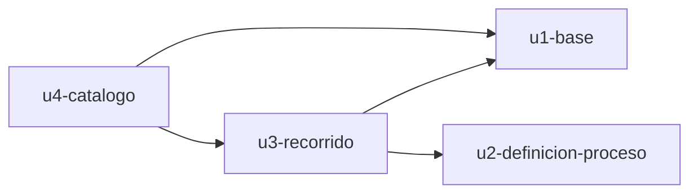

# Dependencias entre unidades

Grafo de dependencias entre las unidades de `unit-of-work.md`, derivado de las dependencias entre componentes de `inception/domain-design/components.md`. Solo describe la topología: el orden de construcción lo decide Delivery Planning.

## Grafo

- `u3-recorrido` depende de `u1-base` (guardar y leer el recorrido, los adjuntos y los registros).
- `u3-recorrido` depende de `u2-definicion-proceso` (orden de los pasos, orígenes y campos).
- `u4-catalogo` depende de `u1-base` (guardar y leer los productos y la marca de primera apertura).
- `u4-catalogo` depende de `u3-recorrido` (paso actual; crear, sembrar, borrar y deshacer recorridos).
- `u1-base` y `u2-definicion-proceso` no dependen de ninguna unidad.



<!-- Text fallback: u3-recorrido depende de u1-base y de u2-definicion-proceso. u4-catalogo depende de u1-base y de u3-recorrido. u1-base y u2-definicion-proceso no dependen de nada. No hay ciclos. -->

```yaml
units:
  - name: u1-base
    kind: service
    depends_on: []
  - name: u2-definicion-proceso
    kind: library
    depends_on: []
  - name: u3-recorrido
    kind: ui
    depends_on: [u1-base, u2-definicion-proceso]
  - name: u4-catalogo
    kind: ui
    depends_on: [u1-base, u3-recorrido]
```

## Puntos de integración

Todas las integraciones son llamadas internas dentro de la misma aplicación (Q3).

| De | A | Qué cruza | Comportamiento ante fallo |
|---|---|---|---|
| u3-recorrido | u1-base | Guardar, leer y borrar el recorrido, los registros y los adjuntos | La escritura es completa o nula; el error se devuelve a la pantalla y se conserva el dato anterior |
| u3-recorrido | u2-definicion-proceso | Pasos en orden, orígenes directos e indirectos y campos | Si la definición no es válida, la aplicación no arranca |
| u4-catalogo | u1-base | Guardar, leer y borrar productos y la marca de primera apertura | La escritura es completa o nula; el error se devuelve a la pantalla |
| u4-catalogo | u3-recorrido | Paso actual; crear, sembrar, borrar y deshacer el recorrido de un producto | Si falla la segunda escritura de una operación compuesta, U4 deshace la primera y todo queda como estaba (Q4) |
| Pantallas | u1-base | Peticiones de las pantallas al servidor local | Solo se aceptan del propio origen y en el propio equipo |

## Trabajo en paralelo

- `u1-base` y `u2-definicion-proceso` no dependen entre sí y se pueden construir a la vez.
- `u3-recorrido` necesita las dos anteriores; `u4-catalogo` necesita `u1-base` y `u3-recorrido`.
- Esto deja varios órdenes válidos (por ejemplo U1, U2, U3, U4 o U2, U1, U3, U4). La elección es de Delivery Planning.

## Walking skeleton

No aplica: el plan de este trabajo no usa walking skeleton.
