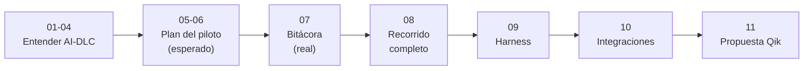

# Guía del playbook de AI-DLC

> Documento de trabajo. Define qué es el playbook, para quién es, cómo se organiza y cómo lo vamos construyendo. Cada capítulo del playbook se escribe siguiendo esta guía.
>
> Versión 1 — 10 de octubre de 2026. Autores: Andrés Gentile con Claude Code.

## 1. Qué es el playbook y para quién es

El playbook explica a los compañeros de trabajo **qué es AI-DLC, cómo está compuesto y cómo se usa**, a partir de un caso real: nuestro piloto del **panel** de conocimiento, arquitectura y observabilidad de productos tecnológicos (ver [vision-panel.md](../docs/vision-panel.md)).

Tiene dos objetivos:

1. **Que alguien lo lea y entienda todo sin tener que ejecutarlo.** Cada fase y cada etapa del piloto quedan documentadas con su input, su proceso, la interacción con los agentes, los controles que se activaron, lo que se generó y lo que salió mal.
2. **Que Andrés aprenda AI-DLC mientras lo construye.** El playbook es también el cuaderno de aprendizaje del piloto.

Lectores: compañeros del equipo que no conocen AI-DLC. No hace falta que sepan AWS, Kiro ni Claude Code. Primera presentación: lunes 12 de octubre de 2026.

## 2. Principios

- **Se escribe mientras trabajamos.** No se redacta al final. Al cerrar cada etapa del piloto se actualiza su página.
- **Ejemplos reales, no teóricos.** Cada concepto se muestra con un archivo, una captura o una salida concreta del piloto.
- **De lo general a lo profundo.** Primero la idea en una frase, luego el mapa y después el detalle. El lector se detiene en el nivel que necesite.
- **Esperado contra real.** Antes de ejecutar escribimos lo que esperamos que pase. Después, lo que realmente pasó, y comparamos.
- **Documentado contra observado.** Distinguimos lo que dice la documentación oficial de AI-DLC, lo que decidimos nosotros y lo que vimos en el laboratorio. Si no coinciden, se anota.
- **Honesto.** Los errores, desvíos y sorpresas también se documentan. Suelen enseñar más que lo que salió bien.
- **Datos ficticios.** El playbook se va a compartir: sin datos reales, credenciales ni información interna sensible.

## 3. Formato y herramientas

- **Archivos Markdown** dentro de la carpeta `playbook/` del repositorio, versionados en Git junto al piloto.
- **Obsidian como visor.** Se abre la raíz del repositorio como vault. Así los enlaces llegan tanto a las páginas del playbook como a los artefactos reales que genera AI-DLC en `aidlc/`. También se puede leer en VS Code o en GitHub.
- **Diagramas en Mermaid**, que funcionan en Obsidian, GitHub y VS Code:
  - `mindmap` para los mapas mentales de la estructura.
  - `flowchart` para los recorridos. Lo que no usamos en el piloto se pinta en gris claro.
  - Cada diagrama lleva debajo una versión en texto, por si no se renderiza.
- **Nombres de las etapas en inglés**, con su número, tal como aparecen en AI-DLC (por ejemplo, `2.3 Requirements Analysis`). Así coinciden con lo que muestra la herramienta. Las fases van en español.
- **Capturas** en `playbook/assets/`, con el nombre `cap<capítulo>-<etapa>-<nn>.png`. Por ejemplo: `cap07-2.3-requirements-01.png`.
- **Presentaciones.** Si hace falta presentar, se generan slides o una página web a partir de los capítulos. El Markdown sigue siendo la fuente.

## 4. Estructura por capítulos

| # | Capítulo | Contenido | Se escribe | Etapa del plan |
|---|---|---|---|---|
| 00 | Índice | Cómo leer el playbook y el estado de cada capítulo | Ahora | — |
| 01 | Qué es AI-DLC | Una página: el problema que resuelve, la idea central, las 5 fases y el repositorio de AI-DLC | Antes del piloto | A1 |
| 02 | Anatomía del repositorio | Mapa mental por niveles (ver §5) | Antes del piloto | A1 |
| 03 | Memoria, estado y registros | Cómo AI-DLC recuerda y deja constancia (ver §6) | Antes del piloto; se completa con evidencia | A1 / A6 |
| 04 | Entorno y setup | Modelo de IA, editor, harness, versiones y costos (ver §7) | Antes del piloto | A1 |
| 05 | Mapa del piloto (lo esperado) | Fases y etapas que vamos a usar y las que no. Por cada etapa usada: agentes, artefactos, hooks, sensores y gates. Mapa del recorrido detallado | Antes de ejecutar | A2 |
| 06 | Flujo conceptual | Input → proceso → output de cada fase y etapa, dónde interactuamos y hasta qué profundidad llegamos | Antes de ejecutar | A2 |
| 07 | Bitácora del piloto (lo real) | Una página por etapa ejecutada, con la plantilla del §8. Al final, la comparación esperado contra real | Durante el piloto | A2–A3 |
| 08 | Recorrido completo | Etapas condicionales y fase de Operación, sobre el mismo panel | Durante A4–A5 | A4–A5 |
| 09 | Harness | Cómo funciona por dentro: conductor, motor, hooks, herramientas, estado, permisos y personalización | Durante A6 | A6 |
| 10 | Integraciones | Las dos conexiones de referencia (repositorio/CI y gestor de trabajo) | Durante A7 | A7 |
| 11 | Conclusiones y propuesta para Qik | Lecciones aprendidas, decisiones defendidas y propuesta de adopción | Durante A8 | A8 |
| — | Anexos | Glosario, plantilla de etapa, decisiones y desvíos, FAQ y "cómo lo hago yo" | Siempre | — |



Texto: entender AI-DLC (01–04) → plan del piloto, lo esperado (05–06) → bitácora, lo real (07) → recorrido completo (08) → harness (09) → integraciones (10) → propuesta para Qik (11).

Estructura de carpetas:

```
playbook/
├── 00-guia-del-playbook.md      este documento
├── 00-indice.md
├── 01-que-es-ai-dlc.md
├── 02-anatomia-del-repo/
├── 03-memoria-estado-registros.md
├── 04-entorno-y-setup.md
├── 05-mapa-del-piloto.md
├── 06-flujo-conceptual.md
├── 07-bitacora-piloto/          una página por etapa ejecutada
├── 08-recorrido-completo/
├── 09-harness/
├── 10-integraciones/
├── 11-conclusiones-qik.md
├── anexos/
│   ├── glosario.md
│   ├── plantilla-etapa.md
│   ├── decisiones-y-desvios.md
│   └── faq.md
└── assets/
```

## 5. Capítulo 02: anatomía por niveles

La idea es que el lector baje un nivel cada vez, con un mapa mental por nivel:

- **Nivel 0, la raíz.** Las carpetas principales y para qué existe cada una: el engine del harness (`.claude/`; con otros harness sería `.kiro/`, `.codex/`, etc.), el workspace `aidlc/`, `AGENTS.md`, `docs/` y `playbook/`.
- **Nivel 1, el engine.** Qué contiene: `agents`, `skills`, `hooks`, `sensors`, `tools`, `scopes`, `knowledge`, `aidlc-common` (protocolos y etapas). Una frase por carpeta.
- **Nivel 1, el workspace `aidlc/`.** `spaces`, `memory` (org, team, project y fases), `intents`, `knowledge` y `codekb`. Una frase por carpeta.
- **Nivel 2, el detalle.** Dentro de cada carpeta, cada elemento con una frase: los 14 agentes, cada hook, cada sensor, cada scope, etc.
- **Nivel 3, solo donde aporte.** Abrir un archivo real (un agente o una etapa) y explicar sus partes.

## 6. Capítulo 03: memoria, estado y registros

Explica cómo AI-DLC recuerda lo decidido y cómo deja constancia de lo que pasó. Hay que verificar cada punto con el piloto. Temas previstos:

- **Reglas por capas (`memory/`).** org → team → project → fase → etapa: qué va en cada capa, cómo se combinan y por qué una capa más específica no puede contradecir a una más general.
- **Aprendizajes.** Cómo el ciclo de autoaprendizaje propone nuevas reglas y cómo se admiten.
- **Conocimiento del equipo (`knowledge/`) y DocumentKB.** Documentos propios (`documents/`) y el catálogo que genera la herramienta (`documentkb/`).
- **Conocimiento del código (`codekb/`).**
- **Estado del trabajo (`aidlc-state.md`).** En qué fase y etapa estamos y cómo se retoma una sesión.
- **Diario de cada etapa (`memory.md`).** Qué observa y registra el engine en cada etapa.
- **Registro de auditoría (`audit/`).** Qué eventos se registran, quién los escribe (los hooks), cómo leerlos y qué los protege.
- **Memoria del propio harness.** Diferencia entre la memoria de AI-DLC y la memoria de Claude Code o Kiro, y por qué no se deben mezclar.
- **Qué se versiona en Git y qué no** (`.gitignore`).

Cada tema lleva un ejemplo real tomado del piloto.

## 7. Capítulo 04: entorno y setup

Ficha del entorno con la que se generó todo lo que aparece en la bitácora:

- **Equipo principal:** Mac.
- **Editor y harness:** VS Code con Claude Code. Sustituye a Kiro porque la versión gratuita de Kiro limita los modelos; con Claude Code usamos modelos más avanzados.
- **Modelo de IA:** el modelo y el esfuerzo realmente usados en cada recorrido. Se registra el cambio si cambia durante el piloto.
- **AI-DLC:** versión 2.11.0, scope elegido y plugins.
- **Equipo secundario:** Windows corporativo con VS Code y Copilot, para una prueba acotada.
- **Consumo:** tiempo efectivo y uso del modelo por recorrido. `/aidlc-session-cost` da duración, etapas, sensores y aprendizajes, pero no dinero ni tokens: el uso del modelo se toma de Claude Code.
- **Pasos de instalación y configuración**, reproducibles.

## 8. Plantilla de cada etapa (capítulo 07)

Cada página de la bitácora sigue la misma plantilla:

1. **Ubicación:** fase, etapa e ID (por ejemplo, Concepción · 2.3 Requirements Analysis) y si es ALWAYS o condicional.
2. **Input:** qué entró a la etapa: nuestra petición y los artefactos de etapas anteriores.
3. **Proceso:** qué hizo AI-DLC paso a paso.
4. **Interacción:** las preguntas que hizo el agente y lo que respondimos.
5. **Agentes:** quién lideró, quién apoyó y quién revisó, con lo que comentó cada uno.
6. **Controles:** hooks que se dispararon, sensores, gates y aprobaciones.
7. **Output:** artefactos generados, con enlace al archivo real.
8. **Pruebas:** qué se probó, con qué profundidad y el resultado.
9. **Sorpresas y problemas:** qué salió distinto de lo esperado y cómo se resolvió.
10. **Tiempo y costo.**
11. **Lo que aprendimos.**
12. **Capturas.**

## 9. Cómo trabajamos

- **Antes de cada fase:** completamos lo esperado en los capítulos 05 y 06.
- **En cada aprobación de etapa:** Claude redacta la página de la bitácora a partir de los registros que deja AI-DLC (`memory.md`, `aidlc-state.md`, auditoría y artefactos). Andrés añade capturas, revisa y aprueba.
- **Al cerrar cada fase:** se actualiza la comparación esperado contra real, el glosario y `decisiones-y-desvios.md`.
- **Cada capítulo se cierra con un commit** para poder volver a cualquier punto.

## 10. Hitos

| Fecha | Hito |
|---|---|
| Lunes 12 de octubre de 2026 | Presentación inicial: guía, capítulos 01 a 06 y bitácora marcada "en construcción" |
| Durante A2–A3 | Capítulo 07 completo para el recorrido con etapas ALWAYS |
| Durante A4–A8 | Capítulos 08 a 11 |

## 11. Decisiones tomadas

- 10/10/2026: el caso del piloto es el **panel** (`docs/vision-panel.md`), no el gestor de solicitudes. El primer recorrido construye solo un corte mínimo, que se define en Ideación.
- 10/10/2026: en Mac se usa **VS Code con Claude Code** en lugar de Kiro. Se instala AI-DLC para el harness `claude` y se elimina la instalación de Kiro.
- 10/10/2026: el playbook se escribe en Markdown en `playbook/` y se lee con Obsidian.
- 10/10/2026: modelos por defecto en el primer recorrido: la conversación con el modelo elegido en Claude Code y los 2 revisores con Sonnet y esfuerzo medio. Se revisará según lo que detecten los revisores.

## 12. Pendientes

- Verificar la instalación para Claude Code con `/aidlc --doctor` en una sesión nueva.
- Elegir el scope del primer recorrido (por ejemplo `poc`, `mvp` o `express`) y registrarlo en el capítulo 05.
- Definir el corte mínimo del panel en Ideación.
