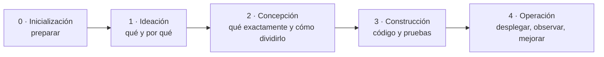

# Capítulo 01 · Qué es AI-DLC

> **En una frase:** AI-DLC (*AI-Driven Development Life Cycle*) es un método de AWS para construir software con IA en pasos ordenados, donde la IA propone y una persona aprueba cada paso antes de seguir.

## 1. El problema que resuelve

| Pedirle código a una IA sin método | Con AI-DLC |
|---|---|
| Empieza a programar antes de entender qué se quiere | Primero pregunta y aclara la intención |
| Las decisiones se pierden en el chat | Cada decisión queda escrita en un archivo |
| Cada vez sale distinto, según cómo se pida | Siempre recorre los mismos pasos |
| Nadie revisa hasta el final | Se detiene en cada paso y espera tu aprobación |
| Mucho o muy poco proceso, según el día | El proceso se ajusta al tamaño del trabajo |

## 2. La idea central en tres reglas

1. **La IA propone, la persona decide.** Al final de cada paso hay una aprobación (*gate*). Sin tu aprobación no avanza.
2. **Proceso proporcional.** Corregir un bug no necesita lo mismo que crear un producto. Eliges un *scope* y AI-DLC ejecuta solo las etapas que ese tamaño de trabajo necesita.
3. **Todo queda escrito.** Cada etapa produce documentos (*artefactos*) y deja un registro de quién decidió qué y cuándo.

## 3. Las 5 fases

Texto: Inicialización → Ideación → Concepción → Construcción → Operación.

| Fase                                  | Pregunta que responde                           | Etapas | ALWAYS | Condicionales |
| ------------------------------------- | ----------------------------------------------- | -----: | -----: | ------------: |
| 0 · Inicialización (*Initialization*) | ¿Dónde guardamos el trabajo?                    |      3 |      3 |             0 |
| 1 · Ideación (*Ideation*)             | ¿Qué queremos y por qué?                        |      7 |      3 |             4 |
| 2 · Concepción (*Inception*)          | ¿Qué exactamente, en qué partes y en qué orden? |      9 |      3 |             6 |
| 3 · Construcción (*Construction*)     | ¿Funciona?                                      |      7 |      2 |             5 |
| 4 · Operación (*Operation*)           | ¿Corre bien en un entorno real?                 |      7 |      0 |             7 |
| **Total**                             |                                                 | **33** | **11** |        **22** |

### ALWAYS y condicionales

Cada etapa es de uno de los dos tipos. En cada fase, ALWAYS + condicionales = total de etapas. Por ejemplo, Ideación: 3 + 4 = 7.

- **ALWAYS:** se ejecuta siempre, sin preguntar si hace falta.
- **Condicional:** antes de ejecutarla, AI-DLC revisa si aplica a este trabajo. Si aplica, la ejecuta. Si no, la salta y deja anotado por qué.

Ejemplos de etapas condicionales:

| Etapa | Se ejecuta si… | Se salta si… |
|---|---|---|
| 1.2 Investigación de mercado | Hay que posicionarse en el mercado o decidir entre comprar y construir | Es una herramienta interna, un bug o un refactor |
| 1.6 Bocetos de pantallas | El trabajo tiene interfaz de usuario | Es solo una API o infraestructura |
| 2.1 Ingeniería inversa | Ya existe código que hay que entender | Se parte de cero |
| 3.4 Diseño de infraestructura | Hay que definir servidores o recursos en la nube | No hay cambios de infraestructura |

Por qué hay dos ceros en la tabla:
- **Inicialización tiene 0 condicionales** porque sus 3 etapas (crear las carpetas, detectar el proyecto e iniciar el registro) siempre hacen falta. Ningún trabajo empieza sin ellas.
- **Operación tiene 0 ALWAYS** porque no todo trabajo llega a desplegarse. Un prototipo puede terminar en Construcción, así que todas sus etapas dependen del caso.

## 4. Las piezas, en una línea cada una

| Pieza | Qué es | Ejemplo en el piloto |
|---|---|---|
| **Intent** | Una pieza de trabajo, de principio a fin | "Construir el primer corte del panel" |
| **Fase** | Un bloque grande del recorrido (hay 5) | Concepción |
| **Etapa** | Un paso concreto dentro de una fase (hay 33) | 2.3 Requirements Analysis |
| **Scope** | El tamaño de recorrido que eliges. Decide qué etapas se ejecutan (hay 11) | `poc` ejecuta 8 etapas y `feature`, las 33 |
| **Agente** | Un rol experto que trabaja en una etapa (hay 14) | El agente de producto escribe los requisitos |
| **Gate** | El punto donde AI-DLC se detiene a pedir aprobación | "¿Apruebas los requisitos?" |
| **Artefacto** | Un documento que produce una etapa | `requirements.md` |

Las piezas internas (hooks, sensores, herramientas, memoria) se explican en los capítulos 02 y 03.

## 5. Cinco cosas que no hay que confundir

| Concepto | Qué es | En nuestro piloto |
|---|---|---|
| **Método** | La forma de trabajar: fases, etapas y aprobaciones | AI-DLC |
| **Framework** | El software que implementa el método y se instala en un proyecto | AI-DLC 2.11.0, del repositorio oficial [awslabs/aidlc-workflows](https://github.com/awslabs/aidlc-workflows) |
| **Harness** | La herramienta de IA donde corre el framework | Claude Code dentro de VS Code. Otras opciones: Kiro, Codex, Cursor, Copilot |
| **Modelo** | La IA que piensa y escribe | El que elegimos en Claude Code (ver capítulo 04) |
| **Producto** | Lo que construimos con todo lo anterior | El panel, en nuestro repositorio `agentile1sp/panel` |

"El repositorio de AI-DLC" puede significar dos cosas:
- **El repositorio oficial de AWS** (`awslabs/aidlc-workflows`): de donde viene el framework.
- **Nuestro repositorio**, donde el framework está instalado: la carpeta `.claude/` es el framework y la carpeta `aidlc/` guarda nuestro trabajo. Es lo que se recorre en el capítulo 02.

## 6. Cómo se ve en la práctica

Según la documentación, sin ejecutarlo todavía:

1. Escribes `/aidlc` y describes lo que quieres construir.
2. AI-DLC propone un scope y un plan de etapas, y tú lo apruebas o lo cambias.
3. En cada etapa, el agente que la lidera hace preguntas. Las respondes en un archivo.
4. El agente genera el artefacto de la etapa y, si corresponde, otro agente lo revisa.
5. AI-DLC se detiene: **apruebas, pides cambios o rechazas.**
6. Pasa a la siguiente etapa.

En el capítulo 07 este ejemplo se sustituye por capturas reales del piloto.

## 7. Qué NO es

- **No es un generador automático.** Sin aprobaciones humanas no avanza.
- **No sustituye al equipo.** Ordena el trabajo entre las personas y la IA, pero las decisiones son de las personas.
- **No es solo para proyectos grandes.** Con el scope adecuado, un bug pasa por 9 etapas y no por 33.

---

**Fuentes:** etapas y fases contadas en `.claude/tools/data/stage-graph.json`; etapas por scope en `.claude/tools/data/scope-grid.json`; agentes en `.claude/agents/`. Corresponden a la versión instalada 2.11.0.
