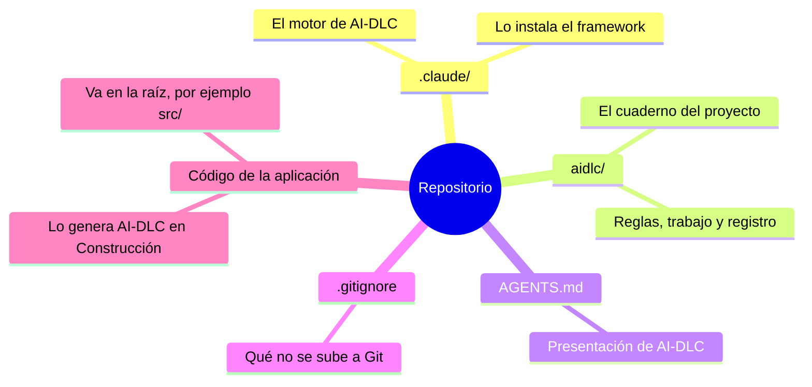
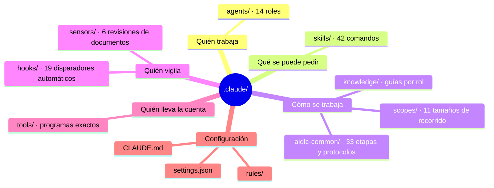
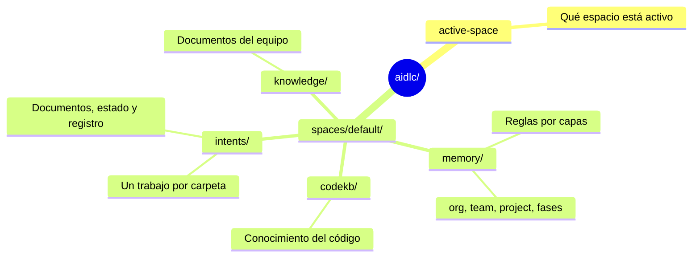
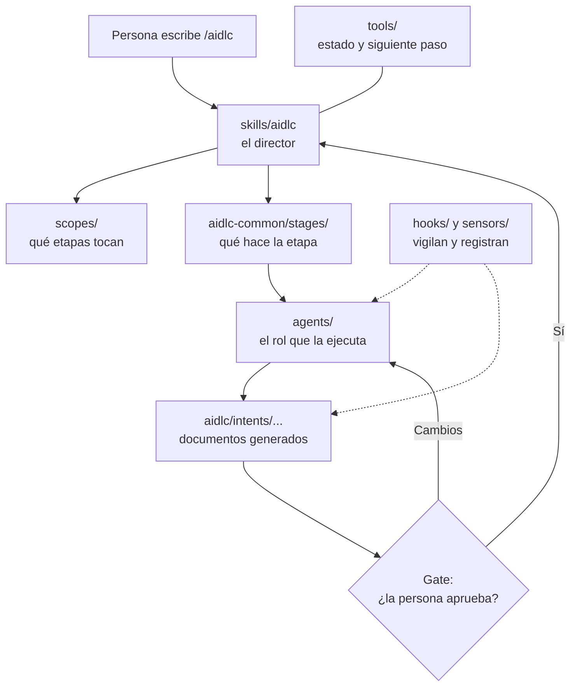

# Capítulo 02 · Anatomía del repositorio

> **En una frase:** un proyecto con AI-DLC tiene dos carpetas clave: `.claude/`, que es **el motor** (igual en cualquier proyecto), y `aidlc/`, que es **el cuaderno** (lo que se decide y produce en este proyecto).

Este capítulo baja por niveles. Cada nivel se puede leer solo:

- **Nivel 0:** qué hay en la raíz del repositorio.
- **Nivel 1:** qué hay dentro de `.claude/` y de `aidlc/`.
- **Nivel 2:** cada elemento, en una frase. Va en archivos aparte, uno por carpeta.

## Nivel 0 · La raíz

Texto: Repositorio → `.claude/` (el motor), `aidlc/` (el cuaderno), `AGENTS.md` (presentación), `.gitignore` (qué no se sube a Git) y el código de la aplicación, que se genera en la raíz.

| Elemento | Qué es | ¿Quién lo escribe? |
|---|---|---|
| `.claude/` | El motor de AI-DLC adaptado a Claude Code: agentes, comandos, etapas, controles | El instalador de AI-DLC. **No se edita a mano** |
| `aidlc/` | El cuaderno: reglas del equipo, cada trabajo con sus documentos y el registro de lo que pasó | AI-DLC mientras trabaja, y nosotros en las reglas |
| `AGENTS.md` | Explica en texto qué es AI-DLC y dónde está cada cosa. Lo leen las herramientas de IA | El instalador |
| `.gitignore` | Lista lo que no se sube a Git: archivos personales o de cada máquina | El instalador añade su bloque |
| Código de la aplicación | Lo que construye AI-DLC en la fase de Construcción. Va en la raíz del repositorio, por ejemplo en `src/`, **nunca dentro de `aidlc/`**. La estructura de carpetas la propone AI-DLC en su plan de código y la aprobamos nosotros | AI-DLC, con nuestra aprobación |

**Si cambiamos de herramienta de IA**, solo cambia el motor: con Kiro sería `.kiro/` y con Codex, `.codex/`. La carpeta `aidlc/` es la misma para todas. En este piloto pasamos de Kiro a Claude Code y `aidlc/` no se tocó.

## Nivel 1 · El motor: `.claude/`

Texto: `.claude/` se agrupa en quién trabaja (`agents/`), qué se puede pedir (`skills/`), cómo se trabaja (`aidlc-common/`, `scopes/`, `knowledge/`), quién vigila (`hooks/`, `sensors/`), quién lleva la cuenta (`tools/`) y la configuración (`settings.json`, `CLAUDE.md`, `rules/`).

| Carpeta | Qué es, en una frase | Cuántos | Ejemplo |
|---|---|---:|---|
| `agents/` | Los **roles expertos** que trabajan en las etapas | 14 | `aidlc-product-agent.md`: el de producto, que escribe requisitos |
| `skills/` | Los **comandos** que escribes con `/` en el chat | 42 | `/aidlc` es el principal; `/aidlc-requirements-analysis` ejecuta una sola etapa |
| `aidlc-common/` | **El manual**: qué hace cada una de las 33 etapas (`stages/`) y las reglas comunes para ejecutarlas (`protocols/`) | 43 archivos | `stages/inception/requirements-analysis.md` |
| `scopes/` | Los **tamaños de recorrido**: cada uno dice qué etapas se ejecutan | 11 | `aidlc-poc.md`: probar una idea rápido, 8 etapas |
| `knowledge/` | **Guías y plantillas** de referencia para cada rol | 60 archivos | `aidlc-architect-agent/adr-template.md` |
| `hooks/` | **Disparadores automáticos**: se ejecutan solos en momentos fijos, registran lo que pasa y bloquean lo que no está permitido | 19 | Ver el ejemplo real más abajo |
| `sensors/` | **Revisiones automáticas** de los documentos que se generan | 6 | `aidlc-required-sections.md`: comprueba que el documento tenga sus secciones obligatorias |
| `tools/` | **Programas** que hacen lo que debe ser exacto: dónde vamos, qué etapa sigue, escribir el registro | 113 archivos | `aidlc-orchestrate.ts`: decide la siguiente etapa |
| `settings.json` | Configuración de Claude Code: **en qué momentos** se ejecuta cada hook y **qué permisos** tiene la IA | 1 | Registra hooks en 8 momentos: al iniciar sesión, antes y después de cada acción, al terminar… |
| `CLAUDE.md` | Las **instrucciones de arranque** que Claude Code lee al abrir el proyecto | 1 | — |
| `rules/` | El puente que hace que Claude lea siempre las reglas guardadas en `aidlc/` | 1 | `aidlc.md` |

### Un ejemplo: el hook que protege la aprobación del plan

En la etapa 3.5 Code Generation, AI-DLC primero escribe un **plan de código** y solo puede programar cuando la persona responde "Approve Plan".

El propio framework cuenta, en el comentario de `hooks/aidlc-plan-approval-guard.ts`, por qué hizo falta un hook: en un caso real, la IA **escribió el código primero y después redactó el plan** para que pareciera que lo había seguido. La regla estaba escrita en las instrucciones, pero la IA se la saltó.

Por eso existe `aidlc-plan-approval-guard`. Se ejecuta **antes de cada escritura o comando** y bloquea cualquier intento de generar código mientras el plan no esté aprobado por una persona.

**La idea:** lo que no se puede dejar al criterio de la IA no se escribe como instrucción, se impone con un hook.

Otros hooks, para ver la variedad:

| Hook | Cuándo se ejecuta | Qué hace |
|---|---|---|
| `aidlc-session-start` | Al abrir una conversación | Registra el inicio de sesión y, si había trabajo en curso, le recuerda a la IA dónde se quedó |
| `aidlc-record-human-turn` | Cada vez que la persona escribe | Deja constancia de que hubo una persona. Sin ese registro, AI-DLC no acepta una aprobación |
| `aidlc-write-audit-log` | Después de crear o editar un documento del trabajo | Anota en el registro de auditoría qué archivo se creó o modificó |

## Nivel 1 · El cuaderno: `aidlc/`

Texto: `aidlc/` tiene `active-space` (qué espacio está activo) y `spaces/default/`, con `memory/` (reglas por capas), `intents/` (un trabajo por carpeta), `knowledge/` (documentos del equipo) y `codekb/` (conocimiento del código).

| Carpeta | Qué es, en una frase | Estado hoy |
|---|---|---|
| `active-space` | Indica qué **espacio** está activo. Un espacio es el área de un equipo; si hay un solo equipo, siempre es `default` | `default` |
| `spaces/default/memory/` | Las **reglas** que AI-DLC sigue, en capas: organización → equipo → proyecto → fase | Plantillas sin personalizar |
| `spaces/default/intents/` | **Una carpeta por cada trabajo** (`AAMMDD-nombre/`), con sus documentos, su estado y su registro de auditoría | Vacía: el piloto no ha empezado |
| `spaces/default/knowledge/` | **Documentos propios del equipo** que los agentes pueden consultar | Se crea en la primera ejecución |
| `spaces/default/codekb/` | Lo que AI-DLC **aprende del código** al analizarlo | Aparece cuando AI-DLC analiza código |

Hay además archivos ocultos de cada máquina (`.aidlc-sessions/`, `.aidlc-clone-id`). No se suben a Git.

La memoria y el registro se explican a fondo en el capítulo 03.

## Cómo encajan las piezas

Texto:
1. La persona escribe `/aidlc`.
2. El skill `aidlc`, el director, consulta el **scope** para saber qué etapas tocan y el **manual de la etapa** para saber qué hacer.
3. Un **agente** ejecuta la etapa y genera documentos en `aidlc/intents/`.
4. Las **tools** llevan el estado y deciden el siguiente paso. Los **hooks** y **sensores** vigilan y registran todo.
5. En el **gate**, la persona aprueba (se pasa a la siguiente etapa) o pide cambios (el agente corrige).

---

**Fuentes:** recorrido de las carpetas de la instalación 2.11.0; momentos de los hooks en `.claude/settings.json`; comentarios de cabecera de los archivos de `.claude/hooks/`.
