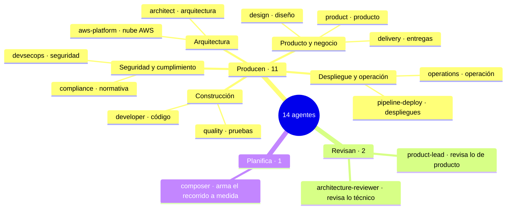

# Capítulo 02 · Nivel 2 · Los agentes (`.claude/agents/`)

> **En una frase:** los agentes son **14 roles expertos**, como en un equipo de software real. Cada etapa tiene un rol que la **lidera**, otros que **apoyan** y, en algunas, uno que **revisa**.

## Los 14, agrupados

Texto: 11 agentes producen (producto y negocio, arquitectura, construcción, seguridad y cumplimiento, despliegue y operación), 2 solo revisan y 1 planifica el recorrido.

## Tres formas de participar en una etapa

| Papel | Qué hace | Ejemplo |
|---|---|---|
| **Lidera** | Hace preguntas, decide la estructura y escribe el documento de la etapa | `product` lidera 2.3 Requirements Analysis |
| **Apoya** | Aporta su especialidad al documento del líder | `devsecops` añade la parte de seguridad en 3.2 NFR Requirements |
| **Revisa** | Lee el resultado y señala problemas antes de tu aprobación. No escribe | `product-lead` revisa los requisitos de 2.3 |

## Los 11 que producen

| Agente | Rol, en una frase | Lidera | Apoya |
|---|---|---|---|
| `product` | Producto: entiende qué se quiere y lo convierte en requisitos | 1.1 Intent Capture & Framing · 1.2 Market Research · 1.4 Scope Definition · 2.3 Requirements Analysis · 2.4 User Stories | 1.6 · 1.7 · 2.5 |
| `design` | Diseño UX/UI: pantallas, interacción y accesibilidad | 1.6 Rough Mockups · 2.5 Refined Mockups | 2.4 · 2.6 |
| `delivery` | Gestión: equipo, orden de entregas y traspaso entre fases | 1.5 Team Formation · 1.7 Approval & Handoff · 2.9 Delivery Planning | 1.4 · 2.7 |
| `architect` | Arquitectura: cómo se divide el sistema y cómo se comunican sus partes | 1.3 Feasibility & Constraints · 2.6 Domain Design · 2.7 Units Generation · 2.8 Contract Design · 3.1 Functional Design · 3.2 NFR Requirements · 3.3 NFR Design | 1.1 · 2.1 · 2.9 |
| `aws-platform` | Nube AWS: infraestructura y entornos | 3.4 Infrastructure Design · 4.2 Environment Provisioning | 1.3 · 2.6 · 2.8 · 3.3 · 4.7 |
| `developer` | Desarrollo: escribe el código y entiende el código existente | 2.1 Reverse Engineering · 3.5 Code Generation | 2.2 · 2.4 · 3.1 · 4.3 |
| `quality` | Calidad: estrategia de pruebas y rendimiento | 3.6 Build and Test · 4.6 Performance Validation | 2.2 · 2.4 · 3.2 |
| `devsecops` | Seguridad: amenazas, requisitos y controles de seguridad | — | 2.2 · 3.2 · 3.4 · 3.6 · 4.2 |
| `compliance` | Cumplimiento: normativas, clasificación de datos y riesgos | — | 1.3 · 3.2 · 3.4 · 4.2 |
| `pipeline-deploy` | Despliegues: integración continua, pipeline y puesta en marcha | 2.2 Practices Discovery · 3.7 CI Pipeline · 4.1 Deployment Pipeline · 4.3 Deployment Execution | — |
| `operations` | Operación: monitoreo, incidentes y mejora continua | 4.4 Observability Setup · 4.5 Incident Response · 4.7 Feedback & Optimization | — |

- **`devsecops` y `compliance` nunca lideran:** solo aportan su especialidad en las etapas de otros.
- **Las 3 etapas de Inicialización (0.1 a 0.3) no tienen agente.** Las ejecuta directamente el director (`skills/aidlc`).

## Los 2 que revisan

No escriben nada. Leen el resultado de una etapa y señalan problemas **antes** de que tú apruebes.

| Revisor | Revisa | Etapas |
|---|---|---|
| `product-lead` | Que lo de producto esté completo, se pueda probar y tenga sentido para el negocio. Es "la voz del cliente" | 1.1 · 1.6 · 2.3 · 2.4 · 2.5 |
| `architecture-reviewer` | Que lo técnico sea coherente, se pueda construir y no tenga dependencias ocultas | 2.6 · 2.7 · 2.8 · 3.1 · 3.2 · 3.3 · 3.4 · 3.5 |

La revisión tiene dos intensidades:
- **Consultiva** (*advisory*): sugiere mejoras. Se usa en las etapas de Ideación y Concepción.
- **Adversarial** (*adversarial*): intenta activamente encontrar fallos. Se usa en las etapas de diseño técnico y código de Construcción (3.1 a 3.5).

## El que planifica

`composer` no participa en ninguna etapa. Cuando pides `/aidlc compose "<tarea>"`, analiza qué tan clara y arriesgada es la tarea y propone **el recorrido mínimo** de etapas que la resuelve con seguridad. Esa propuesta también pasa por tu aprobación.

## Un detalle de Claude Code: ¿cuántas IAs trabajan a la vez?

En la mayoría de las etapas **no** se lanza una IA aparte por cada agente: la misma conversación "se pone el sombrero" del rol que toca. Se lanza un agente separado (un *subagente*) solo en estos casos:

- **4 etapas delegadas:** 2.1 Reverse Engineering, 2.2 Practices Discovery, 2.4 User Stories (varios agentes trabajan juntos) y 3.5 Code Generation.
- **Las revisiones**, para que el revisor no esté influido por quien escribió.
- **`composer`**, cuando se le pide un recorrido a medida.

## ¿Qué modelo de IA usa cada agente?

Por defecto, **todos usan el mismo modelo que la conversación**, el que elegimos en Claude Code. La excepción son **los 2 revisores, que usan Sonnet con esfuerzo medio**. Se puede cambiar por agente; ver el capítulo 04.

---

**Fuentes:** etapas lideradas, apoyadas y revisadas en `.claude/tools/data/stage-graph.json`; roles en la descripción de cada archivo de `.claude/agents/`; modelos con `aidlc config models --show`; subagentes según `.claude/CLAUDE.md`. Versión 2.11.0.
