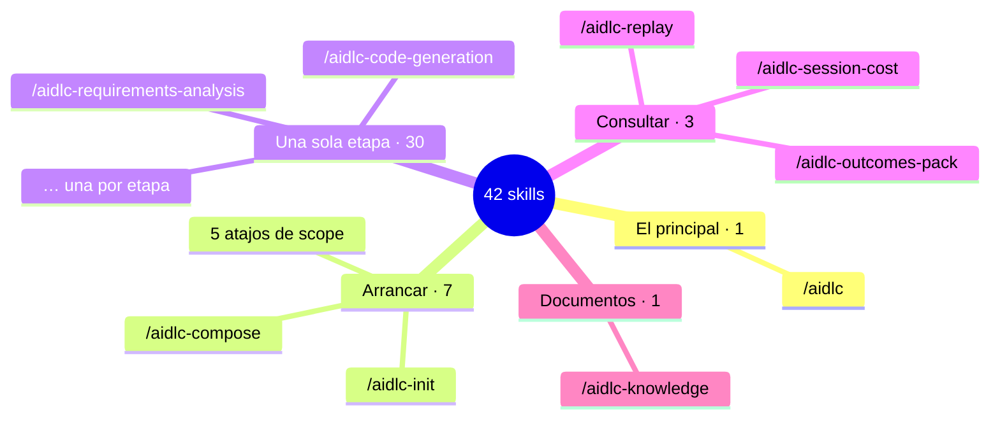

# Capítulo 02 · Nivel 2 · Los skills (`.claude/skills/`)

> **En una frase:** los skills son **los comandos que escribes en el chat con `/`**. Hay 42, pero en el día a día se usa uno: **`/aidlc`**.

## Skill no es lo mismo que hook

| | Skill | Hook |
|---|---|---|
| Qué es | Una **receta** escrita que la IA lee y sigue | Un **programa** que Claude Code ejecuta solo |
| Quién lo activa | Tú, al escribir `/nombre` | Claude Code, en momentos fijos |
| ¿La IA puede desviarse? | Puede equivocarse al seguirla | No: el programa se ejecuta igual siempre |

Cada skill es una carpeta con un archivo `SKILL.md`, que contiene las instrucciones para la IA.

## Los 42, agrupados



Texto: 1 principal (`/aidlc`), 7 para arrancar un trabajo, 30 para ejecutar una sola etapa, 3 para consultar y 1 para los documentos del equipo.

## 1 · El principal: `/aidlc`

Es **el director**. Arranca un trabajo nuevo, continúa donde te quedaste y lleva el recorrido de etapa en etapa. Si lo escribes con una descripción, AI-DLC detecta el scope adecuado y te propone el plan:

```
/aidlc Quiero un sistema para pedir vacaciones con aprobación del jefe
```

También acepta opciones para consultar o ajustar el recorrido. Las más útiles:

| Opción | Para qué sirve |
|---|---|
| `/aidlc --status` | Ver en qué fase y etapa estamos y cómo están los controles |
| `/aidlc --doctor` | Comprobar que la instalación funciona |
| `/aidlc --scope <nombre>` | Elegir el scope en lugar de dejar que lo detecte |
| `/aidlc --stage <etapa>` | Saltar a una etapa concreta |
| `/aidlc --depth <nivel>` | Cambiar el nivel de detalle del trabajo |
| `/aidlc --test-strategy <nivel>` | Cambiar cuántas pruebas se escriben |
| `/aidlc --review <tipo>` | Ajustar la intensidad de las revisiones |
| `/aidlc --version` | Ver la versión instalada |

## 2 · Arrancar: 7 skills

| Skill | Qué hace |
|---|---|
| `/aidlc-init` | Ejecuta de una vez la fase de Inicialización (0.1 a 0.3): crea la carpeta del trabajo y su registro. Es opcional, porque `/aidlc` lo hace solo |
| `/aidlc-mvp` | Arranca con el scope **mvp**: construir lo esencial, sin operación |
| `/aidlc-express` | Arranca con el scope **express**: el recorrido más ligero, sin diseño ni revisores |
| `/aidlc-feature` | Arranca con el scope **feature**: ciclo completo para una funcionalidad nueva |
| `/aidlc-bugfix` | Arranca con el scope **bugfix**: corregir un bug concreto |
| `/aidlc-security-patch` | Arranca con el scope **security-patch**: responder a una vulnerabilidad |
| `/aidlc-compose` | Pide al agente `composer` un recorrido **a medida** de la tarea. Lo apruebas antes de ejecutarlo |

Los 5 atajos de scope son lo mismo que `/aidlc --scope <nombre>`, solo que más cortos de escribir. Los otros 6 scopes (`poc`, `classic`, `enterprise`, `infra`, `refactor`, `workshop`) no tienen atajo: se eligen con `--scope`.

## 3 · Una sola etapa: 30 skills

Hay uno por etapa, con el nombre `/aidlc-<etapa>`. Por ejemplo, `/aidlc-requirements-analysis` o `/aidlc-code-generation`.

- **Para qué sirven:** ejecutan **una etapa aislada sin mover el recorrido principal**. Sirven para practicar una etapa, repetirla o probarla por separado.
- **Por qué son 30 y no 33:** las 3 etapas de Inicialización no tienen sentido por separado, así que se ejecutan juntas con `/aidlc-init`.

## 4 · Consultar: 3 skills

Ninguno cambia el trabajo ni avanza etapas: solo leen el registro.

| Skill | Qué muestra | ¿Crea archivo? |
|---|---|---|
| `/aidlc-session-cost` | Números del trabajo: duración, etapas completadas, revisiones de sensores y aprendizajes. **No muestra dinero ni tokens** | No, solo en pantalla |
| `/aidlc-replay` | Un **relato de lo que pasó**, pensado para quien no estuvo presente | No, solo en pantalla |
| `/aidlc-outcomes-pack` | Un **documento de traspaso** al cerrar el trabajo, para que otro equipo pueda mantener y continuar el sistema | Sí, `OUTCOMES.md` |

`/aidlc-replay` y `/aidlc-outcomes-pack` nos van a servir para la bitácora del piloto: dan la versión oficial de lo que pasó, sacada del registro de auditoría.

## 5 · Documentos: 1 skill

**`/aidlc-knowledge`** registra **documentos propios del equipo** (PDF, Word, Markdown, texto) en un catálogo para que los agentes los consulten y los citen. Por ejemplo, un manual interno de arquitectura o una normativa. Nunca avanza etapas ni aprueba nada. Se explica en el capítulo 03.

---

**Fuentes:** carpetas y descripciones (`description`) de cada `SKILL.md` en `.claude/skills/`; opciones de `/aidlc` según `.claude/CLAUDE.md`. Versión 2.11.0.
