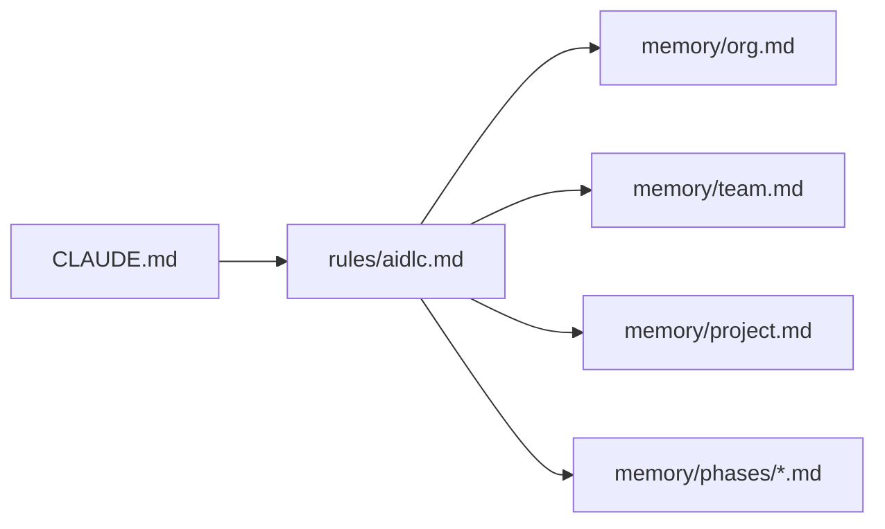

# Capítulo 03 · Nivel 2 · Knowledge y configuración

> **En una frase:** `knowledge/` es **la biblioteca** de cada agente, y los archivos de configuración son **los ajustes** que conectan AI-DLC con Claude Code.

## 1 · `knowledge/`: la biblioteca de los agentes

Son guías, patrones y plantillas que cada agente consulta para trabajar como un especialista. Hay una carpeta por agente y una compartida.

| Carpeta | Guías | Ejemplos |
|---|---:|---|
| `aidlc-product-agent/` | 8 | Cómo obtener requisitos, patrones de historias de usuario, marcos de priorización |
| `aidlc-developer-agent/` | 6 | Guía de generación de código, diseño de APIs, modelado de datos |
| `aidlc-architect-agent/` | 6 | Plantilla de decisión de arquitectura (ADR), patrones de arquitectura, diseño guiado por el dominio |
| `aidlc-design-agent/` | 5 | Accesibilidad (WCAG), wireframes, patrones de interacción |
| `aidlc-aws-platform-agent/` | 4 | Well-Architected Framework, buenas prácticas de CDK, optimización de costos |
| `aidlc-devsecops-agent/` | 4 | Modelado de amenazas (STRIDE), guía de seguridad |
| `aidlc-operations-agent/` | 4 | Respuesta a incidentes, observabilidad, objetivos de servicio (SLO y SLI) |
| `aidlc-quality-agent/` | 4 | Estrategia de pruebas, validación de requisitos no funcionales |
| `aidlc-delivery-agent/` | 3 | Topologías de equipo, planificación del trabajo |
| `aidlc-pipeline-deploy-agent/` | 3 | Estrategias de ramas, patrones de CI/CD, estrategias de despliegue |
| `aidlc-compliance-agent/` | 1 | Marcos regulatorios |
| `aidlc-architecture-reviewer-agent/` | 1 | Cómo revisar |
| `aidlc-product-lead-agent/` | 1 | Cómo revisar |
| `aidlc-composer-agent/` | 1 | Cómo armar un recorrido |
| `aidlc-shared/` | 9 | Para todos: principios de AI-DLC, formato de la auditoría, plantillas de estado y memoria, cómo tratar código existente |

**`.claude/knowledge/` no es lo mismo que `aidlc/spaces/default/knowledge/`:**

| | `.claude/knowledge/` | `aidlc/spaces/default/knowledge/` |
|---|---|---|
| Qué es | La biblioteca **del framework** | Los documentos **de nuestro equipo** |
| Quién la escribe | AWS, con la instalación | Nosotros |
| ¿Se edita? | No | Sí (se explica en el capítulo 04) |

## 2 · La configuración

### `settings.json`: los ajustes de Claude Code para este proyecto

Tiene cuatro partes:

| Parte | Qué hace | En nuestra instalación |
|---|---|---|
| **hooks** | Indica a Claude Code qué hook ejecutar en cada momento | 17 registros en 8 momentos (ver el archivo de hooks) |
| **permissions** | Acciones que la IA puede hacer **sin pedirte permiso** | 45 reglas: editar archivos del proyecto, lanzar subagentes, buscar en la web y los comandos `aidlc` de consulta. Cualquier otra cosa te pide permiso |
| **env** | Variables de entorno | `AWS_AIDLC_DEFAULT_SCOPE=classic`: si no eliges scope y AI-DLC no lo detecta, usa `classic` |
| **statusLine** | La barra de estado de Claude Code | Muestra la fase, la etapa y el costo estimado |

Además incluye un **mensaje de bienvenida** con el resumen de fases, etapas y scopes.

### `settings.local.json.example`: los ajustes personales

Es una plantilla. Si se copia como `settings.local.json`, sirve para cambiar ajustes **solo en tu máquina**: ese archivo no se sube a Git. Ejemplos de la plantilla:
- Cambiar el scope por defecto.
- Ocultar el costo estimado de la barra de estado. Es útil al presentar en pantalla compartida. La plantilla aclara que **es una estimación a precio de lista, no una factura**.

### `.mcp.json`: conexiones con servicios externos (no instalado)

AI-DLC puede conectar a la IA con 5 servicios externos (servidores MCP): uno de documentación de librerías (`context7`) y 4 de AWS (servicios, precios, infraestructura como código y serverless). Iría en un archivo `.mcp.json` en la raíz del proyecto.

**En nuestra instalación no hay ninguno:** al instalar no dimos consentimiento para activarlos. AI-DLC funciona igual sin ellos. Los de AWS necesitan una cuenta de AWS con credenciales. Si en algún momento hacen falta, se activan con `aidlc config project`.

### `CLAUDE.md`: las instrucciones de arranque

Claude Code lo lee al abrir el proyecto. Explica a la IA qué es AI-DLC, dónde está cada cosa y cómo responder cuando la persona pide cambiar un control o un modelo. Incluye el contenido de `AGENTS.md`.

### `rules/aidlc.md`: el puente hacia las reglas del equipo

Es un archivo corto con 7 importaciones que hacen que Claude Code cargue siempre las reglas guardadas en `aidlc/spaces/default/memory/`: `org.md`, `team.md`, `project.md` y las 4 fases. Gracias a este puente, la IA tiene presentes las reglas del equipo en toda la conversación, no solo dentro de una etapa. Las reglas en sí se explican en el capítulo 04.

Texto: `CLAUDE.md` importa `rules/aidlc.md`, que importa `org.md`, `team.md`, `project.md` y las reglas de cada fase de `aidlc/spaces/default/memory/`.

---

**Fuentes:** carpetas de `.claude/knowledge/`; `.claude/settings.json`; `.claude/settings.local.json.example`; `.claude/CLAUDE.md`; `.claude/rules/aidlc.md`. Versión 2.11.0.
