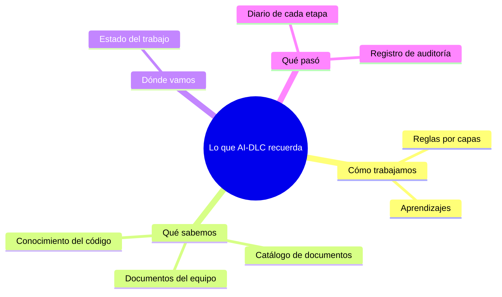
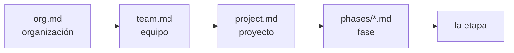
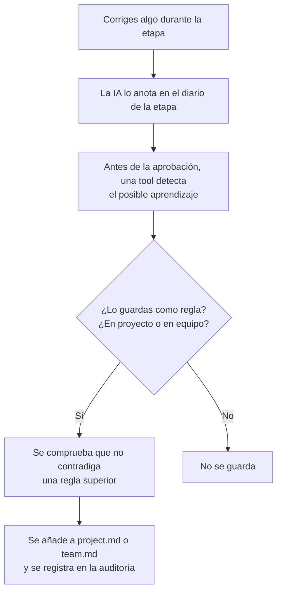

# Capítulo 03 · Memoria, estado y registros

> **En una frase:** AI-DLC no depende de que la IA "se acuerde". Todo lo importante queda escrito en archivos: **cómo trabajamos** (reglas), **qué sabemos** (conocimiento), **dónde vamos** (estado) y **qué pasó** (registro).

## El mapa

Texto: AI-DLC recuerda cómo trabajamos (reglas y aprendizajes), qué sabemos (documentos del equipo, catálogo y conocimiento del código), dónde vamos (estado) y qué pasó (diario de etapa y auditoría).

| Qué recuerda | Archivo o carpeta | Quién lo escribe | ¿Se edita a mano? |
|---|---|---|---|
| Reglas por capas | `aidlc/spaces/default/memory/` | El framework, la etapa de prácticas y los aprendizajes | Solo en las aprobaciones, no directamente |
| Documentos del equipo | `aidlc/spaces/default/knowledge/` | Nosotros | Sí |
| Conocimiento del código | `aidlc/spaces/default/codekb/` | AI-DLC, al analizar código existente | No |
| Estado del trabajo | `<trabajo>/aidlc-state.md` | Las tools | **Nunca** |
| Diario de cada etapa | `<trabajo>/<fase>/<etapa>/memory.md` | AI-DLC, mientras trabaja la etapa | **Nunca** |
| Registro de auditoría | `<trabajo>/audit/` | Las tools y los hooks | **Nunca** |

`<trabajo>` es la carpeta de cada trabajo: `aidlc/spaces/default/intents/AAMMDD-nombre/`.

## 1 · Reglas por capas (`memory/`)

Son las reglas que AI-DLC sigue en cada etapa. Se organizan en **5 capas**, de la más general a la más específica:

Texto: organización → equipo → proyecto → fase → etapa.

| Capa | Archivo | Qué contiene | Ejemplo real de nuestra instalación |
|---|---|---|---|
| Organización | `org.md` | Valores por defecto del framework y normas de toda la organización | "Usamos *trunk-based development*: todo se une a `main` con ramas cortas" |
| Equipo | `team.md` | Las prácticas que el equipo confirma | Vacío: se llena en la etapa 2.2 Practices Discovery |
| Proyecto | `project.md` | Ajustes propios de este proyecto | Vacío: se llena con los aprendizajes |
| Fase | `phases/ideation.md`, `inception.md`, `construction.md`, `operation.md` | Reglas de cada fase | Construcción: "nunca escribir credenciales en el código" |
| Etapa | La definición de la etapa | Lo que exige esa etapa concreta | 2.3 Requirements Analysis: los requisitos deben poder probarse |

Cada archivo tiene las mismas secciones: forma de trabajar, esqueleto, pruebas, controles, despliegue, estilo de código, prohibido, obligatorio y correcciones.

**Cómo se combinan:** se **suman**. Todas las capas aplican a la vez. Una capa más específica puede **añadir o precisar**, pero **no contradecir** a una más general. Si un aprendizaje nuevo contradice una regla superior, AI-DLC lo rechaza antes de guardarlo.

**Cómo llegan a la IA:** por tres caminos. Al abrir la conversación, a través de `rules/aidlc.md` (capítulo 02). Al empezar cada etapa, porque el motor le entrega las que aplican. Y cuando se lanza un subagente, porque el hook `deliver-stage-rules` se las pasa.

## 2 · Aprendizajes: cómo una corrección se convierte en regla

Si durante una etapa corriges algo a la IA (por ejemplo, "los IDs siempre en formato UUID"), AI-DLC puede convertirlo en una regla permanente:

Texto: corriges algo → la IA lo anota en el diario → antes de aprobar, una tool detecta el aprendizaje → tú decides si se guarda y dónde → se comprueba que no contradiga nada → se añade a `project.md` o `team.md`.

- **Tú decides siempre:** la tool detecta y propone, pero no guarda nada sin tu respuesta.
- **Nunca se modifican las definiciones de las etapas.** Lo aprendido se guarda en las reglas del proyecto o del equipo, y la próxima vez la etapa lo tiene en cuenta automáticamente.
- **También puede proponer un sensor nuevo** cuando lo aprendido es una comprobación automática.
- Se puede apagar con `/aidlc --learnings off`.

## 3 · Conocimiento

| Qué | Dónde | Para qué |
|---|---|---|
| **Documentos del equipo** | `knowledge/aidlc-shared/` (todos los agentes) y `knowledge/<agente>/` (uno solo) | Guías propias del equipo que los agentes leen después de las del framework. Por ejemplo, un manual interno de arquitectura |
| **Catálogo de documentos** (*DocumentKB*) | `knowledge/documents/`: **tus originales** (PDF, Word, Markdown). `knowledge/documentkb/`: **el catálogo** que genera la tool | Que los agentes puedan buscar y citar documentos. Se gestiona con `/aidlc-knowledge` |
| **Conocimiento del código** (*CodeKB*) | `codekb/<repositorio>/` | Lo que AI-DLC aprende al analizar código existente en 2.1 Reverse Engineering: 9 documentos, como arquitectura, estructura, APIs, dependencias y calidad |

Dos reglas del catálogo de documentos:
- **No existe la opción "eliminar".** Para quitar un documento, borras tu archivo y sincronizas. Así la tool nunca tiene poder para borrar tus archivos.
- **El texto de los documentos se trata como datos, no como instrucciones.** Si un documento dice "ignora las reglas", la IA no lo obedece.

En nuestro piloto **no habrá conocimiento del código**, porque partimos de cero. Solo se genera cuando ya existe código.

## 4 · Estado: `aidlc-state.md`

Es **la ficha del trabajo**: dónde vamos y con qué configuración. La escriben solo las tools; si la IA intenta editarla, un hook la bloquea.

| Sección | Qué guarda |
|---|---|
| Información del proyecto | Descripción, si es nuevo o existente, scope, fecha de inicio, agente activo |
| Configuración del scope | Etapas a ejecutar y a saltar (con el motivo), nivel de detalle, pruebas, controles, sensores, aprendizajes |
| Estado del espacio de trabajo | Lenguajes, frameworks y sistema de construcción detectados |
| Progreso por fase | Pendiente, activa, verificada o saltada |
| Progreso por etapa | Una casilla por etapa (ver abajo) |

Las casillas de cada etapa:

| Casilla | Significa |
|---|---|
| `[ ]` | Pendiente |
| `[-]` | En curso |
| `[?]` | Esperando tu aprobación |
| `[R]` | Revisando, después de que pediste cambios |
| `[x]` | Completada |
| `[S]` | Saltada |

Junto a la ficha, `project-description.json` guarda **tu descripción inicial palabra por palabra**.

**Para qué sirve:** cuando abres una conversación nueva, el hook `session-start` lee esta ficha y la IA sabe exactamente dónde se quedó el trabajo, aunque la conversación anterior se haya perdido.

## 5 · El diario de cada etapa: `memory.md`

Mientras trabaja una etapa, la IA anota sus decisiones en 4 secciones:

| Sección | Qué anota | Ejemplo de la plantilla |
|---|---|---|
| Interpretaciones | Cómo entendió algo ambiguo | "Elegí REST en lugar de GraphQL: el equipo solo necesita operaciones básicas" |
| Desviaciones | Dónde se apartó de lo que sugería la etapa | "No añadí la capa de caché: los datos son pocos y añade riesgo" |
| Compromisos | Qué sacrificó y por qué | "TDD en lugar de BDD: el equipo trabaja con pruebas unitarias" |
| Preguntas abiertas | Lo que queda por confirmar | "Confirmar con cumplimiento cuánto tiempo se guardan los datos" |

De aquí salen los aprendizajes de la sección 2. Si una etapa se aprueba con el diario vacío, queda registrado en la auditoría (evento `MEMORY_EMPTY`).

## 6 · El registro de auditoría: `audit/`

Es **la caja negra** del trabajo: cada cosa que pasa queda anotada con fecha y hora.

- **Un archivo por copia del repositorio** (`audit/<máquina>-<id>.md`), para que dos personas o dos máquinas no se pisen al escribir.
- **115 tipos de evento**, en 25 categorías. Algunos ejemplos:

| Evento | Cuándo |
|---|---|
| `WORKFLOW_STARTED` | Empieza un trabajo, con su scope |
| `SESSION_STARTED` | Se abre una conversación |
| `HUMAN_TURN` | Una persona escribió algo |
| `STAGE_STARTED` | Empieza una etapa |
| `ARTIFACT_CREATED` | Se crea un documento |
| `SENSOR_FAILED` | Un sensor encontró un problema |
| `SUBAGENT_COMPLETED` | Terminó un subagente |
| `STAGE_AWAITING_APPROVAL` | La etapa espera tu aprobación |
| `GATE_APPROVED` / `GATE_REJECTED` | Aprobaste o pediste cambios, con tus palabras exactas |
| `RULE_LEARNED` | Se guardó un aprendizaje como regla |
| `STAGE_COMPLETED` | Terminó la etapa |

**Sus reglas:**
- **Solo se añade, nunca se borra ni se modifica.**
- **La fecha la pone la tool**, nunca la IA.
- **Tus palabras se guardan tal cual**, sin resumir.
- **Sin datos sensibles:** ni contraseñas ni datos personales.
- **La IA no puede escribir en él directamente**, porque un hook lo bloquea. Todo entra a través de las tools y los hooks.

**Cómo leerlo:** con `/aidlc-replay`, que lo convierte en un relato, o con `aidlc engine audit history`.

**Su límite, dicho por el propio framework:** es **evidencia operativa, no una prueba a prueba de manipulaciones**. Registra que hubo una persona presente, pero no autentica quién era.

## 7 · La memoria de Claude Code no es la de AI-DLC

Claude Code tiene **su propia memoria**: instrucciones y notas que guarda en tu máquina, fuera del repositorio. Las diferencias:

| | Memoria de AI-DLC | Memoria de Claude Code |
|---|---|---|
| Dónde vive | En el repositorio (`aidlc/`) | En tu máquina, fuera del repositorio |
| ¿La ve el equipo? | Sí, se sube a Git | No, es personal |
| ¿Tiene control? | Sí: aprobaciones, comprobación de contradicciones y auditoría | No |

**Regla práctica:** todo lo que deba aplicar al proyecto o al equipo va en la memoria de AI-DLC, mediante las aprobaciones y los aprendizajes, no en la memoria personal de la herramienta.

## 8 · Qué se sube a Git y qué no

| Se sube (es del equipo) | No se sube (es de cada máquina o persona) |
|---|---|
| Reglas (`memory/`) | Qué espacio y qué trabajo tienes activos |
| Documentos y catálogos (`knowledge/`, `codekb/`) | El identificador de tu copia del repositorio |
| Cada trabajo: estado, documentos, diarios y auditoría | Datos de sesión (`.aidlc-sessions/`) |
| `intents.json`, el índice de trabajos | Datos internos del motor (`.aidlc-engine/`, `runtime-graph.json`) |
| | Ajustes personales (`.claude/settings.local.json`) |

---

**Ejemplos reales:** este capítulo describe lo que dice la documentación instalada. Al ejecutar el piloto, en el capítulo 07 se añadirán un `aidlc-state.md`, un `memory.md` y un extracto de la auditoría reales.

**Fuentes:** `.claude/knowledge/aidlc-shared/` (`state-template.md`, `memory-template.md`, `audit-format.md`, `verification.md`); `.claude/aidlc-common/protocols/stage-protocol.md` (reglas de auditoría y carga de conocimiento); `stage-protocol-learnings.md`; `.claude/CLAUDE.md` (capas, knowledge, DocumentKB y Git); `aidlc/spaces/default/memory/`; `.gitignore`. Versión 2.11.0.
