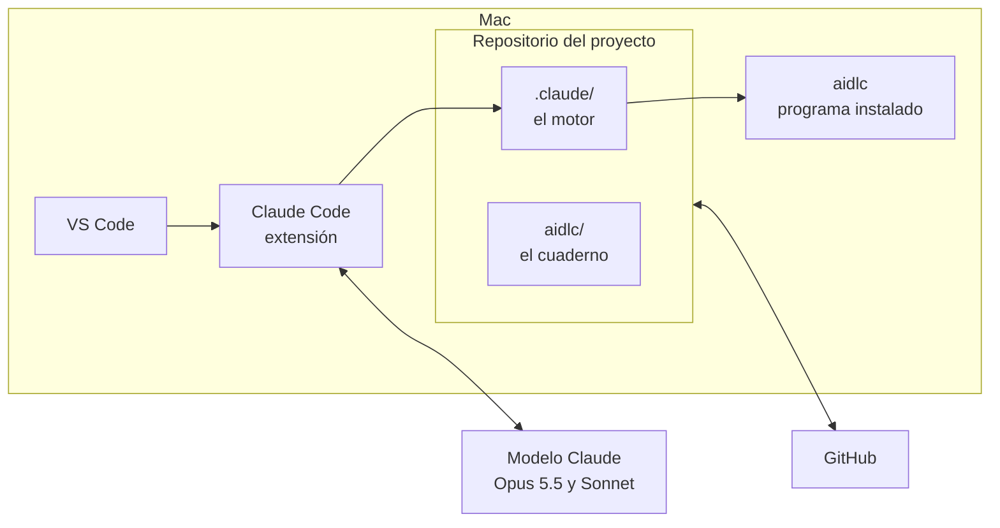

# Capítulo 05 · Entorno y setup

> **En una frase:** el piloto se ejecuta en un Mac con **VS Code + Claude Code**, el modelo **Claude Opus 5.5** y **AI-DLC 2.11.0**. Todo lo que aparece en la bitácora del piloto se generó con este entorno.

## 1 · Ficha del entorno

| Elemento | Valor | Comentario |
|---|---|---|
| Equipo | Mac con chip Apple (arm64) | Equipo principal del piloto |
| Sistema operativo | macOS 27.0 | |
| Editor | VS Code 1.141.0 | |
| Harness | Claude Code, extensión de VS Code 2.1.296 | Donde corre AI-DLC |
| Plan de Claude | Claude Pro | Suscripción: no se paga por token |
| Modelo de la conversación | Claude Opus 5.5 | Hace el trabajo de casi todas las etapas |
| Modelo de los revisores | Claude Sonnet, esfuerzo medio | Valor por defecto de AI-DLC |
| AI-DLC | 2.11.0 | Última versión disponible al 10/10/2026 |
| Scope por defecto | `classic` | Solo se usa si no se elige otro; en el piloto lo elegiremos (capítulo 06) |
| Servidores MCP | Ninguno | No se activaron al instalar |
| Control de versiones | Git 2.54 y GitHub CLI 2.74 | Repositorio privado en GitHub |
| Equipo secundario | Windows con VS Code + Copilot | **Pendiente**: se documentará en una prueba acotada |

## 2 · Cómo se conectan las piezas



Texto:
- En el Mac, **VS Code** ejecuta la extensión **Claude Code**.
- Claude Code habla con el **modelo** (Opus 5.5 y Sonnet) en los servidores de Anthropic y usa el **motor** `.claude/` del repositorio.
- El motor ejecuta sus hooks y tools a través del programa **`aidlc`** instalado en el Mac.
- El repositorio se sincroniza con **GitHub**.

## 3 · Por qué Claude Code y no Kiro

AI-DLC funciona en varias herramientas: Kiro, Claude Code, Codex, Cursor, Copilot y opencode. El plan inicial era Kiro, pero **la versión gratuita de Kiro limita los modelos disponibles**. Con Claude Code se pueden usar los modelos más avanzados de Anthropic.

Diferencias que se notan en el día a día:

| | Claude Code | Kiro |
|---|---|---|
| Modelo por agente | Se puede usar un modelo distinto para cada agente, por ejemplo Sonnet en los revisores | Un solo modelo para toda la sesión |
| Barra de estado | Muestra fase, etapa y costo estimado | No tiene |
| Preguntas | Con opciones para elegir | En texto numerado |
| Registro de tokens y costo | Sí | No |

## 4 · Los modelos

AI-DLC clasifica a los agentes en tres grupos según el tipo de trabajo:

| Grupo | Agentes | Modelo en el piloto |
|---|---|---|
| **Deciden** | product, design, architect, aws-platform, developer, quality, devsecops, compliance, composer | El de la conversación: Opus 5.5 |
| **Redactan** con plantilla | delivery, pipeline-deploy, operations | El de la conversación: Opus 5.5 |
| **Revisan** | product-lead, architecture-reviewer | **Sonnet**, esfuerzo medio |

- **Por qué los revisores usan otro modelo:** AI-DLC lo deja así por defecto para revisar más rápido y con menos costo. La propia herramienta lo explica: subir el esfuerzo "cambia tiempo y costo de revisión por más profundidad".
- **Decisión del piloto:** mantener los valores por defecto en el primer recorrido y anotar qué encuentran los revisores. Si se les escapan cosas, se sube el esfuerzo y se comparan los resultados.
- **Cómo cambiarlo:** con `aidlc config models`. Por ejemplo, `--preset thorough` sube a los revisores a esfuerzo extra alto.
- **En Kiro**, la guía de AI-DLC recomienda Claude Opus 4.8 como modelo de la conversación. Allí todos los agentes usan ese mismo modelo.

## 5 · Costo y límites de uso

- **Con Claude Pro no se paga por token.** El costo que muestra AI-DLC en la barra de estado es una **estimación a precio de lista**: cuánto costaría si se pagara por API. Sirve como referencia, no es un gasto real.
- **Claude Pro tiene límites de uso por período**, y Opus los consume más rápido que otros modelos. Un recorrido de AI-DLC tiene muchas etapas, preguntas y revisiones.
- **Riesgo:** llegar al límite a mitad de una etapa. Si pasa, el estado queda guardado y el trabajo se retoma cuando el límite se renueva (capítulo 04).
- **Mitigaciones:**
  1. Elegir un scope acotado para el primer recorrido (capítulo 06).
  2. Anotar en la bitácora el uso de cada etapa, para saber cuánto consume un recorrido.
  3. Los revisores ya usan Sonnet, que consume menos.
- **Al presentar en pantalla compartida**, el costo estimado se puede ocultar en los ajustes personales (`settings.local.json`).

## 6 · Instalación paso a paso

Así se instaló AI-DLC en este proyecto:

| Paso | Qué se hace | Comando o acción |
|---|---|---|
| 1 | Instalar el programa `aidlc` en la máquina | Según la [guía oficial](https://awslabs.github.io/aidlc-workflows/) |
| 2 | Instalar AI-DLC para Claude Code en el proyecto | `aidlc config --harness claude`: crea `.claude/` (unos 315 archivos) y añade su bloque a `.gitignore`. No toca `aidlc/` |
| 3 | Reiniciar Claude Code para que cargue los hooks | En VS Code: **Cmd + Shift + P** → **Developer: Reload Window**. Si Claude Code pide aprobar los hooks, se aprueban |
| 4 | Verificar la instalación | `aidlc doctor` o `/aidlc --doctor` en el chat |
| 5 | Comprobar si hay versión nueva | `aidlc update --check` |
| 6 | Guardar la instalación en Git | Rama nueva, commit de `.claude/` y `.gitignore`, PR y merge |

Resultado real del paso 4:

```
AI-DLC doctor

Machine
  ok    9 checks passed

Project (.claude, Claude Code)
  ok    all 47 checks passed

Framework integrity
  ok    all 12 checks passed
```

**Notas:**
- **Si el proyecto tenía AI-DLC instalado para otra herramienta**, por ejemplo `.kiro/`, esa carpeta se borra desde una terminal externa. Los hooks de AI-DLC no dejan que la IA borre archivos de control. La carpeta `aidlc/` se conserva porque es la misma para todas las herramientas.
- **No hace falta crear una carpeta para el código.** AI-DLC lo genera en la raíz del repositorio en la etapa 3.5 Code Generation, con una estructura que propone y que aprobamos.

## 7 · Pendientes

- **Equipo Windows** con VS Code + Copilot: instalación y una prueba acotada, para comparar un comportamiento concreto con Claude Code.
- **Uso real por etapa:** se medirá durante el piloto (capítulo 08).

---

**Fuentes:** versiones obtenidas con `sw_vers`, `code --version`, `aidlc --version`, `git --version` y `gh --version`; modelos con `aidlc config models --show`; agrupación de agentes en `.claude/tools/data/agent-tiers.json`; diferencias por herramienta en la guía de Kiro y `.claude/CLAUDE.md`; precios en `.claude/tools/data/model-rates.json`.
