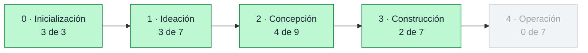
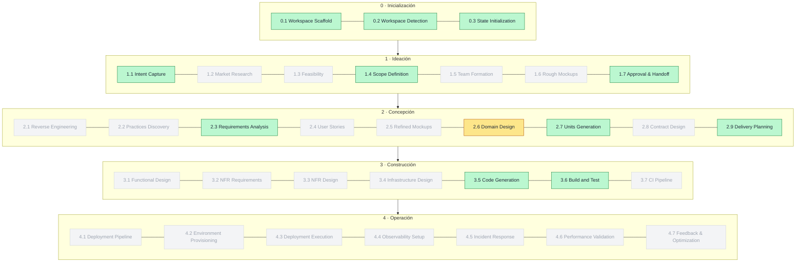
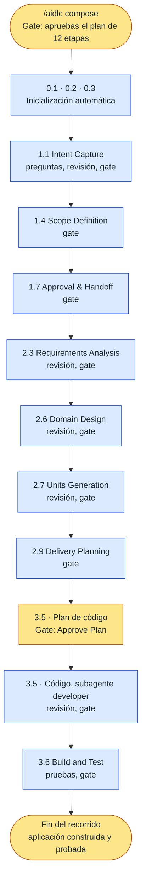

# Capítulo 05 · Mapa del piloto (lo esperado)

> **En una frase:** el primer recorrido del piloto ejecuta **12 de las 33 etapas**: las 11 ALWAYS más `2.6 Domain Design`, que es imprescindible. Este capítulo es **la predicción**; el capítulo 07 cuenta lo que realmente pasó.

## 1 · Qué construimos y con qué scope

- **El producto:** un primer corte mínimo de una aplicación web nueva, desde cero. El alcance exacto se decide en `1.1 Intent Capture` y `1.4 Scope Definition`.
- **El objetivo de este recorrido:** una pasada rápida por el flujo básico, es decir, por las etapas **ALWAYS**.
- **El scope:** **un plan a medida con `/aidlc compose`**.

### Por qué un plan a medida

Comparamos las 11 etapas ALWAYS con los 11 scopes de AI-DLC y **ningún scope ejecuta exactamente esas 11**:

| Scope | Etapas | Problema |
|---|---:|---|
| `poc` | 8 | Le faltan 1.4, 1.7, 2.7 y 2.9 |
| `mvp` | 23 | Le falta 1.7 y añade hasta 13 condicionales |
| `feature` / `enterprise` | 33 | Ejecutan las 33: es el recorrido completo |

Con `/aidlc compose`, el agente `composer` propone una tabla de etapas a medida. **Se revisa y se aprueba en un gate antes de ejecutar nada**, y queda registrada en la auditoría.

### Por qué 12 etapas y no 11

Cada etapa declara qué documentos necesita, y el validador de `compose` rechaza un plan en el que falte uno obligatorio:

| Etapa ALWAYS | Necesita obligatoriamente | Lo produce |
|---|---|---|
| `2.7 Units Generation` | `components`, los componentes del sistema | `2.6 Domain Design`, **condicional** |
| `2.9 Delivery Planning` | `components` | `2.6 Domain Design` |

Por eso se añade `2.6 Domain Design`. Además, su condición ("se necesitan componentes nuevos") se cumple igualmente en una aplicación que parte de cero.

## 2 · Las fases

Texto: Inicialización (3 de 3 etapas) → Ideación (3 de 7) → Concepción (4 de 9) → Construcción (2 de 7) → Operación (0 de 7, no se ejecuta).

## 3 · Las 33 etapas: cuáles usamos

En **verde**, las 11 ALWAYS. En **amarillo**, `2.6 Domain Design`, añadida porque otras etapas la necesitan. En **gris**, las 21 que no se ejecutan en este recorrido.

Texto: se ejecutan 0.1, 0.2, 0.3, 1.1, 1.4, 1.7, 2.3, 2.6 (añadida), 2.7, 2.9, 3.5 y 3.6. No se ejecutan 1.2, 1.3, 1.5, 1.6, 2.1, 2.2, 2.4, 2.5, 2.8, 3.1, 3.2, 3.3, 3.4, 3.7 ni las 7 de Operación.

## 4 · Las 12 etapas en detalle

Cada etapa produce también un archivo `<etapa>-questions` con las preguntas que hizo y nuestras respuestas.

| Etapa | Lidera | Revisa | Documentos que produce | Sensores | Particularidad |
|---|---|---|---|---|---|
| **0.1** Workspace Scaffold | El director | — | La carpeta del trabajo | — | Automática, sin aprobación |
| **0.2** Workspace Detection | El director | — | — | — | Detecta si el proyecto es nuevo o existente |
| **0.3** State Initialization | El director | — | `aidlc-state.md` | — | Crea la ficha del trabajo |
| **1.1** Intent Capture | product | product-lead | `intent-statement` (la intención) · `stakeholder-map` (los interesados) | claim-sources · required-sections · upstream-coverage | Cada afirmación debe indicar de dónde sale |
| **1.4** Scope Definition | product | — | `scope-document` (qué entra y qué no) · `intent-backlog` (lista inicial de trabajo) | required-sections · upstream-coverage | Aquí se decide el corte mínimo |
| **1.7** Approval & Handoff | delivery | — | `initiative-brief` (resumen de la iniciativa) · `decision-log` (decisiones tomadas) | required-sections · upstream-coverage | Cierre de Ideación |
| **2.3** Requirements Analysis | product | product-lead | `requirements` | required-sections · upstream-coverage | |
| **2.6** Domain Design ⚠️ | architect | architecture-reviewer | `components` (catálogo de componentes con diagrama) · `decisions` (decisiones de arquitectura) · `traceability` | required-sections · upstream-coverage · traceability | Añadida por dependencia |
| **2.7** Units Generation | architect | architecture-reviewer | `unit-of-work` (unidades de trabajo) · sus dependencias · su mapa con las historias · `traceability` | required-sections · upstream-coverage · traceability | Divide el sistema en unidades construibles |
| **2.9** Delivery Planning | delivery | — | `bolt-plan` (plan de *bolts*, ciclos cortos de construcción) · reparto del equipo · riesgos y orden · dependencias externas | required-sections · upstream-coverage | Cierre de Concepción |
| **3.5** Code Generation | developer, **como subagente** | architecture-reviewer | `code-generation-plan` · el código · `unit-test-instructions` · `code-summary` · `traceability` | required-sections · traceability | **Primero el plan, que se aprueba, y después el código** |
| **3.6** Build and Test | quality | — | Instrucciones de construcción y pruebas · `build-and-test-summary` · `build-test-results` | required-sections · upstream-coverage · type-check | Ejecuta las pruebas y deja los resultados |

## 5 · Hooks y controles a lo largo del recorrido

| Cuándo | Qué esperamos ver |
|---|---|
| **Siempre** | `session-start` al abrir · `record-human-turn` en cada mensaje · `write-audit-log` y `run-sensors` en cada documento · `sync-workflow-state` en cada cambio de etapa |
| **En cada aprobación** (9 etapas, de 1.1 a 3.6) | El gate, con tus palabras guardadas tal cual · sensores de revisión de documentos · el ritual de aprendizajes antes de aprobar |
| **En las 5 revisiones** (1.1, 2.3, 2.6, 2.7, 3.5) | Se lanza el revisor como subagente: `deliver-stage-rules` le entrega las reglas y `log-subagent` registra el cierre |
| **En 3.5 Code Generation** | El developer se lanza como subagente · `plan-approval-guard` impide escribir código antes de aprobar el plan |
| **Si pides cambios en un documento ya revisado** | `review-freeze`: la revisión anterior deja de valer |

## 6 · Configuración esperada y dos decisiones para el gate

En un plan a medida, AI-DLC parte de la configuración de `classic`. El `composer` puede proponer otra con su justificación, y **la decisión final es nuestra en el gate**.

| Ajuste | Punto de partida | Qué significa |
|---|---|---|
| Sensores | Encendidos | Revisiones automáticas de documentos y código |
| Aprendizajes | Encendidos | Proponer reglas a partir de nuestras correcciones |
| Aprobar plan de código | Encendido | En 3.5, el código se escribe solo después de aprobar el plan |
| Agentes de apoyo | Apagados | Cada etapa la hace solo el líder |
| Revisiones | Consultivas | También en 3.5, que normalmente es adversarial |
| **Confirmar resumen** | **Apagado** | No te muestra un resumen de lo que entendió antes de escribir cada documento |
| **Guard Policy** | **`off`** | Si cambia algo ya aprobado, avisa y sigue. Además, los controles de aprobación del plan, documento congelado, transiciones de estado y alcance del revisor **se apartan** en el trabajo que nadie pidió explícitamente; cada vez que se apartan, queda registrado |

**Decisión 1 · Guard Policy.** Con `off`, varios de los hooks que bloquean (capítulo 02) se apartan y no los veríamos en acción. **Propuesta:** subirla a **`strict`** en el gate, para que el piloto muestre todos los controles. `strict` no baja ninguno y, si cambia algo ya aprobado, vuelve a pedir aprobación.

**Decisión 2 · Confirmar resumen.** Con el ajuste apagado, AI-DLC no lee en voz alta lo que entendió antes de escribir. **Propuesta:** **encenderlo**. Es como se detecta un malentendido antes de que se convierta en documento, y deja otra interacción visible para el playbook. A cambio, añade un paso por etapa y consume algo más del límite de Claude Pro.

## 7 · El recorrido detallado

Texto: `compose` y aprobación del plan → Inicialización automática → 1.1 → 1.4 → 1.7 → 2.3 → 2.6 → 2.7 → 2.9 → 3.5 con aprobación del plan de código y luego el código → 3.6 → fin, con la aplicación construida y probada. Si pedimos cambios en algún gate, la etapa vuelve a trabajar antes de continuar.

## 8 · Qué queda fuera y por qué

- **Operación completa** (las 7 etapas): este recorrido termina con la aplicación **construida y probada**, no desplegada. Operación se practica en el recorrido completo (capítulo 08).
- **Las 14 condicionales restantes** de Ideación, Concepción y Construcción: investigación de mercado, viabilidad, bocetos, historias de usuario, contratos, diseño no funcional, infraestructura, CI… También se practican en el capítulo 08.

## 9 · Qué vamos a comparar en el capítulo 07

- ¿Propuso el `composer` estas mismas 12 etapas? ¿Añadió o quitó alguna? ¿Con qué justificación?
- ¿Qué configuración propuso y qué decidimos en el gate?
- ¿Coincidieron los agentes, documentos, sensores y hooks con las tablas de este capítulo?
- ¿Cuántos gates hubo, cuántas veces pedimos cambios y qué encontraron los revisores?
- ¿Cuánto tiempo y cuánto uso del modelo consumió cada etapa?

---

**Fuentes:** etapas, líderes, revisores, documentos, sensores y dependencias en `.claude/tools/data/stage-graph.json`; etapas por scope en `scope-grid.json`; reglas del `composer` en `.claude/knowledge/aidlc-composer-agent/composing.md`. Versión 2.11.0.
