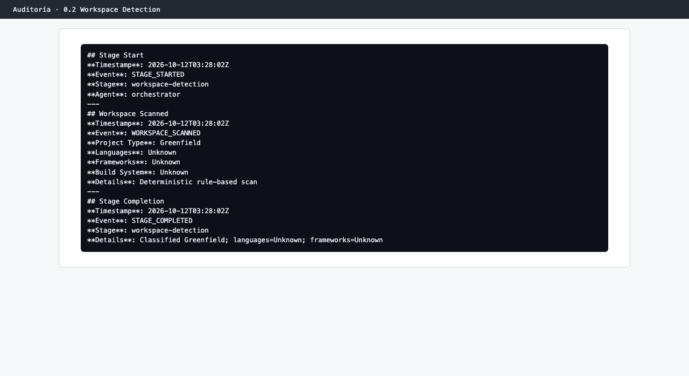

# Capítulo 07 · 0.2 Workspace Detection

> **En una frase:** AI-DLC escaneó el repositorio con reglas fijas, sin IA, y lo clasificó como **proyecto nuevo** (Greenfield) porque no encontró código ni sistema de construcción.

[← 0.1 Workspace Scaffold](02-0.1-workspace-scaffold.md) · [Resumen](00-resumen.md) · [Siguiente: 0.3 State Initialization →](04-0.3-state-init.md)

## 1 · Ubicación

Inicialización · 0.2 Workspace Detection · ALWAYS.

## 2 · Input

El propio repositorio: archivos de código, de dependencias y de construcción.

## 3 · Proceso

Un escaneo determinista (`WORKSPACE_SCANNED`: "Deterministic rule-based scan"). Busca lenguajes, frameworks y sistema de construcción, y con eso decide si el proyecto es nuevo o existente.

## 4 · Interacción

Ninguna.

## 5 · Agentes

El conductor. Ningún agente experto.

## 6 · Controles

Ninguno.

## 7 · Output

No produce documentos. El resultado se guarda en `aidlc-state.md`:

| Campo | Valor |
|---|---|
| Project Type | Greenfield |
| Project Type Source | workspace scan |
| Languages | Unknown |
| Frameworks | Unknown |
| Build System | Unknown |

## 8 · Pruebas

No aplica.

## 9 · Sorpresas y problemas

- El repositorio no estaba vacío: tenía el playbook, `docs/` y la configuración de AI-DLC. Aun así lo clasificó como nuevo, que era lo correcto, porque no había código de aplicación.
- Esa clasificación tiene consecuencias. Hizo que `2.1 Reverse Engineering` se saltara aunque el plan guardado la incluye (ver el [arranque](01-arranque-plan-a-medida.md)).
- Los campos Languages, Frameworks y Build System se quedaron en "Unknown" hasta el final. No se actualizan cuando, ya en Construcción, aparece la herramienta en Node.js.

## 10 · Tiempo y costo

Menos de un segundo, sin llamadas al modelo.

## 11 · Lo que aprendimos

La decisión de proyecto nuevo o existente es automática, y cambia qué etapas se ejecutan. Si se equivoca, se corrige diciéndolo en el chat ("esto es código existente").

## 12 · Capturas

*El escaneo y su clasificación en la auditoría.*

---

**Fuentes:** auditoría del trabajo (`WORKSPACE_SCANNED`); `aidlc-state.md` (sección Workspace State); `.claude/aidlc-common/stages/initialization/workspace-detection.md`.
