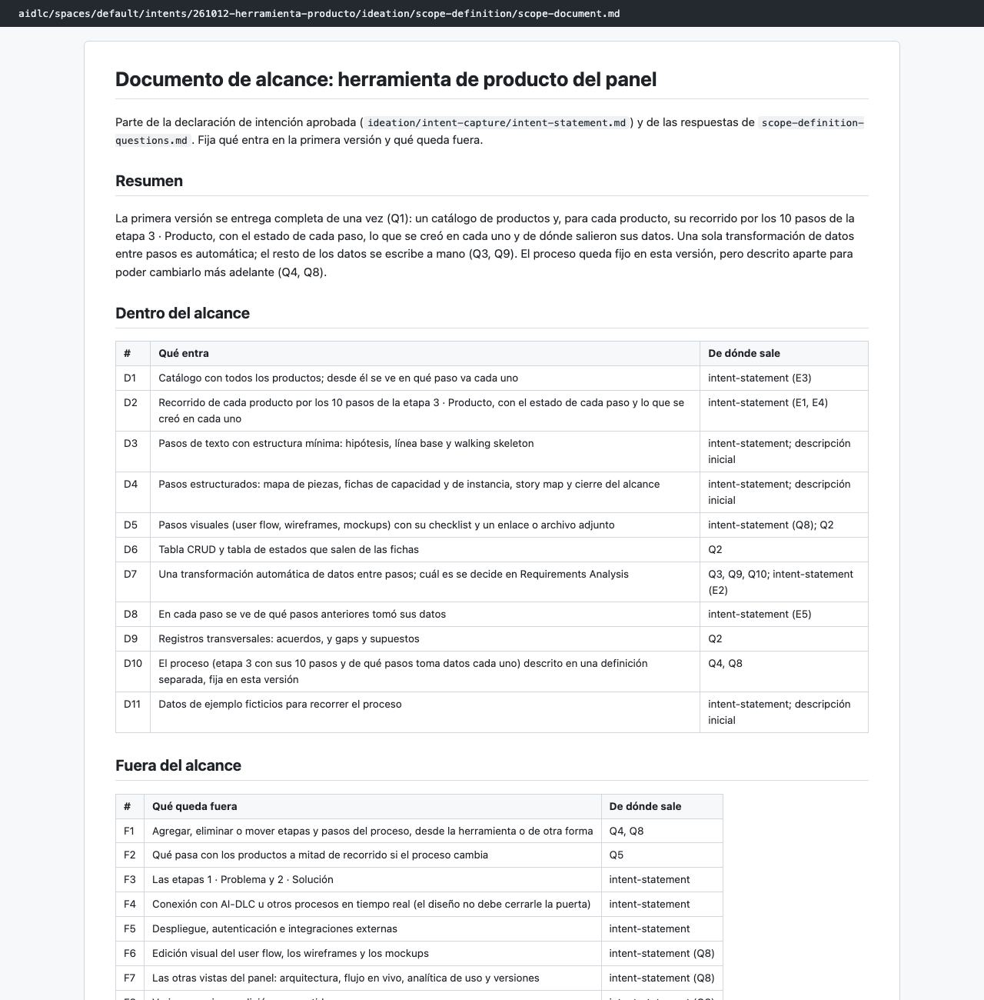
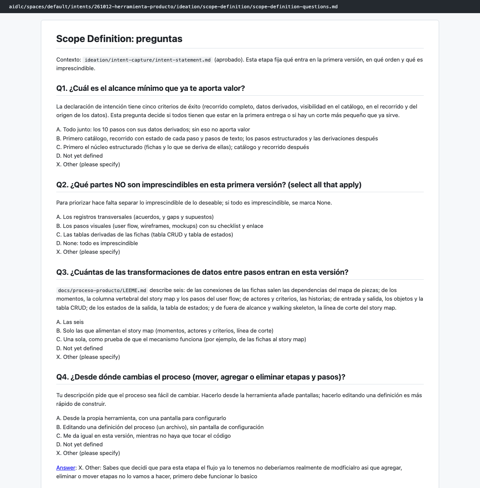

# Capítulo 07 · 1.4 Scope Definition

> **En una frase:** el agente `product` fijó **qué entra y qué no** en la primera versión y lo partió en un backlog de piezas. Aquí tomamos la primera decisión que contradecía una etapa ya aprobada: **el proceso queda fijo** en esta versión.

[← 1.1 Intent Capture](05-1.1-intent-capture.md) · [Resumen](00-resumen.md) · [Siguiente: 1.7 Approval & Handoff →](07-1.7-approval-handoff.md)

## 1 · Ubicación

Ideación · 1.4 Scope Definition · ALWAYS. Las condicionales 1.2 Market Research y 1.3 Feasibility se saltaron.

## 2 · Input

- [intent-statement.md](../../aidlc/spaces/default/intents/261012-herramienta-producto/ideation/intent-capture/intent-statement.md) y [stakeholder-map.md](../../aidlc/spaces/default/intents/261012-herramienta-producto/ideation/intent-capture/stakeholder-map.md), aprobados en 1.1.
- La descripción inicial.

## 3 · Proceso

1. Preguntas en 3 tandas, la última con seguimientos de respuestas anteriores.
2. Resumen consolidado y confirmación.
3. Documentos: alcance y backlog.
4. Aprendizajes: 3 candidatas, guardamos 1.
5. Gate: aprobamos.

Esta etapa **no tiene revisor**.

## 4 · Interacción

10 preguntas, 3 de ellas de seguimiento.

| Pregunta | Nuestra respuesta |
|---|---|
| Q1 · ¿Cuál es el alcance mínimo con valor? | Todo junto |
| Q2 · ¿Qué partes no son imprescindibles? | Ninguna |
| Q3 · ¿Cuántas transformaciones de datos entran? | Una sola |
| Q4 · ¿Desde dónde cambias el proceso? | Texto propio: "…el flujo ya lo tenemos, no deberíamos modificarlo, así que agregar, eliminar o mover etapas no lo vamos a hacer; primero debe funcionar lo básico" |
| Q5 · ¿Qué pasa con los productos a mitad si cambia el proceso? | Fuera de alcance |
| Q6 · ¿En qué orden construir? | Valor primero |
| Q7 · ¿Hay fecha límite? | Texto propio: "lo antes posible, en unas horas" |
| Q8 · (seguimiento de Q4) ¿Cómo queda lo de cambiar el proceso? | Fijo, pero descrito en una definición aparte |
| Q9 · (seguimiento) ¿Qué se deriva solo y qué se escribe a mano? | Una transformación automática; el resto a mano |
| Q10 · (seguimiento) ¿Cuál es esa transformación? | Sin definir todavía |

- **Resumen consolidado:** Looks correct.

## 5 · Agentes

| Papel | Agente | Modelo |
|---|---|---|
| Lidera | `product` | Opus |
| Apoyo | `delivery` (declarado en la etapa) | No participó: los agentes de apoyo estaban apagados en el plan |
| Revisa | — | Esta etapa no tiene revisor |

## 6 · Controles

| Control | Qué pasó |
|---|---|
| Sensores `required-sections` y `upstream-coverage` | Pasaron en los 3 archivos |
| Aprendizajes | 3 candidatas; guardamos 1 |
| Gate | Approve |

La regla que quedó en `project.md`: *cuando una respuesta contradice algo ya aprobado en una etapa anterior, se trata como cambio de alcance; se confirma con una pregunta de seguimiento y se deja explícito en el documento de la etapa.*

## 7 · Output

- [scope-document.md](../../aidlc/spaces/default/intents/261012-herramienta-producto/ideation/scope-definition/scope-document.md): 11 elementos dentro (D1 a D11), 9 fuera (F1 a F9), una sección de **cambio respecto a la intención**, el orden, el plazo, el flujo de valor y los riesgos.
- [intent-backlog.md](../../aidlc/spaces/default/intents/261012-herramienta-producto/ideation/scope-definition/intent-backlog.md): 10 piezas (IB-1 a IB-10), todas Must, en orden de valor primero.
- [scope-definition-questions.md](../../aidlc/spaces/default/intents/261012-herramienta-producto/ideation/scope-definition/scope-definition-questions.md).

## 8 · Pruebas

No aplica.

## 9 · Sorpresas y problemas

- **Contradijimos una etapa aprobada.** En 1.1 dijimos que el proceso debía poder cambiarse con facilidad. En Q4 dijimos que no se iba a cambiar. El agente no ignoró la contradicción ni la resolvió por su cuenta:
  1. Hizo una pregunta de seguimiento (Q8).
  2. Dejó el cambio escrito en el documento de alcance, en una sección propia.
  3. No reescribió la intención ya aprobada.
- **Todo imprescindible y en horas.** Con todo Must y un plazo de horas, el agente no insistió con más preguntas de priorización. Usó el orden de entrega como orden de recorte y lo marcó como supuesto sin confirmar. Ese supuesto se discutió en 1.7.
- **El flujo de valor salió como lista**, no como diagrama. El agente lo anotó como desvío: así no tenía que validar un diagrama y se lee igual.

## 10 · Tiempo y costo

- **25 minutos**, de 03:47 a 04:12. Casi 5 de ellos fueron de revisar el gate antes de aprobar.
- **22 llamadas al modelo**, todas del conductor con Opus.
- **6 mensajes nuestros.**

## 11 · Lo que aprendimos

- Un cambio de opinión entre etapas no rompe el flujo: se convierte en un cambio de alcance explícito y trazable.
- Las preguntas de seguimiento son la herramienta del agente para no adivinar.

## 12 · Capturas

*El documento de alcance, con lo que entra y lo que no.*

*Las preguntas, incluida la respuesta libre a Q4 que cambió el alcance.*

---

**Fuentes:** artefactos de `ideation/scope-definition/`; su `memory.md`; auditoría (03:47–04:12 UTC); `aidlc/spaces/default/memory/project.md`.
