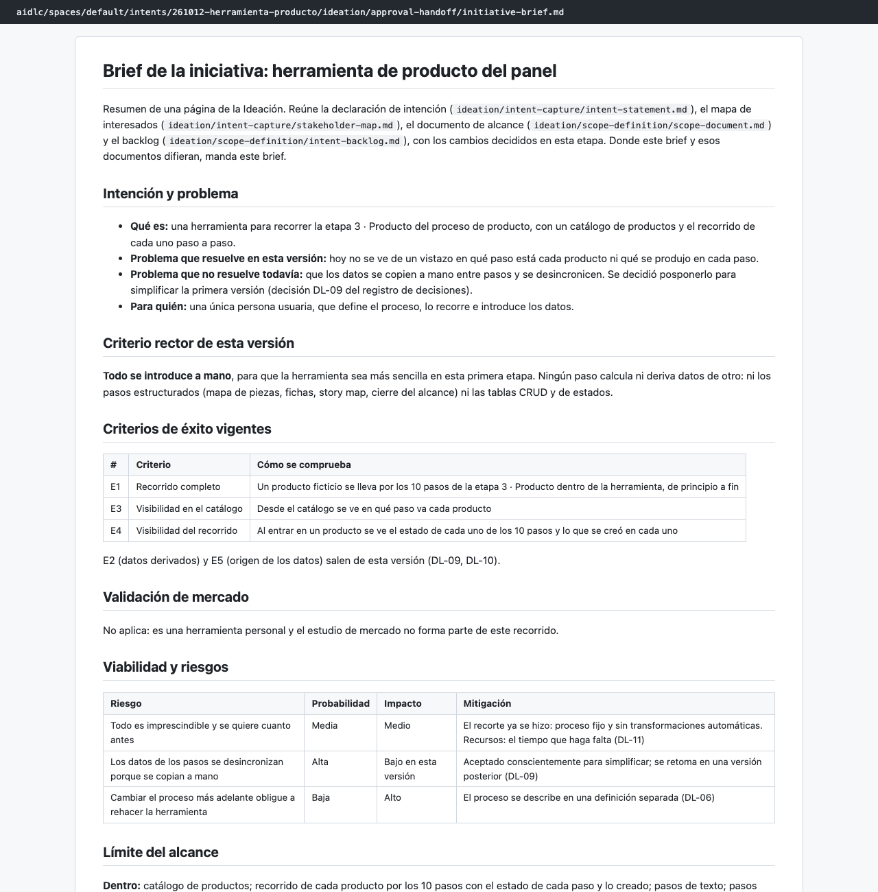
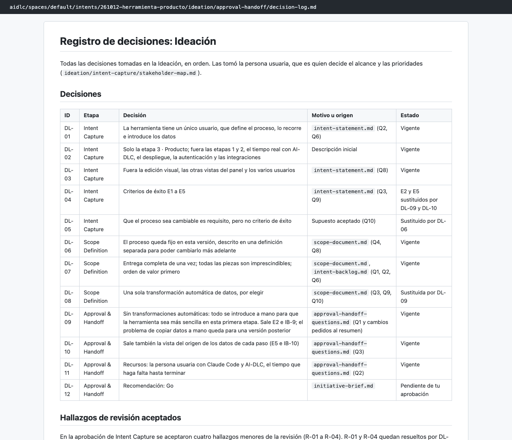
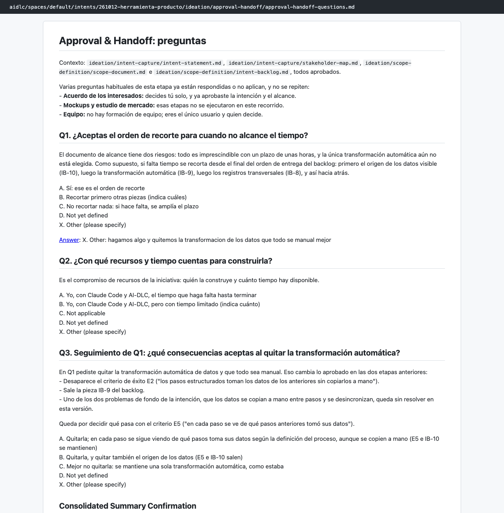

# Capítulo 07 · 1.7 Approval & Handoff

> **En una frase:** el agente `delivery` reunió la Ideación en un **brief de una página** y un **registro de decisiones**. Aquí recortamos el alcance de verdad: **todo se introduce a mano**, sin transformaciones automáticas, y eso pasó a ser el criterio rector de la versión.

[← 1.4 Scope Definition](06-1.4-scope-definition.md) · [Resumen](00-resumen.md) · [Siguiente: 2.3 Requirements Analysis →](08-2.3-requirements-analysis.md)

## 1 · Ubicación

Ideación · 1.7 Approval & Handoff · ALWAYS. Cierra la fase de Ideación. Las condicionales 1.5 Team Formation y 1.6 Rough Mockups se saltaron.

## 2 · Input

Los cuatro documentos aprobados de 1.1 y 1.4: intención, interesados, alcance y backlog.

## 3 · Proceso

1. Preguntas en 2 tandas.
2. Resumen consolidado: **pedimos cambios**.
3. "¿Qué debería cambiar?": respondimos con texto propio.
4. Nuevo resumen y confirmación.
5. Documentos: el brief y el registro de decisiones.
6. Aprendizajes: 3 candidatas, guardamos 1.
7. Gate: aprobamos.
8. Al aprobar, AI-DLC verificó la fase (Ideación → Concepción) y escribió el informe de verificación.

## 4 · Interacción

| Pregunta | Nuestra respuesta |
|---|---|
| Q1 · ¿Aceptas el orden de recorte si no alcanza el tiempo? | Texto propio: "hagamos algo y quitemos la transformación de los datos, que todo sea manual mejor" |
| Q2 · ¿Con qué recursos y tiempo? | Yo, con Claude Code y AI-DLC, el tiempo que haga falta |
| Q3 · (seguimiento de Q1) ¿Qué consecuencias aceptas? | Quitar la transformación y también E5 (ver de dónde salen los datos de cada paso) |
| Resumen consolidado | **Request changes** |
| ¿Qué debería cambiar? | "Que todo se meta de forma manual, así hacemos la herramienta más sencilla en esta primera etapa" |
| Resumen consolidado (segunda vez) | Looks correct |

De las 6 preguntas tipo de la etapa solo se hicieron 3. Las de mercado, bocetos y equipo no aplicaban, y el acuerdo de interesados ya estaba respondido.

## 5 · Agentes

| Papel | Agente | Modelo |
|---|---|---|
| Lidera | `delivery` | Opus |
| Apoyo | `product` (declarado) | No participó: agentes de apoyo apagados |
| Revisa | — | Esta etapa no tiene revisor |

## 6 · Controles

| Control | Qué pasó |
|---|---|
| Confirmación de resumen | Funcionó como estaba previsto: el "Request changes" no generó nada; pidió qué cambiar y volvió a mostrar el resumen |
| Sensores `required-sections` y `upstream-coverage` | Pasaron en los 3 archivos |
| Aprendizajes | 3 candidatas; guardamos 1 |
| Gate | Approve |
| Verificación de fase | Ideación consistente para pasar a Concepción, con 2 avisos |

La regla que quedó en `project.md`: *cuando la persona pide un cambio al resumen que expresa un principio, se registra como criterio rector explícito de la versión en el brief y en el registro de decisiones.*

## 7 · Output

- [initiative-brief.md](../../aidlc/spaces/default/intents/261012-herramienta-producto/ideation/approval-handoff/initiative-brief.md): intención, **criterio rector** ("todo se introduce a mano"), criterios de éxito vigentes (E1, E3 y E4), riesgos, límite del alcance, backlog vigente (8 piezas) y recomendación **Go**.
- [decision-log.md](../../aidlc/spaces/default/intents/261012-herramienta-producto/ideation/approval-handoff/decision-log.md): 12 decisiones de toda la Ideación (DL-01 a DL-12), con su estado (vigente o sustituida).
- [verification/phase-check-ideation.md](../../aidlc/spaces/default/intents/261012-herramienta-producto/verification/phase-check-ideation.md): la verificación de fase.

Las decisiones que cambiaron el producto:

| ID | Decisión | Efecto |
|---|---|---|
| DL-06 | El proceso queda fijo, descrito aparte (de 1.4) | Sustituye a "el proceso debe ser fácil de cambiar" |
| DL-09 | Sin transformaciones automáticas: todo a mano | Sale E2 y la pieza IB-9 |
| DL-10 | Sale también la vista del origen de los datos | Sale E5 y la pieza IB-10 |
| DL-12 | Recomendación: Go | Pendiente de nuestra aprobación en el gate |

## 8 · Pruebas

No aplica.

## 9 · Sorpresas y problemas

- **El brief manda sobre los documentos anteriores.** El agente no reescribió la intención ni el alcance ya aprobados para quitar E2, E5, IB-9 e IB-10. El brief y el registro de decisiones declaran que **mandan** sobre ellos. La verificación de fase lo marca como aviso: hay documentos aprobados con contenido sustituido.
- **El problema de fondo quedó sin resolver, a propósito.** "Los datos se copian a mano y se desincronizan" era uno de los dos problemas de 1.1. Con DL-09 no tiene ninguna pieza en esta versión. La verificación de fase lo deja escrito.
- **La pregunta abierta del diario:** ¿conviene reabrir 1.1 y 1.4 para que reflejen DL-09 y DL-10, o basta con que mande el brief? Se dejó así.

## 10 · Tiempo y costo

- **15 minutos**, de 04:12 a 04:27. Casi 6 de ellos fueron de revisar el gate.
- **27 llamadas al modelo**, del conductor con Opus.
- **8 mensajes nuestros.**

## 11 · Lo que aprendimos

- El "Request changes" del resumen es barato: se corrige antes de que exista ningún documento.
- Un recorte grande se hace mejor en el cierre de la fase, con todo a la vista, que a mitad de una etapa.
- Que el registro de decisiones marque qué está **sustituido** permite entender la historia sin releer todas las etapas.

## 12 · Capturas

*El brief, con el criterio rector "todo se introduce a mano".*

*El registro de decisiones de la Ideación, con su estado.*

*Las preguntas, con el cambio pedido al resumen.*

---

**Fuentes:** artefactos de `ideation/approval-handoff/`; su `memory.md`; `verification/phase-check-ideation.md`; auditoría (04:12–04:27 UTC).
