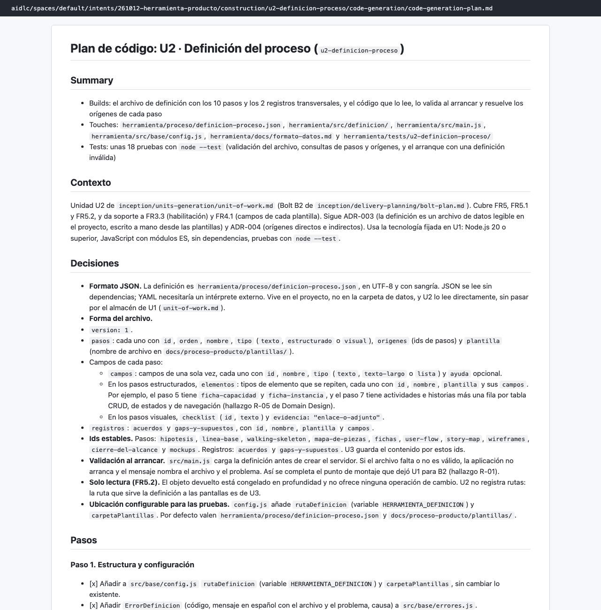
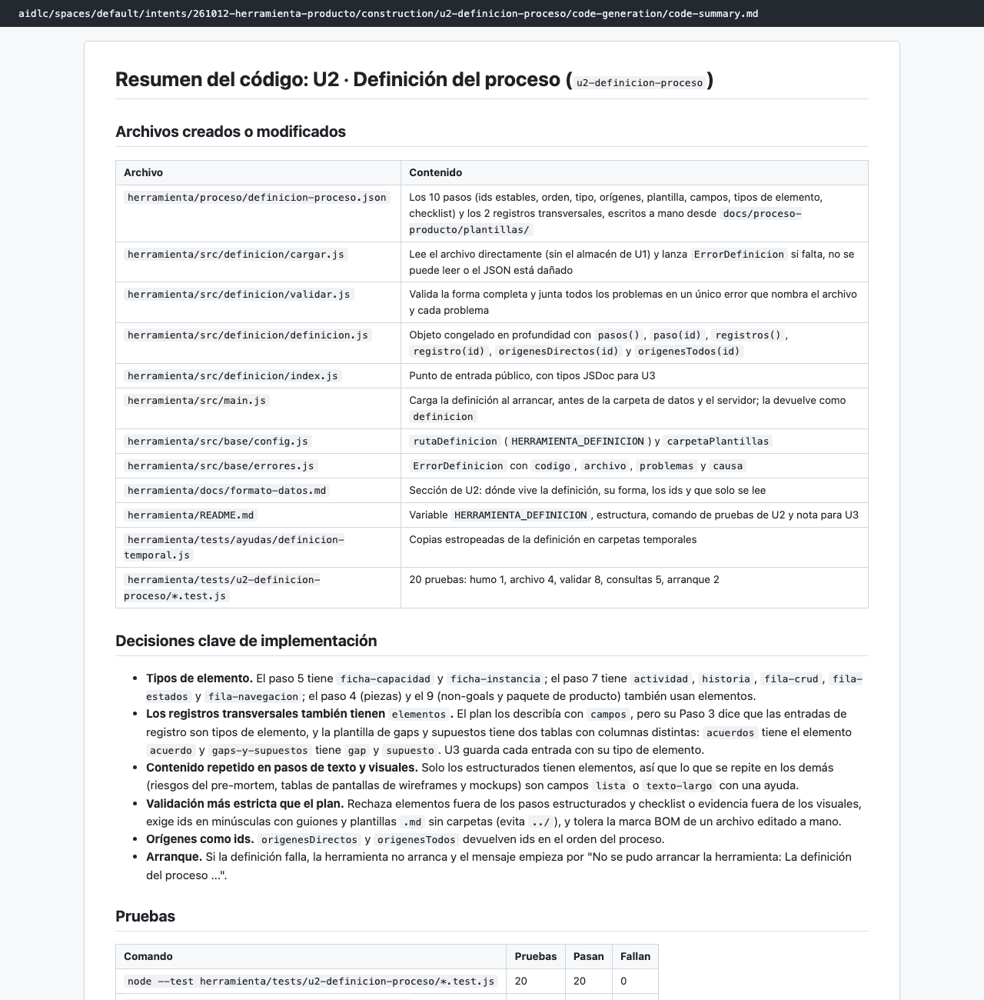
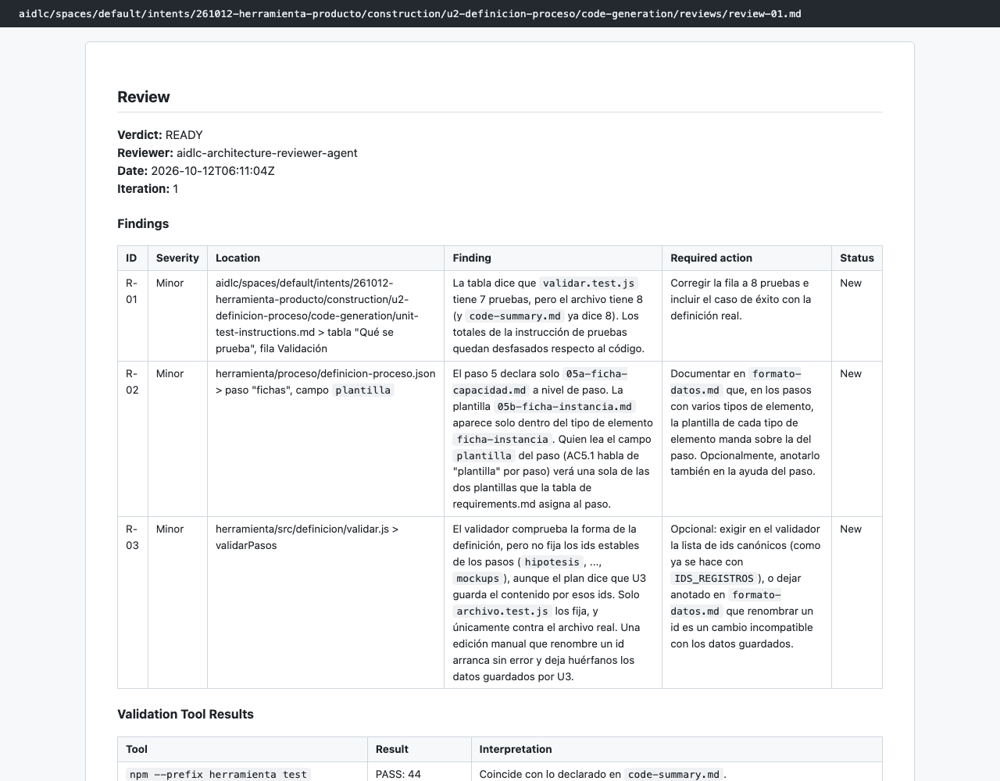

# Capítulo 07 · 3.5 Code Generation · U2 Definición del proceso

> **En una frase:** la unidad más pequeña escribió a mano el archivo con los 10 pasos y los 2 registros del proceso de producto, y el código que lo valida al arrancar. Si el archivo está mal, la herramienta no arranca y dice por qué.

[← U1](01-u1-base.md) · [Visión general](00-vision-general.md) · [Siguiente: U3 →](03-u3-recorrido.md)

## 1 · Ubicación

Construcción · 3.5 Code Generation · unidad U2 `u2-definicion-proceso` (bolt B2), tipo `library` y tamaño S.

## 2 · Input

- U2 en `unit-of-work.md` y la decisión ADR-003 (la definición es un archivo de datos legible).
- Las plantillas de `docs/proceso-producto/plantillas/`, de donde salen los campos de cada paso.
- Requisitos: FR5, FR5.1 y FR5.2.

## 3 · Proceso

1. **05:54–05:55:** plan de 11 pasos y 36 casillas. Aprobado.
2. **05:55–06:09:** el `developer` construyó la unidad (14 minutos).
3. **06:09–06:11:** resumen, revisión READY y comprobación con salida 0.
4. **06:11:** unidad aprobada automáticamente.

## 4 · Interacción

Una sola: aprobar el plan (Approve Plan).

## 5 · Agentes

| Papel | Agente | Modelo | Resultado |
|---|---|---|---|
| Construye | `developer` (subagente) | Opus | 20 pruebas nuevas, 44 en total |
| Revisa | `architecture-reviewer` (subagente) | Sonnet | READY, con 3 observaciones menores |

Las 3 menores:
- Una tabla de las instrucciones dice 7 pruebas donde hay 8.
- El paso 5 nombra una sola plantilla aunque usa dos.
- El validador no fija los ids de los pasos que U3 necesita.

## 6 · Controles

| Control | Qué pasó |
|---|---|
| `reviewer-scope` | **Bloqueó una vez al revisor** cuando intentó leer la carpeta del trabajo fuera de los archivos de su unidad. El revisor siguió con lo que sí podía leer |
| Sensor `traceability` | Aviso: solo lista los requisitos de U2 |
| Revisor | READY |
| Comprobación | Salida 0 |

## 7 · Output

16 archivos, entre ellos:
- [definicion-proceso.json](../../../herramienta/proceso/definicion-proceso.json): los 10 pasos (Hipótesis, Línea base, Walking skeleton, Mapa de piezas, Fichas, User flow, Story map, Wireframes, Cierre del alcance y Mockups) y los 2 registros (Acuerdos, y Gaps y supuestos), con su tipo, sus orígenes, su plantilla y sus campos.
- `src/definicion/`: carga, validación y consultas, como los pasos en orden y los orígenes directos e indirectos de un paso.

**Decisiones de implementación:**
- Los pasos estructurados tienen **tipos de elemento**. Por ejemplo, el paso 5 tiene fichas de capacidad y de instancia, y el 7 tiene actividades, historias y tres tablas.
- La validación es más estricta que el plan: rechaza ids mal formados y nombres de plantilla con carpetas.

Documentos: [plan](../../../aidlc/spaces/default/intents/261012-herramienta-producto/construction/u2-definicion-proceso/code-generation/code-generation-plan.md) · [resumen](../../../aidlc/spaces/default/intents/261012-herramienta-producto/construction/u2-definicion-proceso/code-generation/code-summary.md) · [revisión](../../../aidlc/spaces/default/intents/261012-herramienta-producto/construction/u2-definicion-proceso/code-generation/reviews/review-01.md).

## 8 · Pruebas

20 pruebas: archivo 4, validación 8, consultas 5, arranque 2 y humo 1. Las 24 de U1 siguieron en verde.

## 9 · Sorpresas y problemas

- **El revisor tropezó con su propio límite.** El control `reviewer-scope` impide que un revisor lea el trabajo de otras unidades, para que juzgue solo la suya. Aquí bloqueó una lectura demasiado amplia. Funcionó como estaba previsto.
- **Pequeñas diferencias de recuento entre el plan y el código** (18 pruebas previstas y 20 hechas). Las anotó el `developer` en el resumen.

## 10 · Tiempo y costo

**18 minutos** (05:53 → 06:11) y **63 llamadas al modelo**: 20 del conductor, 33 del `developer` y 10 del revisor.

## 11 · Lo que aprendimos

Que el proceso sea un archivo de datos validado al arrancar hace que cambiarlo en el futuro sea editar un JSON, no tocar código. Es la puerta que dejó abierta la decisión DL-06 de Ideación.

## 12 · Capturas

*El plan de código de U2.*

*El resumen del código.*

*La revisión: READY con 3 observaciones menores.*

---

**Fuentes:** `construction/u2-definicion-proceso/code-generation/`; auditoría (05:53–06:11 UTC).
