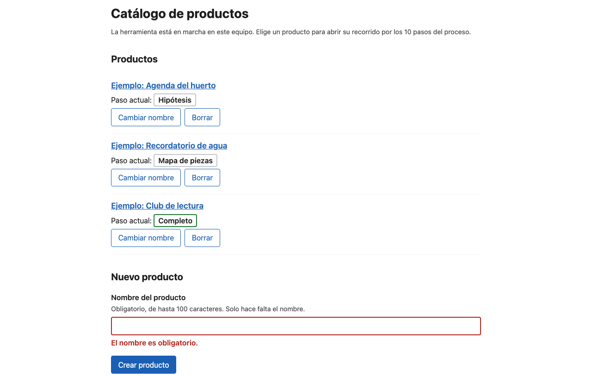
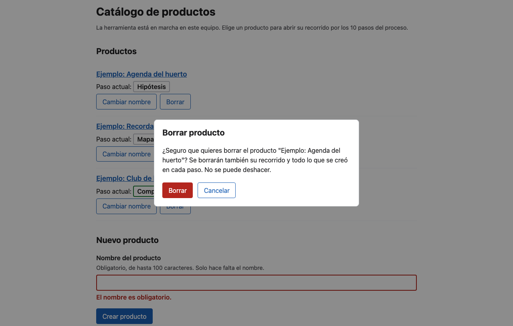
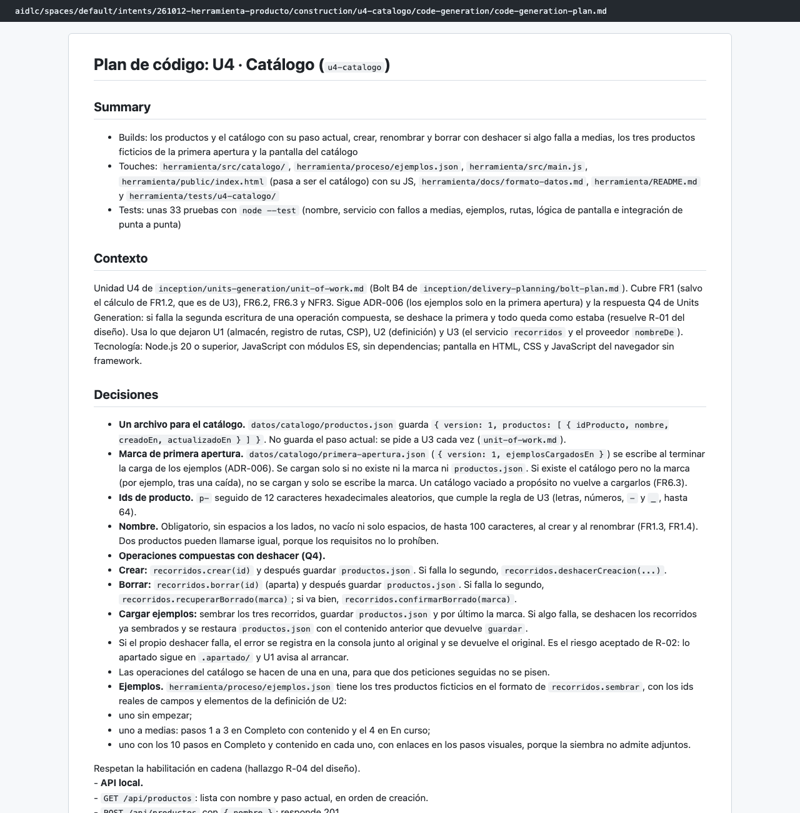
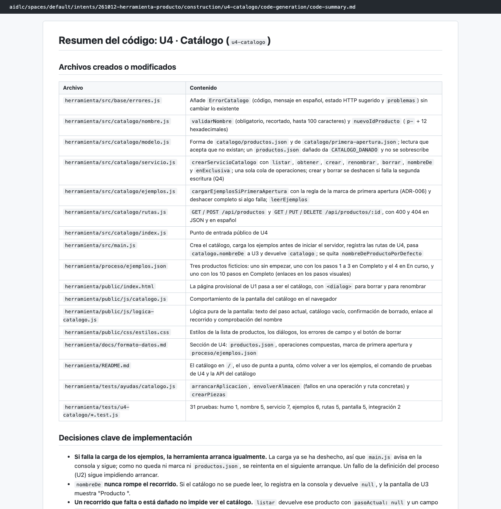
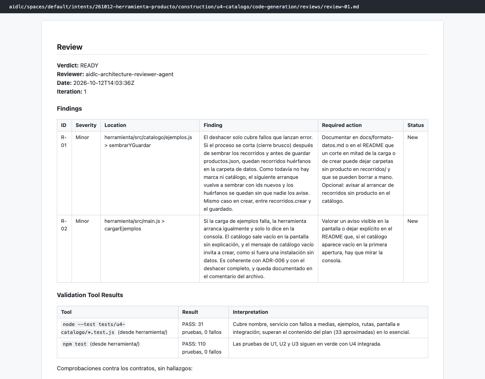

# Capítulo 07 · 3.5 Code Generation · U4 Catálogo

> **En una frase:** la última unidad completó la herramienta: el catálogo de productos, crear, renombrar y borrar con deshacer si algo falla a medias, y los tres productos de ejemplo de la primera apertura. A mitad de su construcción se agotó el uso del plan Pro, y se terminó casi 7 horas después.

[← U3](03-u3-recorrido.md) · [Visión general](00-vision-general.md) · [Siguiente: cierre de la etapa →](05-cierre-de-la-etapa.md)

## 1 · Ubicación

Construcción · 3.5 Code Generation · unidad U4 `u4-catalogo` (bolt B4), tipo `ui` y tamaño M.

## 2 · Input

- U4 en `unit-of-work.md`, la decisión ADR-006 (ejemplos solo en la primera apertura) y la respuesta Q4 de 2.7 (deshacer la primera escritura si falla la segunda).
- Requisitos: FR1 (salvo el cálculo de FR1.2), FR6.2, FR6.3 y NFR3.
- U1, U2 y U3, ya construidas: almacén, definición, servicio `recorridos` y el proveedor `nombreDe`.

## 3 · Proceso

1. **06:40–06:43:** plan de 14 pasos y 51 casillas. Aprobado.
2. **06:43:** el `developer` empezó a construir.
3. **06:46: límite de uso.** El chat respondió "You've hit your session limit · resets 5:10am (America/Panama)". La sesión se cortó con U4 a medias.
4. **13:39:** nueva sesión. `/aidlc --resume` retomó exactamente en U4, con el plan ya aprobado: no hizo falta aprobarlo otra vez.
5. **13:42–14:01:** el `developer` construyó la unidad **desde el principio**. El primer intento no había dejado ningún paso terminado.
6. **14:02–14:04:** resumen, lista de archivos, trazabilidad y revisión READY.
7. **14:04:** comprobación con salida 0 y unidad aprobada automáticamente.
8. A continuación, la etapa no se pudo cerrar (ver [cierre](05-cierre-de-la-etapa.md)). Eso provocó una **segunda revisión** de U4 a las 14:16, también READY.

## 4 · Interacción

| Pregunta | Respuesta |
|---|---|
| ¿Apruebas el plan de código de u4-catalogo? | Approve Plan |

El resto de las preguntas de esta unidad tienen que ver con el cierre de la etapa.

## 5 · Agentes

| Papel | Agente | Modelo | Resultado |
|---|---|---|---|
| Construye | `developer` (subagente, 2 lanzamientos) | Opus | 31 pruebas nuevas, 110 en total |
| Revisa | `architecture-reviewer` (subagente, 2 revisiones) | Sonnet | READY las dos veces: 2 menores, y 3 en la segunda |

Las observaciones menores:
- **R-01:** si el proceso se corta de golpe entre crear o sembrar un recorrido y guardar el catálogo, quedan carpetas huérfanas sin aviso. Es la consecuencia de haber elegido deshacer en vez de limpieza al arrancar (Q4 de [2.7](../10-2.7-units-generation.md)).
- **R-02:** si falla la carga de ejemplos, el catálogo sale vacío y el motivo solo aparece en la consola.
- **R-03** (segunda revisión): un `productos.json` sin marca de primera apertura impide cargar los ejemplos sin avisar.

El `developer` también señaló sus propios desvíos y dudas: un sexto archivo no previsto (`modelo.js`), la regla de ids copiada de U3 y la comprobación del nombre repetida en servidor y pantalla.

## 6 · Controles

| Control | Qué pasó |
|---|---|
| Sensor `traceability` | Aviso: solo lista los 10 requisitos de U4 |
| Revisor | READY |
| Comprobación | Salida 0, con 110 pruebas |
| Revisión de recuperación | Una segunda revisión, provocada por el bloqueo del cierre |

## 7 · Output

23 archivos:
- `src/catalogo/`: nombre, modelo, servicio, ejemplos y rutas.
- `proceso/ejemplos.json`: los tres productos de ejemplo.
  - "Agenda del huerto", sin empezar.
  - "Recordatorio de agua", con los pasos 1 a 3 completos y el 4 en curso.
  - "Club de lectura", completo.
- La pantalla del catálogo en `/`, con su lógica separada para poder probarla.
- Cambios en `src/main.js` y en `src/base/errores.js`, la documentación del formato de datos, el README y las pruebas.

**Decisiones de implementación:**
- Si falla la carga de ejemplos, la herramienta arranca igual y lo reintenta en el siguiente arranque.
- `nombreDe` nunca rompe la pantalla de recorrido: si no puede leer el catálogo, muestra "Producto <id>".
- Un recorrido dañado no impide ver el catálogo.
- En el diálogo de borrar, el foco empieza en "Cancelar".

Documentos: [plan](../../../aidlc/spaces/default/intents/261012-herramienta-producto/construction/u4-catalogo/code-generation/code-generation-plan.md) · [resumen](../../../aidlc/spaces/default/intents/261012-herramienta-producto/construction/u4-catalogo/code-generation/code-summary.md) · [revisión 1](../../../aidlc/spaces/default/intents/261012-herramienta-producto/construction/u4-catalogo/code-generation/reviews/review-01.md) · [revisión 2](../../../aidlc/spaces/default/intents/261012-herramienta-producto/construction/u4-catalogo/code-generation/reviews/review-02.md).

## 8 · Pruebas

31 pruebas: nombre 5, servicio 7, ejemplos 6, rutas 5, pantalla 5, integración 2 y humo 1.
- **Fallos a medias:** se provocan envolviendo el almacén real para que falle el guardado de un archivo concreto.
- **Integración:** una prueba lleva un producto por los 10 pasos hasta "Completo" (criterios E1, E3 y E4). Otra comprueba que, si se borra un ejemplo, no vuelve al reiniciar.

## 9 · Sorpresas y problemas

- **El límite de uso del plan Pro cortó la construcción.** Para retomarla no hubo que hacer nada especial: `/aidlc --resume` en la sesión nueva. El coste fue repetir el arranque de U4 (25 llamadas al modelo perdidas) y casi 7 horas de espera.
- **La primera apertura carga ejemplos también en las pruebas de U1 a U3**, porque cada arranque sobre una carpeta vacía es una primera apertura. No rompió ninguna prueba.
- **Las pantallas seguían sin abrirse en un navegador.** Se hizo después, al preparar este capítulo: el catálogo, el error de nombre vacío y el diálogo de borrado funcionan (ver capturas).

## 10 · Tiempo y costo

**31 minutos de trabajo** (6 del primer intento y 25 del segundo) y **117 llamadas al modelo**: 37 del conductor, 73 del `developer` y 7 del revisor. La segunda revisión cuenta en el [cierre](05-cierre-de-la-etapa.md).

## 11 · Lo que aprendimos

- Que el trabajo quede guardado en cada paso hace que un corte, incluso uno de 7 horas, no cueste más que repetir el último paso.
- Las decisiones de Concepción tienen consecuencias visibles: aquí se ve el resultado de haber elegido deshacer en vez de limpieza al arrancar.

## 12 · Capturas

*El catálogo con los tres ejemplos en distintos puntos del recorrido.*

*Crear un producto sin nombre muestra "El nombre es obligatorio."*

*Borrar abre un diálogo que nombra el producto y permite cancelar.*

*El plan de código de U4.*

*El resumen del código de U4.*

*La primera revisión de U4.*

---

**Fuentes:** `construction/u4-catalogo/code-generation/`; auditoría (06:40–06:46 y 13:39–14:17 UTC); conversaciones de las sesiones del 12/10/2026; capturas tomadas con la herramienta en marcha.
