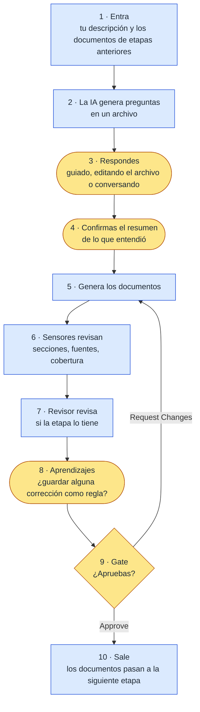
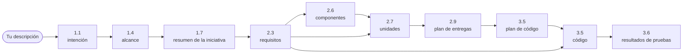

# Capítulo 07 · Flujo conceptual (lo esperado)

> **En una frase:** todas las etapas siguen el mismo ciclo: **entra** algo, la IA **pregunta**, **confirma** lo que entendió, **genera** documentos que se **revisan**, y **tú apruebas** antes de que la salida pase a la siguiente etapa.

> ⚠️ Como el capítulo 06, este capítulo es **una predicción** basada en la documentación instalada. El capítulo 08 muestra cómo fue en la realidad.

> Este capítulo cubre las 12 etapas del piloto. Las 33, incluidas las que el piloto no usa, están en el [capítulo 02, Etapas](../02-etapas/00-indice.md).

## 1 · El ciclo de una etapa

Es igual en todas las etapas que tienen aprobación. Lo que cambia es qué entra, qué se pregunta y qué sale.



En amarillo, los momentos en los que participas tú. En azul, lo que hace AI-DLC.

Texto: entra → genera preguntas → respondes → confirmas el resumen → genera documentos → sensores → revisor → aprendizajes → gate. Si apruebas, la salida pasa a la siguiente etapa. Si pides cambios, vuelve a generar.

## 2 · Cómo se interactúa

### Las preguntas

Cada etapa escribe sus preguntas en un archivo (`<etapa>-questions.md`). **Ese archivo es la fuente de verdad:** tus respuestas siempre quedan escritas ahí. Ejemplo del formato:

```markdown
## Pregunta 1
¿Quiénes usarán la aplicación? (select all that apply)
A. Empleados
B. Jefes de equipo
C. Recursos humanos
X. Other (please specify)

[Answer]: A, B
```

Toda pregunta termina con `X. Other`, para responder con tus palabras. Antes de empezar, AI-DLC pregunta **cómo quieres responder**:

| Opción | Cómo funciona |
|---|---|
| **Guide me** | Te muestra las preguntas en el chat, por tandas, y eliges opciones |
| **I'll edit the file** | Abres el archivo y escribes las respuestas en cada `[Answer]:` |
| **Chat** | Conversas libremente y la IA saca las decisiones de la conversación |

### La confirmación del resumen

Antes de escribir, AI-DLC te muestra **en viñetas lo que entendió** de tus respuestas. Confirmas o corriges. En el piloto está encendida.

### El gate

| Fase | Opciones |
|---|---|
| Ideación y Concepción | **Approve** · **Request Changes** · a veces **Add [etapa]**, para incluir una etapa que se había saltado |
| Construcción y Operación | Solo **Approve** · **Request Changes** |

- La IA **se detiene y espera** tu respuesta; no puede seguir sola.
- **Tus palabras se guardan tal cual** en la auditoría.
- Cómo interpreta tu respuesta:
  - **Apruebas** ("Approve", "1", "se ve bien"): avanza.
  - **Apruebas y pides algo** ("está bien, pero cambia X"): registra la aprobación, hace el cambio y te dice en una línea qué cambió, sin volver a preguntar.
  - **Pides cambios**: vuelve a generar con tus palabras como indicaciones.
  - **Haces una pregunta**: la responde y espera tu decisión.

## 3 · La profundidad

Cuánto pregunta y cuánto escribe cada etapa depende del **nivel de detalle** (*depth*):

| Nivel | Preguntas por etapa | Documentos |
|---|---|---|
| **Minimal** | 2 a 4 | Lo mínimo, análisis breve |
| **Standard** | 5 a 8 | Completos, con detalle moderado |
| **Comprehensive** | 8 a 12 o más | Exhaustivos, con análisis profundo |

En el piloto, el nivel lo propone el `composer` en su plan y lo aprobamos en su gate. Se puede cambiar en cualquier momento con `/aidlc --depth <nivel>`. Lo mismo ocurre con el volumen de pruebas (`/aidlc --test-strategy <nivel>`).

## 4 · Fase a fase

| Fase | Entra | Sale | Pregunta que responde |
|---|---|---|---|
| **Inicialización** | Tu petición inicial | La carpeta del trabajo y su ficha (`aidlc-state.md`) | ¿Dónde guardamos el trabajo? |
| **Ideación** | Tu descripción | Intención, alcance y resumen de la iniciativa | ¿Qué queremos y por qué? |
| **Concepción** | Lo aprobado en Ideación | Requisitos, componentes, unidades y plan de entregas | ¿Qué exactamente, en qué partes y en qué orden? |
| **Construcción** | Lo aprobado en Concepción | El código, sus pruebas y los resultados | ¿Funciona? |

## 5 · Etapa a etapa: entra, se hace, sale

| Etapa | Entra | Qué hace | Sale | Interacción contigo |
|---|---|---|---|---|
| **0.1** Workspace Scaffold | Nada | Crea la carpeta del trabajo | `aidlc/spaces/default/intents/AAMMDD-nombre/` | Ninguna, automática |
| **0.2** Workspace Detection | Los archivos del repositorio | Decide si el proyecto es nuevo o existente y detecta tecnologías | La clasificación: nuevo | Ninguna |
| **0.3** State Initialization | La clasificación y el scope | Crea la ficha del trabajo | `aidlc-state.md` | Ninguna |
| **1.1** Intent Capture | Tu descripción, guardada palabra por palabra | Aclara qué se quiere, para quién y por qué | `intent-statement.md` · `stakeholder-map.md` | Preguntas · resumen · revisión de product-lead · gate |
| **1.4** Scope Definition | La intención | Decide qué entra y qué queda fuera | `scope-document.md` · `intent-backlog.md` | Preguntas · resumen · gate |
| **1.7** Approval & Handoff | Todo lo de Ideación | Resume la iniciativa y sus decisiones para pasar a Concepción | `initiative-brief.md` · `decision-log.md` | Preguntas · resumen · gate de cierre de Ideación |
| **2.3** Requirements Analysis | Intención y alcance | Convierte lo acordado en requisitos que se puedan probar | `requirements.md` | Preguntas · resumen · revisión de product-lead · gate |
| **2.6** Domain Design | Los requisitos | Define los componentes del sistema y las decisiones de arquitectura | `components.md` (con diagrama) · `decisions.md` | Preguntas · resumen · revisión de architecture-reviewer · gate |
| **2.7** Units Generation | Componentes y requisitos | Divide el sistema en unidades construibles y sus dependencias | `unit-of-work.md` · dependencias · mapa con las historias | Preguntas · resumen · revisión de architecture-reviewer · gate |
| **2.9** Delivery Planning | Todo lo de Concepción | Ordena la construcción en *bolts* y señala riesgos | `bolt-plan.md` · riesgos y orden · dependencias externas | Preguntas · resumen · gate de cierre de Concepción |
| **3.5** Code Generation | Todo el diseño de la unidad | Primero escribe el plan de código y, tras tu aprobación, el código | El código en la raíz del repositorio · `code-generation-plan.md` · `code-summary.md` · `unit-test-instructions.md` | **Gate del plan ("Approve Plan")** · revisión de architecture-reviewer · gate |
| **3.6** Build and Test | Todo el código generado | Construye, ejecuta las pruebas y deja los resultados | Instrucciones de construcción y pruebas · `build-and-test-summary.md` · `test-results.md` | Gate final |

## 6 · Cómo viajan los documentos

Cada etapa usa lo que aprobaste en las anteriores. Por eso **un error que se aprueba al principio se arrastra**, y por eso cada gate importa.



Texto: tu descripción → intención → alcance → resumen de la iniciativa → requisitos → componentes → unidades → plan de entregas → plan de código → código → resultados de pruebas. Los requisitos alimentan también, directamente, a las unidades y al código.

## 7 · Cuántas veces intervienes

Una estimación para el primer recorrido, si no pedimos cambios:

| Momento | Veces |
|---|---:|
| Aprobar el plan de `compose` | 1 |
| Responder preguntas | 8 etapas aprox., de 1.1 a 3.5 |
| Confirmar un resumen | 7 (de 1.1 a 2.9) |
| Decidir si se guarda un aprendizaje | Solo cuando la IA detecte una corrección |
| Aprobar el plan de código | 1 (en 3.5) |
| Gates de etapa | 9 (de 1.1 a 3.6) |

Cada "Request Changes" añade una vuelta más en esa etapa. Al final del capítulo 08 comparamos estos números con los reales.

---

**Fuentes:** ciclo, preguntas, resumen y gates en `.claude/aidlc-common/protocols/stage-protocol.md` (secciones 1, 3 y 8); entradas y salidas de cada etapa en `.claude/tools/data/stage-graph.json`. Versión 2.11.0.
