# Capítulo 08 · Bitácora del piloto (lo real)

> **En una frase:** el 12 de octubre de 2026 recorrimos con AI-DLC las 12 etapas previstas y construimos una **herramienta local de seguimiento de productos**: 4 unidades, 110 pruebas en verde y 9 revisiones superadas. Fueron unas 4 h 26 min de trabajo y 82 mensajes nuestros.

> Este capítulo cuenta **lo que pasó de verdad**. Los capítulos [05](../06-mapa-del-piloto/00-mapa-del-piloto.md) y [06](../07-flujo-conceptual/00-flujo-conceptual.md) contaban lo que esperábamos, y la última página compara las dos cosas.

## 1 · Qué construimos

Una herramienta web que se ejecuta en el propio equipo para seguir productos por los 10 pasos de la etapa 3 · Producto del proceso de producto:
- un **catálogo** con el paso en que va cada producto;
- el **recorrido** de cada producto, con el estado de cada paso y lo que se creó en él;
- los **registros** de acuerdos, y de gaps y supuestos.

Todo se introduce a mano, se guarda en archivos legibles y arranca con tres productos de ejemplo.

*El catálogo de la herramienta, con los tres productos de ejemplo.*

## 2 · El recorrido real

```mermaid
flowchart LR
    C(["compose<br/>plan de 12 etapas"]) --> I["0.1–0.3<br/>Inicialización"]
    I --> A["1.1 Intent Capture"] --> B["1.4 Scope Definition"] --> H["1.7 Approval & Handoff"]
    H --> R["2.3 Requirements"] --> D["2.6 Domain Design"] --> U["2.7 Units Generation"] --> P["2.9 Delivery Planning"]
    P --> G["3.5 Code Generation<br/>U1 → U2 → U3 → U4"] --> T["3.6 Build and Test"] --> F(["Fin<br/>110 pruebas en verde"])

    classDef idea fill:#fef3c7,stroke:#b45309,color:#1f2937
    classDef incep fill:#dbeafe,stroke:#1d4ed8,color:#1f2937
    classDef cons fill:#dcfce7,stroke:#15803d,color:#1f2937
    class A,B,H idea
    class R,D,U,P incep
    class G,T cons
```

Texto: compose → Inicialización (0.1–0.3) → **Ideación**: 1.1, 1.4 y 1.7 → **Concepción**: 2.3, 2.6, 2.7 y 2.9 → **Construcción**: 3.5, por unidades U1 a U4, y 3.6 → fin. La fase de Operación no se ejecutó.

## 3 · Las etapas, una por página

| # | Etapa | Lidera | Revisa | Resultado | Tiempo |
|---|---|---|---|---|---:|
| — | [Arranque: el plan a medida](01-arranque-plan-a-medida.md) | `composer` | — | Plan de 12 etapas, guardado como `piloto-flujo-basico` | 4 min |
| 0.1 | [Workspace Scaffold](02-0.1-workspace-scaffold.md) | conductor | — | Carpeta del trabajo | < 1 s |
| 0.2 | [Workspace Detection](03-0.2-workspace-detection.md) | conductor | — | Proyecto nuevo (Greenfield) | < 1 s |
| 0.3 | [State Initialization](04-0.3-state-init.md) | conductor | — | `aidlc-state.md` | < 1 s |
| 1.1 | [Intent Capture](05-1.1-intent-capture.md) | `product` | `product-lead` | Intención con 5 criterios de éxito | 19 min |
| 1.4 | [Scope Definition](06-1.4-scope-definition.md) | `product` | — | Alcance y backlog; el proceso queda fijo | 25 min |
| 1.7 | [Approval & Handoff](07-1.7-approval-handoff.md) | `delivery` | — | Brief: "todo se introduce a mano" | 15 min |
| 2.3 | [Requirements Analysis](08-2.3-requirements-analysis.md) | `product` | `product-lead` | 35 requisitos funcionales y 5 no funcionales | 19 min |
| 2.6 | [Domain Design](09-2.6-domain-design.md) | `architect` | `architecture-reviewer` | 3 componentes y 7 decisiones de arquitectura | 14 min |
| 2.7 | [Units Generation](10-2.7-units-generation.md) | `architect` | `architecture-reviewer` | 4 unidades de trabajo | 13 min |
| 2.9 | [Delivery Planning](11-2.9-delivery-planning.md) | `delivery` | — | 4 bolts, uno por unidad | 11 min |
| 3.5 | [Code Generation](12-3.5-code-generation/00-vision-general.md) | `developer` | `architecture-reviewer` | La herramienta, con 110 pruebas | 2 h 23 min |
| 3.6 | [Build and Test](13-3.6-build-and-test.md) | `quality` | — | 110 de 110 y 96,6 % de cobertura | 3 min |
| — | [Esperado contra real](14-esperado-vs-real.md) | | | La comparación con los capítulos 06 y 07 | |

Code Generation tiene su propia subcarpeta: [visión general](12-3.5-code-generation/00-vision-general.md), una página por unidad ([U1](12-3.5-code-generation/01-u1-base.md), [U2](12-3.5-code-generation/02-u2-definicion-proceso.md), [U3](12-3.5-code-generation/03-u3-recorrido.md) y [U4](12-3.5-code-generation/04-u4-catalogo.md)) y el [cierre de la etapa](12-3.5-code-generation/05-cierre-de-la-etapa.md).

## 4 · Los números

| | |
|---|---|
| Etapas ejecutadas | 12 de 33 (3 de Inicialización, 3 de Ideación, 4 de Concepción y 2 de Construcción) |
| Preguntas respondidas | 48, en 7 etapas |
| Gates | 9: 7 aprobados por nosotros y 2 automáticos. Ninguno con cambios pedidos |
| Revisiones | 9, todas READY: 7 hallazgos importantes y 27 menores |
| Reglas aprendidas | 4, guardadas en `aidlc/spaces/default/memory/project.md` |
| Unidades y pruebas | 4 unidades, 70 archivos en `herramienta/` y 110 pruebas en verde |
| Tiempo | 11 h 18 min en total, de los que 6 h 53 min fueron una pausa por el límite de uso |
| Uso del modelo | Unas 697 llamadas: Opus para el conductor, el `composer` y el `developer`, y Sonnet para los revisores |
| Sesiones de Claude Code | 3, con 2 pausas retomadas con `/aidlc --resume` |

## 5 · Los momentos clave

1. **03:24 · El plan:** el `composer` propuso las mismas 12 etapas que predijimos.
2. **03:52 · Primer cambio de alcance** (1.4): el proceso queda fijo en esta versión.
3. **04:18 · Segundo cambio de alcance** (1.7): todo se introduce a mano y salen dos criterios de éxito.
4. **05:02 · Una decisión con consecuencias** (2.7): deshacer en lugar de limpieza al arrancar.
5. **05:22 · Arranque de Construcción bloqueado** por un control y resuelto ejecutando un comando a mano.
6. **06:46 · Límite de uso** a mitad de U4. Se retoma a las 13:39.
7. **14:04 · El cierre de 3.5, bloqueado** por un archivo de Obsidian. Se resuelve con la Guard Policy `relaxed`.
8. **14:42 · Fin del recorrido**, con 110 pruebas en verde.

## 6 · Cómo leer este capítulo

- **Si tienes 5 minutos:** esta página y [Esperado contra real](14-esperado-vs-real.md).
- **Si quieres ver cómo es una etapa con preguntas:** [1.1 Intent Capture](05-1.1-intent-capture.md).
- **Si quieres ver la construcción:** [3.5 Code Generation](12-3.5-code-generation/00-vision-general.md).
- **Si quieres ver lo que salió mal:** el [cierre de 3.5](12-3.5-code-generation/05-cierre-de-la-etapa.md).

Cada página de etapa sigue la plantilla de la guía (§8): ubicación, input, proceso, interacción, agentes, controles, output, pruebas, sorpresas, tiempo y costo, aprendizajes y capturas.

Las capturas de documentos son los archivos reales del recorrido tal como se ven al abrirlos. Las de la herramienta se tomaron con ella en marcha y con sus datos de ejemplo.

---

**Fuentes:** `aidlc/spaces/default/intents/261012-herramienta-producto/` (estado, auditoría, diarios y artefactos); conversaciones de Claude Code del 12/10/2026; `herramienta/`. AI-DLC 2.11.0.
