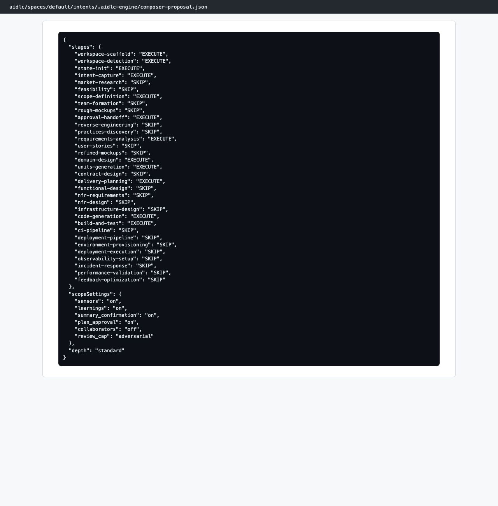
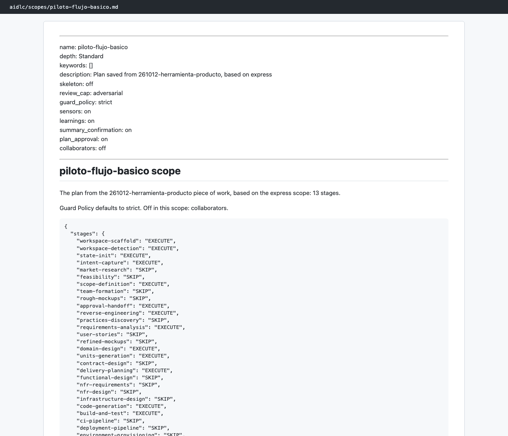

# Capítulo 08 · Arranque: el plan a medida (`/aidlc compose`)

> **En una frase:** antes de la primera etapa, el agente `composer` leyó la descripción del piloto, puntuó cuánto faltaba por definir y propuso un plan de **12 etapas**: las mismas que predijo el capítulo 06. Lo aprobamos y lo guardamos como plan reutilizable.

[← Resumen](00-resumen.md) · [Siguiente: 0.1 Workspace Scaffold →](02-0.1-workspace-scaffold.md)

`compose` no es una etapa: decide **qué etapas** se recorren. Por eso esta página no sigue la plantilla de 12 puntos al completo.

## 1 · Qué entró

- **La petición:** el bloque de la sección 1 de `docs/piloto-recorrido-1.md`, pegado entero en el chat. Incluía qué construir, las restricciones y la configuración que queríamos ver (Guard Policy `strict` y confirmación de resumen encendida).
- **El primer intento falló:** al lanzar `/aidlc compose` solo llegó la primera línea ("Piloto de aprendizaje de AI-DLC"). El conductor no inventó el resto: pidió el texto completo. A la segunda llegó entero.

## 2 · Qué hizo AI-DLC

1. El conductor lanzó al agente `composer` como subagente (con Opus, 2 minutos y 22 herramientas usadas).
2. El `composer` puntuó la descripción en cinco ejes. La puntuación total le sirve para decidir cuántas etapas de descubrimiento hacen falta.

   | Eje | Nota | Nivel |
   |---|---|---|
   | Ambigüedad de la intención | 0,45 | Media |
   | Incertidumbre del código | 0,35 | Media |
   | Falta de verificación | 0,70 | Alta |
   | Riesgo | 0,10 | Baja |
   | Supuestos sin resolver | 0,50 | Media |
   | **Total** | **44 / 100** | Estándar |

3. Partió del scope `express` y le aplicó cambios:
   - **Quitó** `reverse-engineering`, `deployment-pipeline`, `deployment-execution` y `observability-setup`.
   - **Añadió** `intent-capture`, `scope-definition`, `approval-handoff`, `domain-design`, `units-generation` y `delivery-planning`.
4. Justificó cada una de las 33 decisiones. Algunos ejemplos:
   - `2.6 Domain Design` **entra** porque es la única etapa que produce `components`, que necesitan 2.7 y 2.9.
   - `2.4 User Stories` **no entra** porque hay una sola persona usuaria.
   - `3.1 Functional Design` es la primera candidata a reactivar si el modelo de datos se queda corto.
5. Validó la propuesta: 33 etapas, 12 que se ejecutan, 21 que no, y 9 gates visibles.

## 3 · Interacción

| Pregunta | Respuesta |
|---|---|
| ¿Cómo seguimos con este plan? (Approve · Approve and save as scope · Edit the plan · Reject) | **Approve and save as scope** |
| ¿Con qué nombre guardo este plan? | **piloto-flujo-basico** |

## 4 · Configuración que quedó

| Ajuste | Valor | Por qué |
|---|---|---|
| Guard Policy | `strict` | La pedimos para ver todos los controles |
| Confirmación de resumen | Encendida | La pedimos |
| Revisiones | `adversarial` como máximo | El `composer` la subió porque no había pruebas ni CI |
| Sensores, aprendizajes y aprobación del plan de código | Encendidos | Ajustes por defecto del plan a medida |
| Agentes de apoyo (`collaborators`) | Apagados | Cada etapa la lleva un solo agente |
| Profundidad | Standard | Según la puntuación de 44 |

## 5 · Lo que salió

- El trabajo (intent) `261012-herramienta-producto`, creado a las 03:28:02.
- El plan guardado en [aidlc/scopes/piloto-flujo-basico.md](../../aidlc/scopes/piloto-flujo-basico.md), con su copia en `.claude/scopes/` y una entrada en `scope-grid.json`.
- La propuesta completa del `composer` en `aidlc/spaces/default/intents/.aidlc-engine/composer-proposal.json`. Es un archivo interno: no se versiona en git.

## 6 · Sorpresas

- **El plan guardado no es idéntico al aprobado.** El aprobado tenía 12 etapas. El guardado tiene 13, porque conserva `reverse-engineering` del scope base `express`. En este recorrido no importó, porque el proyecto era nuevo y esa etapa se salta igualmente. Si se reutiliza el plan sobre código existente, sí se ejecutaría.
- **La revisión no fue "consultiva".** El capítulo 06 esperaba revisiones consultivas en todas las etapas. El `composer` subió el máximo a `adversarial`. En la práctica, las etapas de Ideación y Concepción hicieron una sola pasada de revisión, y Code Generation sí funcionó en modo adversarial.
- **No partió de `classic`.** El capítulo 06 decía que un plan a medida parte de `classic`. Este partió de `express`.

## 7 · Tiempo y costo

- **4 minutos** desde la petición completa hasta el plan aprobado (03:24 → 03:28). El `composer` tardó 2 de ellos.
- **41 llamadas al modelo**: 29 del conductor y 12 del `composer`, todas con Opus. Antes hubo 15 minutos de conversación para entender qué es `compose` y en qué orden va respecto a las fases.

## 8 · Lo que aprendimos

- `compose` va **antes** de las fases: primero se elige la ruta y después se recorre.
- La descripción es lo único que AI-DLC sabe del trabajo. Si llega cortada, el plan sale genérico; aquí el conductor se negó a rellenarla por su cuenta.
- La puntuación del `composer` es orientativa, pero su tabla de 33 decisiones razonadas es el mejor resumen de por qué cada etapa entra o no.

## 9 · Capturas

*La propuesta del `composer`, tal como quedó en `composer-proposal.json`.*

*El plan guardado como `piloto-flujo-basico`, con la configuración en la cabecera.*

---

**Fuentes:** conversación del 12/10/2026 (03:00–03:28 UTC); `composer-proposal.json`; `aidlc/scopes/piloto-flujo-basico.md`; eventos `WORKFLOW_STARTED` y `SCOPE_SAVED` de la auditoría.
