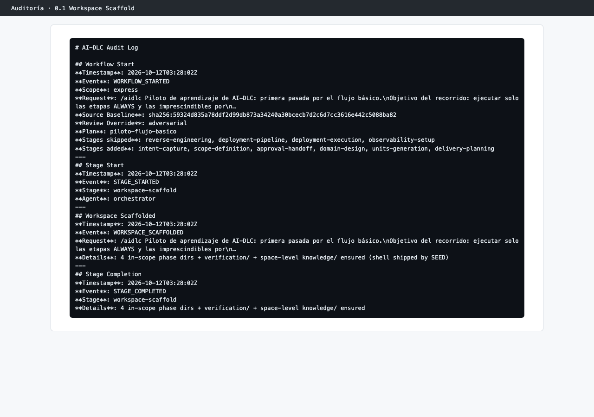

# Capítulo 08 · 0.1 Workspace Scaffold

> **En una frase:** AI-DLC creó la carpeta del trabajo y sus subcarpetas por fase en el mismo segundo en que aprobamos el plan, sin preguntar nada y sin gate.

[← Arranque](01-arranque-plan-a-medida.md) · [Resumen](00-resumen.md) · [Siguiente: 0.2 Workspace Detection →](03-0.2-workspace-detection.md)

## 1 · Ubicación

Inicialización · 0.1 Workspace Scaffold · ALWAYS.

## 2 · Input

La petición de `compose` y el plan aprobado. No consume documentos de otras etapas.

## 3 · Proceso

1. Se registró el inicio del trabajo (`WORKFLOW_STARTED`), con la petición completa, el plan y las etapas añadidas y quitadas.
2. Se marcó Operación como saltada (`PHASE_SKIPPED`: "this plan excludes operation").
3. Se crearon la carpeta del trabajo, una carpeta por cada fase del plan, `verification/` y la carpeta de conocimiento del espacio (`WORKSPACE_SCAFFOLDED`).

## 4 · Interacción

Ninguna. Es una etapa automática.

## 5 · Agentes

El conductor (en la auditoría, `orchestrator`). No intervino ningún agente experto.

## 6 · Controles

Ninguno propio: sin sensores, sin revisor y sin gate. Cada paso queda registrado en la auditoría.

## 7 · Output

- La carpeta del trabajo: `aidlc/spaces/default/intents/261012-herramienta-producto/`, con `initialization/`, `ideation/`, `inception/`, `construction/` y `verification/`.
- El cursor `aidlc/spaces/default/intents/active-intent`, que apunta al trabajo activo. Es local de cada persona y no se versiona.

## 8 · Pruebas

No aplica.

## 9 · Sorpresas y problemas

- Las tres etapas de Inicialización tienen la misma marca de tiempo (03:28:02). Para quien mira el chat son invisibles: lo primero que se ve después de aprobar el plan son ya las preguntas de 1.1.
- La carpeta `initialization/` se crea pero queda vacía: estas etapas no producen documentos.

## 10 · Tiempo y costo

Menos de un segundo. No llama al modelo: lo hace la herramienta `aidlc`.

## 11 · Lo que aprendimos

Inicialización es contabilidad, no trabajo de la IA. Merece la pena saber que existe porque explica de dónde salen la carpeta del trabajo y su auditoría, pero no hay nada que revisar.

## 12 · Capturas

*Los eventos de la auditoría al crear la carpeta del trabajo.*

---

**Fuentes:** auditoría del trabajo (`WORKFLOW_STARTED`, `PHASE_SKIPPED`, `WORKSPACE_SCAFFOLDED`); `.claude/aidlc-common/stages/initialization/workspace-scaffold.md`.
