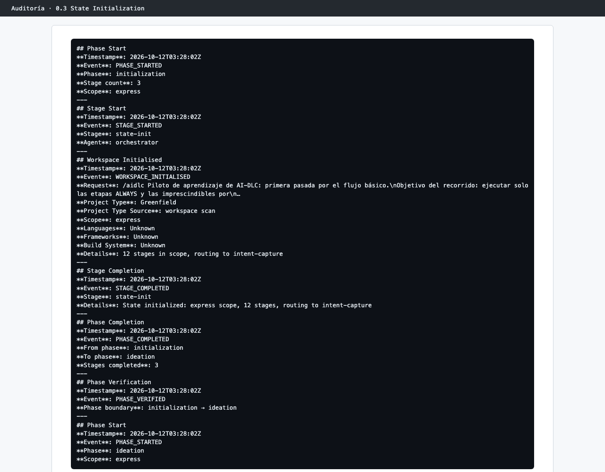
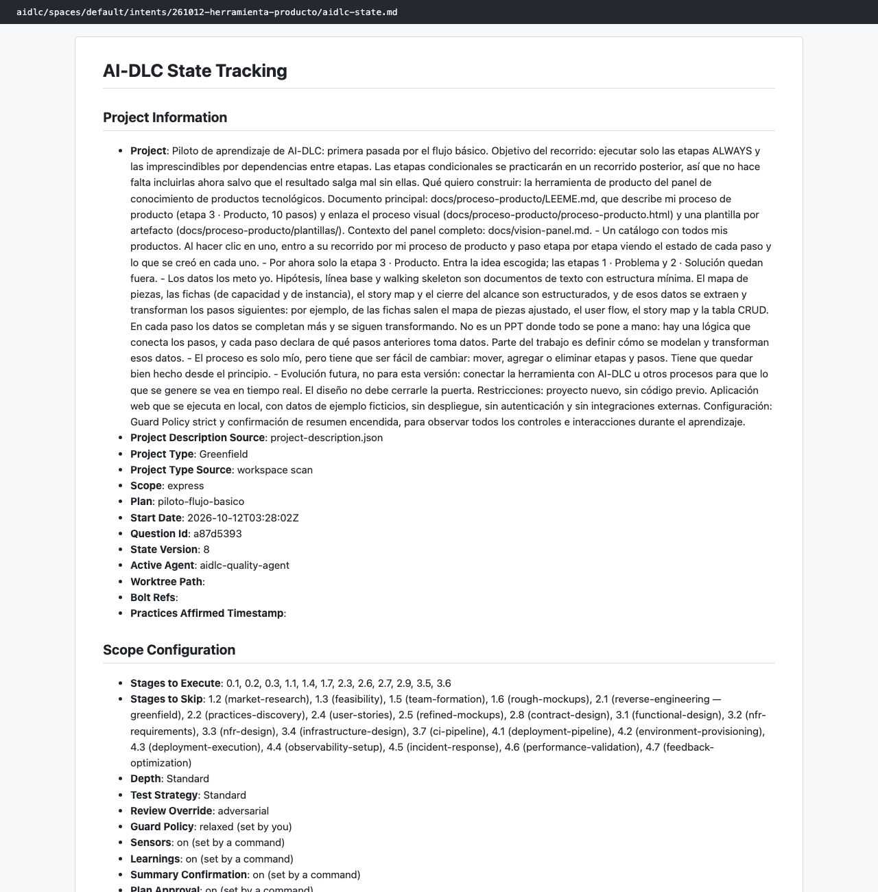

# Capítulo 08 · 0.3 State Initialization

> **En una frase:** AI-DLC escribió la ficha del trabajo, `aidlc-state.md`, con las 12 etapas del plan, la configuración y el punto de partida, y dejó todo listo para la primera etapa de Ideación.

[← 0.2 Workspace Detection](03-0.2-workspace-detection.md) · [Resumen](00-resumen.md) · [Siguiente: 1.1 Intent Capture →](05-1.1-intent-capture.md)

## 1 · Ubicación

Inicialización · 0.3 State Initialization · ALWAYS.

## 2 · Input

El plan aprobado y el resultado del escaneo de 0.2.

## 3 · Proceso

1. Escribió `aidlc-state.md` (`WORKSPACE_INITIALISED`: "12 stages in scope, routing to intent-capture").
2. Cerró la fase de Inicialización y la verificó (`PHASE_COMPLETED` y `PHASE_VERIFIED`, "initialization → ideation").
3. Abrió Ideación y arrancó 1.1 con el agente `product`.

## 4 · Interacción

Ninguna.

## 5 · Agentes

El conductor.

## 6 · Controles

Ninguno propio. A partir de aquí, el hook `sync-workflow-state` mantiene la ficha al día en cada cambio de etapa.

## 7 · Output

[aidlc-state.md](../../aidlc/spaces/default/intents/261012-herramienta-producto/aidlc-state.md), con estas secciones:

| Sección | Qué guarda |
|---|---|
| Project Information | La petición, el tipo de proyecto, el scope `express`, el plan `piloto-flujo-basico` y la fecha de inicio |
| Scope Configuration | Las 12 etapas que se ejecutan, las 21 que se saltan y por qué, la profundidad, la Guard Policy y los interruptores |
| Phase Progress / Stage Progress | El avance por fase y por etapa, con casillas |
| Runtime State | Cómo se construye: puntos de control encendidos, una unidad tras otra (`unit-major`) y en serie |
| Current Status / Session Resume Point | Dónde está el trabajo y qué toca después, para retomarlo en otra sesión |

## 8 · Pruebas

No aplica.

## 9 · Sorpresas y problemas

- La ficha resultó ser la pieza clave para **retomar el trabajo** en otra sesión. El recorrido usó tres sesiones de Claude Code y se pausó dos veces. Cada vez, `/aidlc --resume` siguió exactamente donde se había quedado.
- La ficha cambió de valor más de una vez durante el recorrido. Por ejemplo, la Guard Policy terminó como `relaxed (set by you)` (ver [3.5 Code Generation](12-3.5-code-generation/05-cierre-de-la-etapa.md)).

## 10 · Tiempo y costo

Menos de un segundo, sin llamadas al modelo.

## 11 · Lo que aprendimos

`aidlc-state.md` es el primer archivo que hay que abrir para saber en qué punto está un trabajo. No se edita a mano: lo escribe AI-DLC.

## 12 · Capturas

*La inicialización del estado y el paso de Inicialización a Ideación.*

*La ficha del trabajo al terminar el recorrido.*

---

**Fuentes:** auditoría del trabajo (`WORKSPACE_INITIALISED`, `PHASE_VERIFIED`); `aidlc-state.md`; `.claude/aidlc-common/stages/initialization/state-init.md`.
