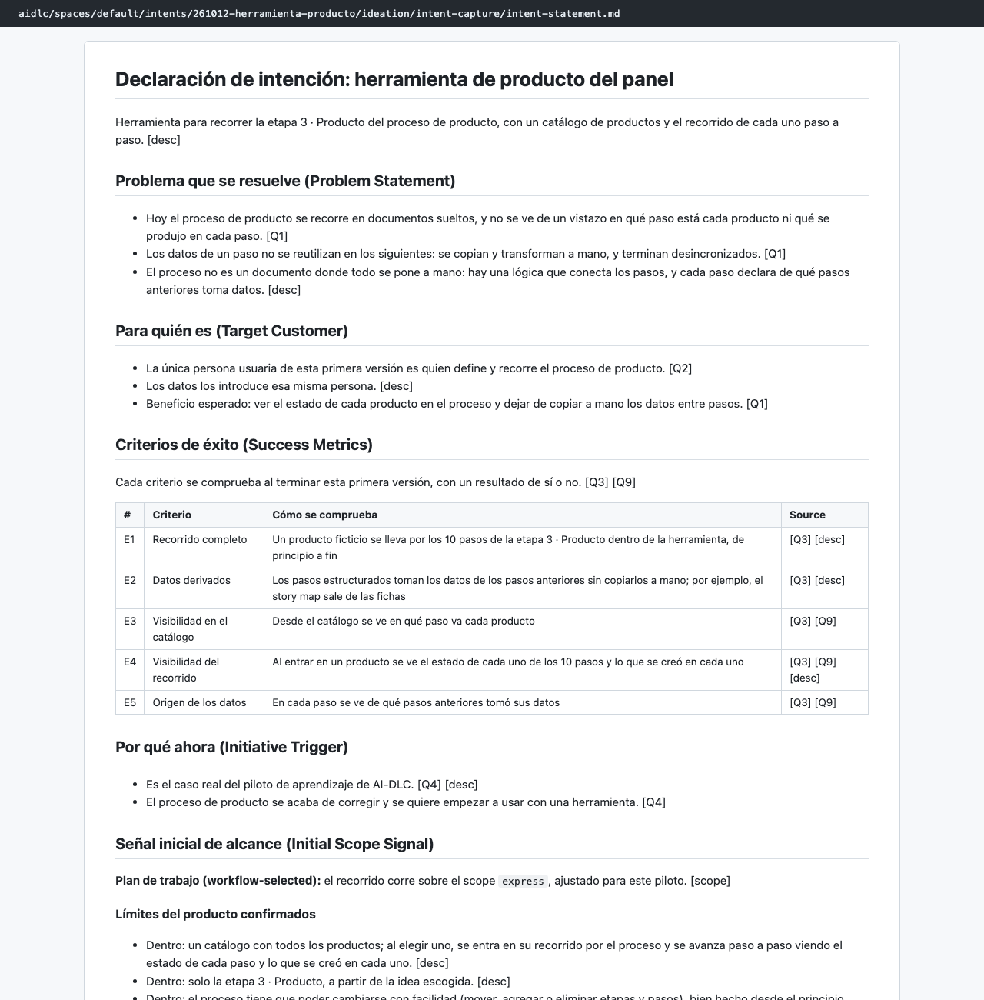
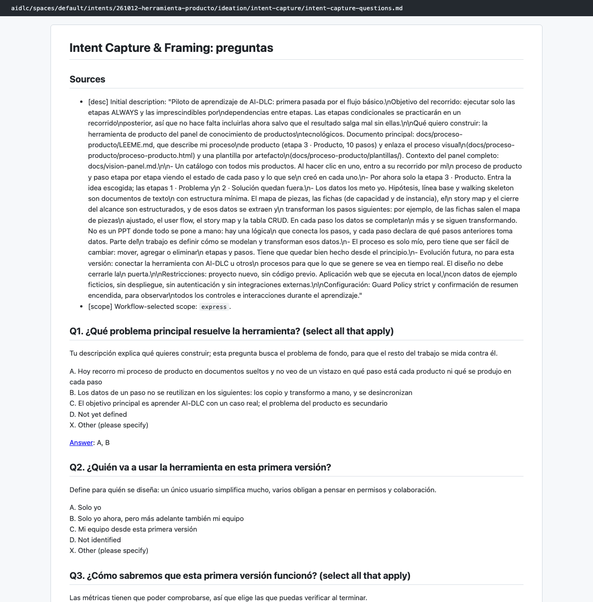
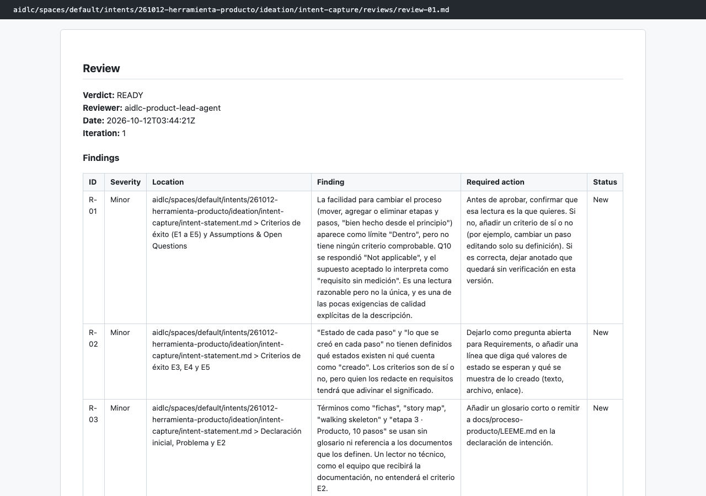

# Capítulo 08 · 1.1 Intent Capture

> **En una frase:** el agente `product` convirtió la descripción del piloto en una **declaración de intención** con 5 criterios de éxito y un **mapa de interesados**, a partir de 11 preguntas. El revisor la dio por buena con 4 observaciones menores.

[← 0.3 State Initialization](04-0.3-state-init.md) · [Resumen](00-resumen.md) · [Siguiente: 1.4 Scope Definition →](06-1.4-scope-definition.md)

## 1 · Ubicación

Ideación · 1.1 Intent Capture & Framing · ALWAYS. Primera etapa con preguntas y gate.

## 2 · Input

- La descripción completa del piloto (la petición de `compose`).
- `docs/proceso-producto/LEEME.md` y `docs/vision-panel.md`, que la descripción nombraba y el agente leyó.
- No hay documentos de etapas anteriores: Inicialización no produce ninguno.

## 3 · Proceso

1. El conductor cargó el perfil del agente `product` y 12 archivos de conocimiento (4 compartidos y 8 propios del agente), y después leyó las instrucciones de la etapa.
2. Preguntó **cómo queríamos responder**: guiado, editando el archivo o conversando. Elegimos **Guide me**, y esa elección se reutilizó en todas las etapas siguientes.
3. Escribió las preguntas en `intent-capture-questions.md` y las presentó en tandas de 3 o 4 con el selector de opciones.
4. Con las respuestas, presentó un **resumen consolidado** y pidió confirmarlo antes de escribir nada.
5. Escribió los dos documentos y pidió **confirmar el único supuesto** que había hecho.
6. Lanzó al **revisor** (`product-lead`) como subagente.
7. Ritual de **aprendizajes**: propuso 3 notas para recordar y guardamos 2.
8. Gate: aprobamos.

## 4 · Interacción

11 preguntas en 4 tandas, más el resumen, el supuesto, los aprendizajes y el gate.

| Pregunta | Nuestra respuesta |
|---|---|
| Q1 · ¿Qué problema principal resuelve? | A y B: no se ve en qué paso va cada producto, y los datos se copian a mano entre pasos |
| Q2 · ¿Quién la usa en esta versión? | Solo yo |
| Q3 · ¿Cómo sabremos que funcionó? | Recorrido completo y datos derivados, más "tener visibilidad del proceso del producto" (texto propio) |
| Q4 · ¿Por qué ahora? | Es el caso del piloto y el proceso se acaba de corregir |
| Q5 y Q6 · ¿Quién más interviene y quién decide? | Nadie más; decido yo |
| Q7 · (respuesta libre) | "Tengo que terminar el piloto para poder documentar todo…" |
| Q8 · ¿Qué queda fuera? | Varios usuarios, otras vistas del panel y edición visual |
| Q9 · ¿Qué tiene que verse? | Paso en el catálogo, estado de los 10 pasos y origen de los datos |
| Q10 · ¿Cambiar el proceso es criterio de éxito? | **Not applicable** |
| Q11 · (seguimiento) ¿El equipo es usuario o solo interesado en el piloto? | Interesado en el piloto |

- **Resumen consolidado:** Looks correct.
- **Supuesto:** "Que el proceso se pueda cambiar sigue siendo requisito, pero no criterio de éxito medible" (por Q10). Lo aceptamos (A. Accept assumptions).

## 5 · Agentes

| Papel | Agente | Modelo | Qué aportó |
|---|---|---|---|
| Lidera | `product` | Opus, en la conversación principal | Preguntas, resumen y documentos |
| Revisa | `product-lead` | Sonnet, como subagente | Veredicto READY con 4 observaciones menores |

Revisión (R-01 a R-04, todas menores):
- **R-01:** que el proceso sea fácil de cambiar no tiene ningún criterio comprobable.
- **R-02:** no se dice qué estados tiene un paso ni qué cuenta como "lo creado".
- **R-03:** términos como fichas o story map se usan sin glosario.
- **R-04:** el objetivo de documentar el piloto no tiene dueño entre producto y piloto.

Se aprobaron como estaban. R-02 y R-03 pasaron como preguntas abiertas a etapas posteriores.

## 6 · Controles

| Control | Qué pasó |
|---|---|
| Sensor `claim-sources` | **Falló en los 3 archivos**: un encabezado obligatorio se había traducido ("Señal inicial de alcance (Initial Scope Signal)") y el sensor espera el literal en inglés. Es un aviso: no bloqueó la aprobación |
| Sensor `required-sections` | Pasó en los 3 archivos |
| Sensor `upstream-coverage` | Pasó en los 3 archivos |
| Revisor | READY en la primera pasada |
| Aprendizajes | 3 candidatas; guardamos 2 en `project.md` |
| Gate | Approve, sin pedir cambios |

Las dos reglas que quedaron en `aidlc/spaces/default/memory/project.md`:
- Si la persona responde "Not applicable" a si un requisito es criterio de éxito, se interpreta como que no lo es en esa versión y se deja como supuesto.
- El equipo al que se explica el piloto figura como interesado en el piloto, no como usuario de la herramienta.

## 7 · Output

- [intent-statement.md](../../aidlc/spaces/default/intents/261012-herramienta-producto/ideation/intent-capture/intent-statement.md): problema, para quién, **5 criterios de éxito (E1 a E5)**, por qué ahora y límites del alcance. Cada afirmación lleva su fuente: `[desc]` si sale de la descripción y `[Q1]` y siguientes si sale de una respuesta.
- [stakeholder-map.md](../../aidlc/spaces/default/intents/261012-herramienta-producto/ideation/intent-capture/stakeholder-map.md): dos interesados (el dueño del proceso y su equipo), quién decide y qué comunicar.
- [intent-capture-questions.md](../../aidlc/spaces/default/intents/261012-herramienta-producto/ideation/intent-capture/intent-capture-questions.md): las preguntas con nuestras respuestas.
- [reviews/review-01.md](../../aidlc/spaces/default/intents/261012-herramienta-producto/ideation/intent-capture/reviews/review-01.md): la revisión.

Los criterios de éxito:

| # | Criterio |
|---|---|
| E1 | Un producto ficticio se lleva por los 10 pasos dentro de la herramienta |
| E2 | Los pasos estructurados toman datos de los anteriores sin copiarlos a mano |
| E3 | Desde el catálogo se ve en qué paso va cada producto |
| E4 | Al entrar en un producto se ve el estado de los 10 pasos y lo creado en cada uno |
| E5 | En cada paso se ve de qué pasos anteriores tomó sus datos |

E2 y E5 se retiraron después, en [1.7 Approval & Handoff](07-1.7-approval-handoff.md).

## 8 · Pruebas

No aplica. Lo que se comprueba aquí es la calidad del documento: sensores y revisor.

## 9 · Sorpresas y problemas

- **Un encabezado traducido rompió un sensor.** Los encabezados que vienen de las plantillas de etapa tienen que quedar en inglés literal, aunque el resto esté en español. El aviso no bloquea y el documento se aprobó así, pero la lección quedó anotada en el diario de 2.6.
- **El agente ajustó las preguntas.** Pasó Q1 y Q4 a selección múltiple para que cupieran en 4 opciones del selector. Lo dejó registrado en el diario de la etapa como desvío.
- **Resolvió una contradicción con una pregunta extra.** Q5 decía "nadie más" y Q7 hablaba de explicar AI-DLC al equipo. En lugar de elegir una lectura, añadió Q11.

## 10 · Tiempo y costo

- **19 minutos**, de 03:28 a 03:47.
- **55 llamadas al modelo**: 52 del conductor con Opus y 3 del revisor con Sonnet. La cifra incluye las tres etapas de Inicialización, que ocurrieron en el mismo segundo.
- **10 mensajes nuestros.**

## 11 · Lo que aprendimos

- Hacer explícito el origen de cada afirmación (`[desc]`, `[Q3]`) hace muy fácil revisar el documento.
- El supuesto y su confirmación son el mecanismo para no inventar: lo que el agente deduce queda marcado y lo confirmas tú.
- El ritual de aprendizajes convierte una interpretación concreta (cómo leer "Not applicable") en una regla que se aplica en adelante.

## 12 · Capturas

*La declaración de intención, con sus fuentes entre corchetes.*

*El archivo de preguntas, con nuestras respuestas tras `[Answer]:`.*

*La revisión del `product-lead`: READY con 4 observaciones menores.*

---

**Fuentes:** artefactos de `ideation/intent-capture/`; su `memory.md`; auditoría (12/10/2026, 03:28–03:47 UTC); `aidlc/spaces/default/memory/project.md`.
