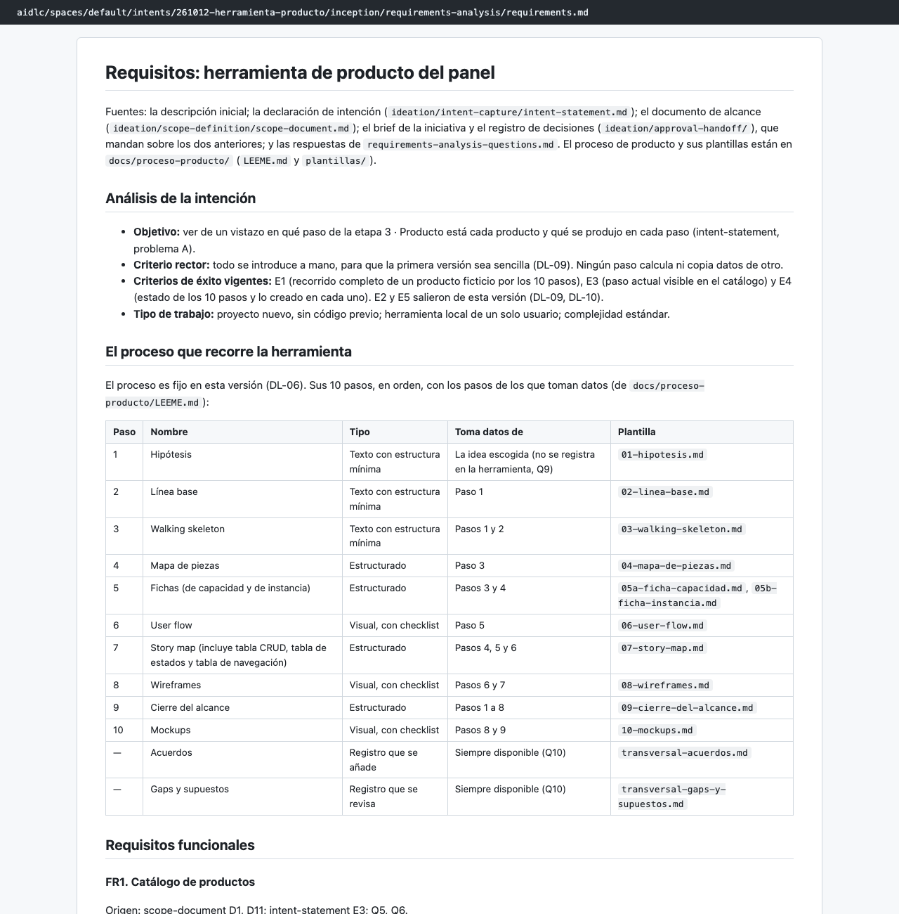
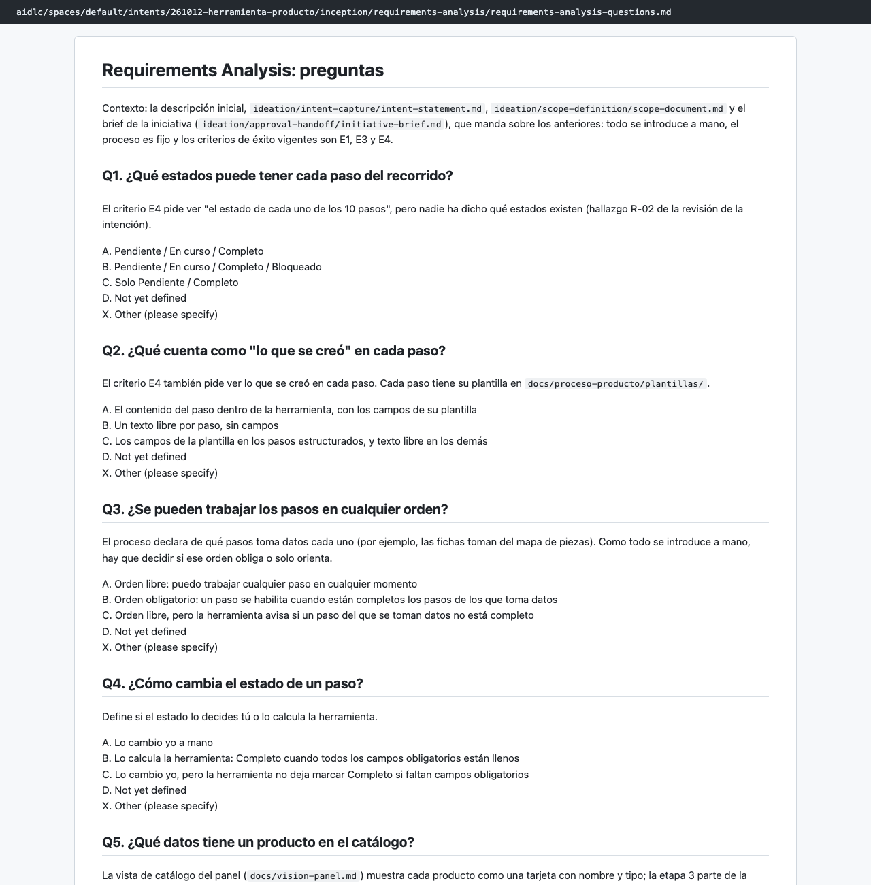
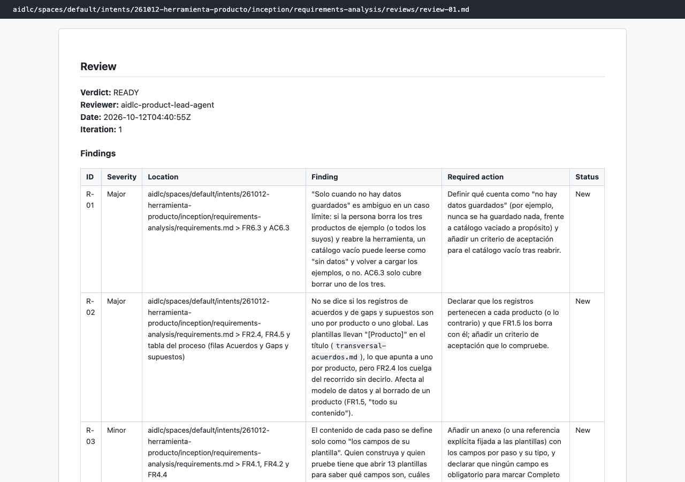

# Capítulo 08 · 2.3 Requirements Analysis

> **En una frase:** el agente `product` convirtió el brief en **40 requisitos comprobables** (35 funcionales y 5 no funcionales) a partir de 10 preguntas. El revisor la dio por buena, pero con **2 observaciones importantes** que se resolvieron en la etapa siguiente.

[← 1.7 Approval & Handoff](07-1.7-approval-handoff.md) · [Resumen](00-resumen.md) · [Siguiente: 2.6 Domain Design →](09-2.6-domain-design.md)

## 1 · Ubicación

Concepción · 2.3 Requirements Analysis · ALWAYS. Abre la fase. Las condicionales 2.1 Reverse Engineering (el proyecto era nuevo) y 2.2 Practices Discovery se saltaron.

## 2 · Input

- El brief y el registro de decisiones de 1.7, que mandan sobre los documentos anteriores.
- `docs/proceso-producto/LEEME.md` y 3 de las 13 plantillas del proceso: ficha de capacidad, story map y cierre del alcance.

## 3 · Proceso

1. Preguntas en 3 tandas, la última de seguimiento.
2. Resumen consolidado y confirmación.
3. Documento de requisitos.
4. Revisión por el `product-lead`.
5. Aprendizajes: 4 candidatas, no guardamos ninguna.
6. Gate: aprobamos.

## 4 · Interacción

| Pregunta | Nuestra respuesta |
|---|---|
| Q1 · ¿Qué estados tiene cada paso? | Pendiente, En curso y Completo |
| Q2 · ¿Qué cuenta como "lo que se creó"? | Los campos de la plantilla de cada paso |
| Q3 · ¿Se pueden trabajar los pasos en cualquier orden? | No: el orden es obligatorio |
| Q4 · ¿Cómo cambia el estado de un paso? | Lo cambio yo a mano |
| Q5 · ¿Qué datos tiene un producto en el catálogo? | Texto propio: "Nombre" |
| Q6 · ¿Qué puedes hacer con los productos? | Crear, editar y borrar |
| Q7 · ¿Se conserva lo introducido al cerrar y abrir? | Sí |
| Q8 · ¿Con qué datos de ejemplo arranca? | Tres productos ficticios |
| Q9 · (seguimiento de Q5) ¿Dónde se escribe la idea escogida? | No se registra |
| Q10 · (seguimiento de Q3) ¿Cuándo están disponibles los registros transversales? | Siempre |

- **Resumen consolidado:** Looks correct.

Q1 y Q2 cerraban la observación R-02 de la revisión de 1.1: qué estados existen y qué cuenta como "lo creado".

## 5 · Agentes

| Papel | Agente | Modelo | Qué aportó |
|---|---|---|---|
| Lidera | `product` | Opus | Preguntas, resumen y requisitos |
| Revisa | `product-lead` | Sonnet, como subagente | READY con 2 observaciones importantes y 6 menores |

Las dos importantes:
- **R-01:** "cargar los ejemplos solo cuando no hay datos guardados" es ambiguo si se vacía el catálogo a propósito: ¿vuelven a cargarse?
- **R-02:** no se dice si los registros de acuerdos, y de gaps y supuestos, son de cada producto o globales. Cambia el modelo de datos y el borrado.

Entre las menores: casos límite del nombre (R-05), requisitos sin criterio de aceptación propio (R-06) y el bloqueo en cadena entre pasos (R-07).

## 6 · Controles

| Control | Qué pasó |
|---|---|
| Sensores `required-sections` y `upstream-coverage` | Pasaron en los 2 archivos |
| Revisor | READY en la primera pasada; las dos observaciones importantes quedaron abiertas |
| Aprendizajes | 4 candidatas; respondimos "Keep none of these" |
| Gate | Approve |

## 7 · Output

- [requirements.md](../../aidlc/spaces/default/intents/261012-herramienta-producto/inception/requirements-analysis/requirements.md) (164 líneas):
  - La tabla del proceso: los 10 pasos y los 2 registros, con su tipo y de qué pasos toma datos.
  - Los requisitos funcionales en 6 grupos: catálogo (FR1), recorrido (FR2), estados y orden (FR3), contenido (FR4), definición del proceso (FR5), y guardado y ejemplos (FR6).
  - Los no funcionales: integridad (NFR1), idioma (NFR2), navegación en dos acciones (NFR3), accesibilidad básica (NFR4) y pruebas (NFR5).
  - Criterios de aceptación en formato Dado/Cuando/Entonces (AC1.1, AC1.2…).
  - Restricciones, supuestos y lo que queda fuera.
- [requirements-analysis-questions.md](../../aidlc/spaces/default/intents/261012-herramienta-producto/inception/requirements-analysis/requirements-analysis-questions.md).
- [reviews/review-01.md](../../aidlc/spaces/default/intents/261012-herramienta-producto/inception/requirements-analysis/reviews/review-01.md).

## 8 · Pruebas

No hay código todavía, pero aquí se fija la postura de pruebas. NFR5 aplica la postura por defecto de `org.md` para este tipo de trabajo: una prueba por requisito, con al menos un caso de éxito por componente.

## 9 · Sorpresas y problemas

- **Se aprobó con observaciones importantes abiertas.** El revisor recomendaba resolver R-01 y R-02 antes de aprobar. Aprobamos igualmente, y la etapa siguiente (2.6) las resolvió con preguntas: Q2 para los registros y Q3 para los ejemplos. El patrón se repitió en todo el recorrido: **lo que un revisor deja abierto lo recoge la etapa siguiente**.
- **El agente decidió dos cosas por su cuenta y las dejó como supuesto:**
  - "Paso actual" es el primer paso no completo, en orden.
  - Si un paso de origen vuelve atrás, los dependientes conservan su contenido pero quedan bloqueados.
- **Leyó solo 3 plantillas de 13.** Le bastaron para saber qué pasos tienen elementos repetibles, y los requisitos remiten a las plantillas en lugar de copiar sus campos. El revisor lo marcó como menor (R-03): quien construya tiene que abrir las plantillas.

## 10 · Tiempo y costo

- **19 minutos**, de 04:27 a 04:45.
- **31 llamadas al modelo**: 26 del conductor con Opus y 5 del revisor con Sonnet.
- **7 mensajes nuestros.**

## 11 · Lo que aprendimos

- Las preguntas de esta etapa son concretas y de producto (estados, orden, qué se guarda), no técnicas.
- Aprobar con observaciones abiertas es legítimo si sabes dónde se van a resolver. Conviene decirlo en el gate.

## 12 · Capturas

*El documento de requisitos.*

*Las 10 preguntas con nuestras respuestas.*

*La revisión: READY con 2 observaciones importantes y 6 menores.*

---

**Fuentes:** artefactos de `inception/requirements-analysis/`; su `memory.md`; auditoría (04:27–04:45 UTC).
