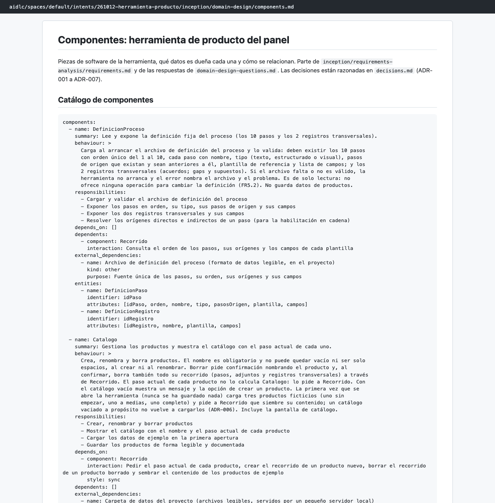
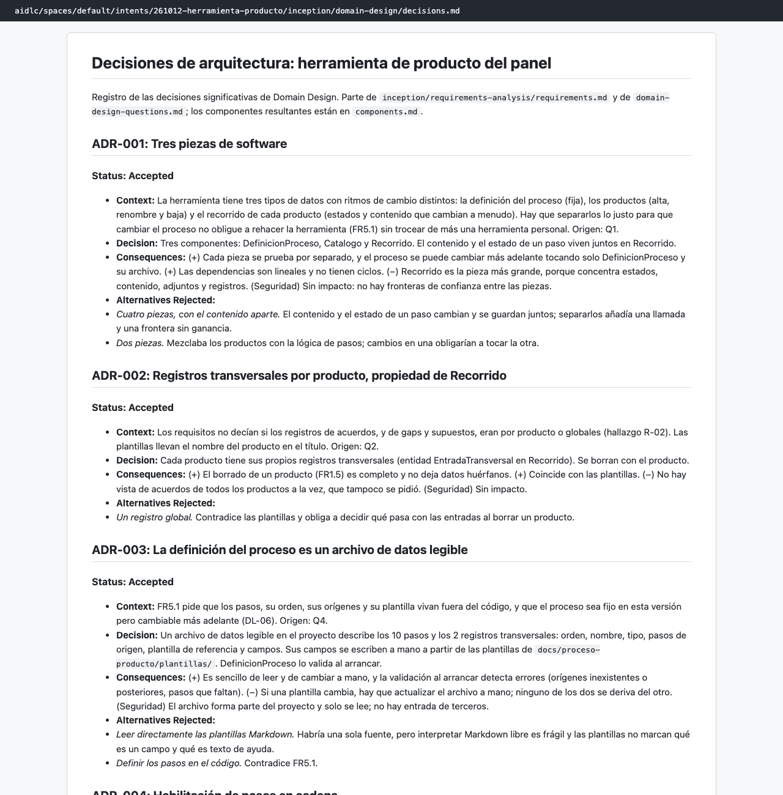
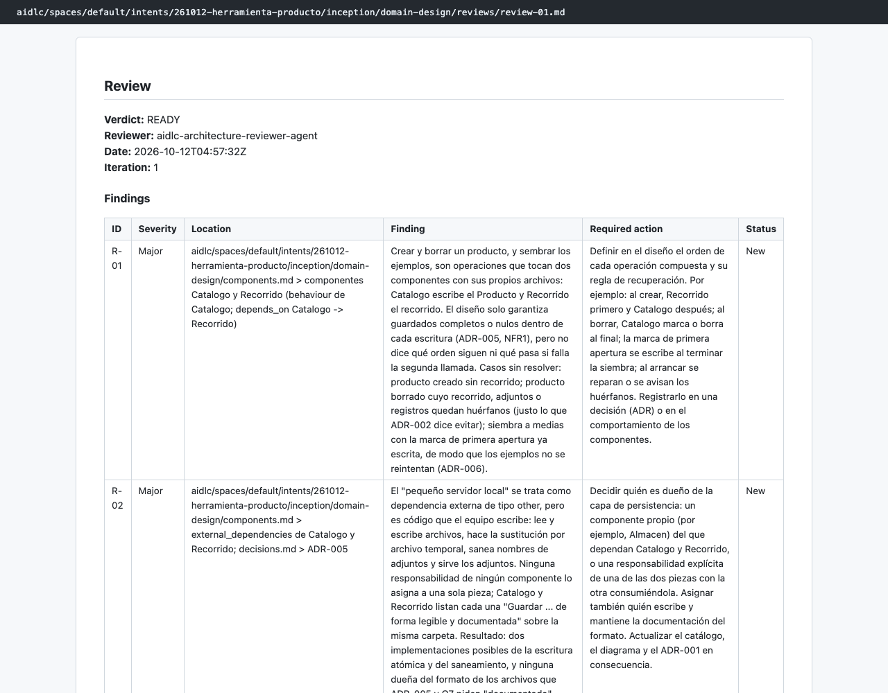

# Capítulo 08 · 2.6 Domain Design

> **En una frase:** el agente `architect` dividió la herramienta en **3 componentes**, decidió dónde y cómo se guardan los datos en **7 decisiones de arquitectura** y resolvió lo que había dejado abierto la revisión de requisitos. Es la única etapa condicional del recorrido.

[← 2.3 Requirements Analysis](08-2.3-requirements-analysis.md) · [Resumen](00-resumen.md) · [Siguiente: 2.7 Units Generation →](10-2.7-units-generation.md)

## 1 · Ubicación

Concepción · 2.6 Domain Design · **condicional**. Entró en el plan por dependencia: es la única etapa que produce `components`, y 2.7 y 2.9 lo necesitan. Las condicionales 2.4 User Stories y 2.5 Refined Mockups se saltaron.

## 2 · Input

- [requirements.md](../../aidlc/spaces/default/intents/261012-herramienta-producto/inception/requirements-analysis/requirements.md) y su revisión, con las observaciones abiertas.
- El brief de 1.7.

## 3 · Proceso

1. Preguntas en 2 tandas. En cada una, el agente marcó cuál era su **opción recomendada**.
2. Resumen consolidado y confirmación.
3. Documentos: el catálogo de componentes con su diagrama, las decisiones y la trazabilidad.
4. Revisión por el `architecture-reviewer`.
5. Aprendizajes: 3 candidatas, no guardamos ninguna.
6. Gate: aprobamos.

## 4 · Interacción

Elegimos la opción A en las 7 preguntas, que en las tres marcadas era la recomendada.

| Pregunta | Nuestra respuesta |
|---|---|
| Q1 · ¿En cuántas piezas se divide la herramienta? | Tres (recomendada) |
| Q2 · ¿Los registros transversales son de cada producto o globales? | De cada producto |
| Q3 · ¿Cuándo se cargan los datos de ejemplo? | Solo la primera vez |
| Q4 · ¿Cómo se describe la definición del proceso? | En un archivo de datos (recomendada) |
| Q5 · ¿El bloqueo de pasos se propaga en cadena? | Sí, en cadena |
| Q6 · ¿Dónde se guardan los datos? | En archivos, con un servidor local (recomendada) |
| Q7 · ¿Cómo no cerrar la puerta a conectarse con AI-DLC? | Con un formato de datos legible |

- **Resumen consolidado:** Looks correct.

Q2, Q3 y Q5 resolvieron las observaciones R-02, R-01 y R-07 de la revisión de requisitos.

## 5 · Agentes

| Papel | Agente | Modelo | Qué aportó |
|---|---|---|---|
| Lidera | `architect` | Opus | Preguntas, componentes y decisiones |
| Apoyo | `aws-platform` y `design` (declarados) | No participaron: agentes de apoyo apagados |
| Revisa | `architecture-reviewer` | Sonnet, como subagente | READY con 2 observaciones importantes y 3 menores |

Las dos importantes:
- **R-01:** crear y borrar un producto, y sembrar los ejemplos, tocan dos componentes con archivos distintos. No se dice qué pasa si falla la segunda escritura: puede quedar un producto sin recorrido o al revés.
- **R-02:** el "pequeño servidor local" se trata como algo externo, pero es código propio y ningún componente es su dueño.

El revisor comprobó también el bloque YAML del catálogo: nombres únicos, sin ciclos y dependencias simétricas. Y comprobó la trazabilidad: los 35 requisitos funcionales tienen componente.

## 6 · Controles

| Control | Qué pasó |
|---|---|
| Sensores `required-sections` y `upstream-coverage` | Pasaron en los 3 archivos |
| Sensor `traceability` | Pasó en `traceability.json` |
| Revisor | READY en la primera pasada; 2 observaciones importantes abiertas |
| Aprendizajes | 3 candidatas; "Keep none of these" |
| Gate | Approve |

## 7 · Output

- [components.md](../../aidlc/spaces/default/intents/261012-herramienta-producto/inception/domain-design/components.md): los 3 componentes en un bloque YAML con entidades, comportamiento y dependencias, más el diagrama, la propiedad de las entidades y las aclaraciones a los requisitos.
  - **DefinicionProceso:** la definición del proceso. Es de solo lectura.
  - **Recorrido:** los pasos y los registros de cada producto, y el cálculo del paso actual.
  - **Catalogo:** los productos y la carga de los ejemplos.
  - Las dependencias van en una sola dirección: Catalogo → Recorrido → DefinicionProceso.
- [decisions.md](../../aidlc/spaces/default/intents/261012-herramienta-producto/inception/domain-design/decisions.md): 7 decisiones de arquitectura (ADR), cada una con contexto, decisión, consecuencias y alternativas descartadas.

  | ADR | Decisión |
  |---|---|
  | 001 | Tres piezas de software |
  | 002 | Registros transversales por producto, propiedad de Recorrido |
  | 003 | La definición del proceso es un archivo de datos legible |
  | 004 | Habilitación de pasos en cadena |
  | 005 | Guardado en archivos legibles con un pequeño servidor local |
  | 006 | Datos de ejemplo solo en la primera apertura |
  | 007 | El paso actual lo calcula Recorrido |

- [traceability.json](../../aidlc/spaces/default/intents/261012-herramienta-producto/inception/domain-design/traceability.json): cada requisito con el componente que lo cubre.

## 8 · Pruebas

No aplica. Las decisiones sí fijan qué habrá que probar después, por ejemplo la habilitación en cadena y la carga de ejemplos solo una vez.

## 9 · Sorpresas y problemas

- **Las opciones recomendadas ayudan mucho**, pero también hacen fácil aceptar sin pensar. Aquí aceptamos las 7.
- **Otra vez se aprobó con observaciones importantes abiertas**, y otra vez las resolvió la etapa siguiente: 2.7 creó una unidad dueña del servidor y preguntó qué hacer si falla la segunda escritura.
- **El agente aclaró los requisitos sin reabrirlos.** `components.md` declara que sus aclaraciones mandan sobre `requirements.md`. Es el mismo patrón que el brief de 1.7.
- **Las pantallas no son un componente aparte:** cada componente incluye las suyas. El agente lo anotó como interpretación.

## 10 · Tiempo y costo

- **14 minutos**, de 04:45 a 04:59.
- **28 llamadas al modelo**: 24 del conductor con Opus y 4 del revisor con Sonnet.
- **6 mensajes nuestros.**

## 11 · Lo que aprendimos

- Esta etapa es donde se toman las decisiones técnicas de verdad. Merece la pena leer las ADR aunque el resumen parezca obvio.
- El diseño quedó preparado para el futuro sin construirlo: archivos legibles y una definición separada dejan abierta la conexión con AI-DLC.

## 12 · Capturas

*El catálogo de componentes.*

*Las decisiones de arquitectura (ADR).*

*La revisión del `architecture-reviewer`.*

---

**Fuentes:** artefactos de `inception/domain-design/`; su `memory.md`; auditoría (04:45–04:59 UTC).
