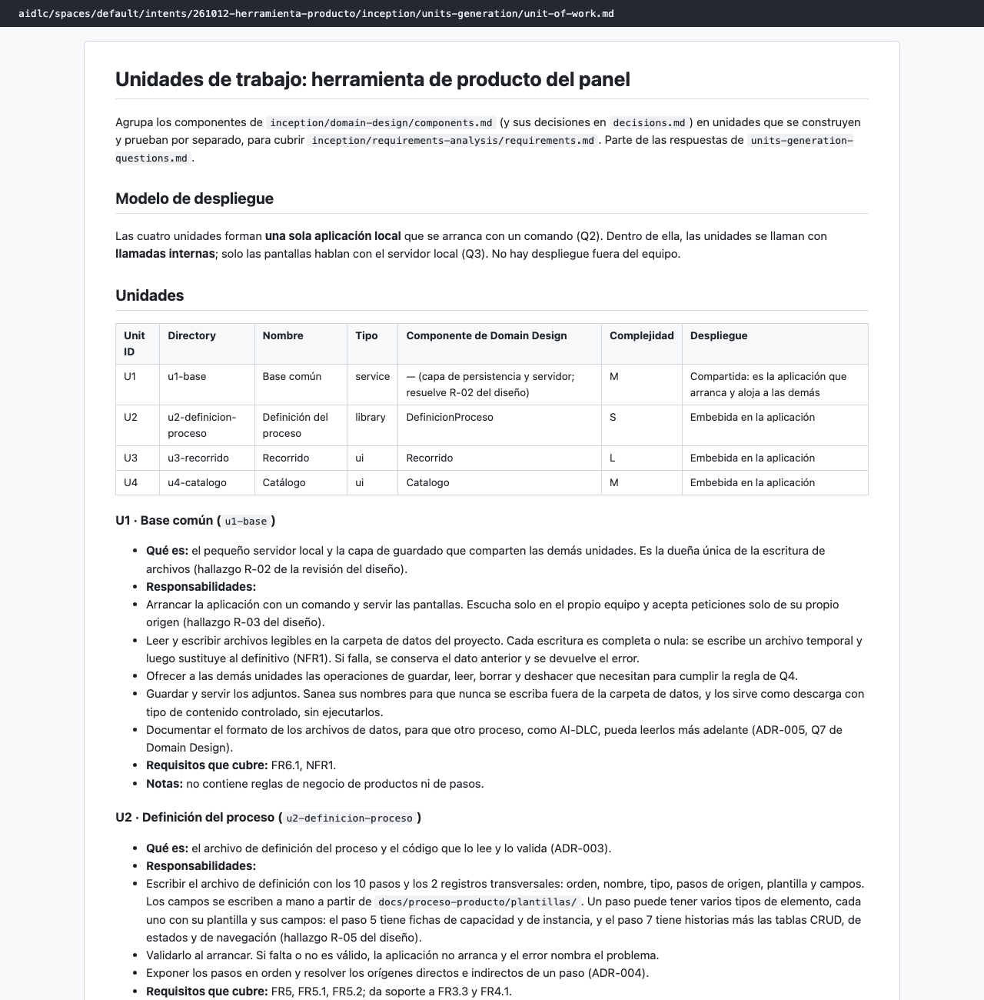
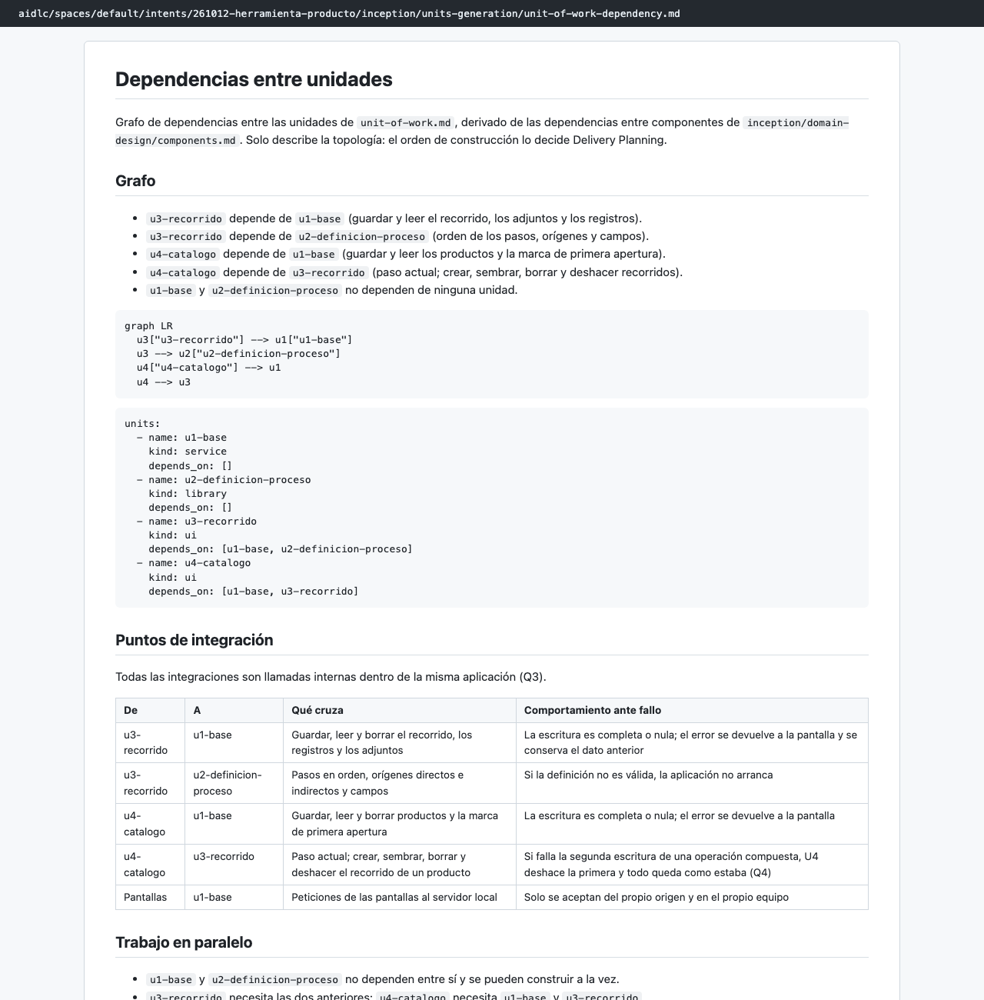
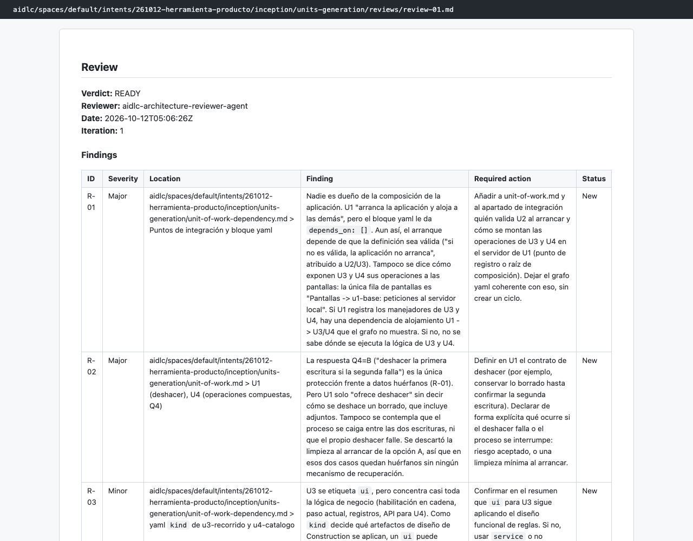

# Capítulo 08 · 2.7 Units Generation

> **En una frase:** el agente `architect` agrupó los 3 componentes en **4 unidades de trabajo** que se construyen y prueban por separado. Aquí elegimos cómo deshacer una operación que falla a medias, una decisión que los revisores de código siguieron señalando hasta el final.

[← 2.6 Domain Design](09-2.6-domain-design.md) · [Resumen](00-resumen.md) · [Siguiente: 2.9 Delivery Planning →](11-2.9-delivery-planning.md)

## 1 · Ubicación

Concepción · 2.7 Units Generation · ALWAYS.

## 2 · Input

- [components.md](../../aidlc/spaces/default/intents/261012-herramienta-producto/inception/domain-design/components.md), [decisions.md](../../aidlc/spaces/default/intents/261012-herramienta-producto/inception/domain-design/decisions.md) y la revisión de 2.6, con sus observaciones abiertas.
- [requirements.md](../../aidlc/spaces/default/intents/261012-herramienta-producto/inception/requirements-analysis/requirements.md).

## 3 · Proceso

1. Una tanda de 4 preguntas.
2. **Aprobación del plan de división:** un paso que no esperábamos. Antes de escribir los documentos, el agente pidió aprobar la propuesta de unidades.
3. Resumen consolidado y confirmación.
4. Documentos: las unidades, sus dependencias, el mapa de requisitos por unidad y la trazabilidad.
5. Revisión por el `architecture-reviewer`.
6. Aprendizajes: 3 candidatas, no guardamos ninguna.
7. **Pausa:** con el gate abierto, pausamos el trabajo porque la conversación estaba muy cargada, y lo retomamos en una sesión nueva.
8. Gate: aprobamos.

## 4 · Interacción

| Pregunta | Nuestra respuesta |
|---|---|
| Q1 · ¿Cómo se agrupan los componentes en unidades? | Cuatro unidades (recomendada) |
| Q2 · ¿Cómo se arranca la herramienta? | Como una sola aplicación |
| Q3 · ¿Cómo se comunican las unidades? | Con llamadas internas |
| Q4 · ¿Qué pasa si una operación que toca catálogo y recorrido falla a la mitad? | **B. Deshacer la primera escritura** si falla la segunda. No elegimos la recomendada (A: orden fijo y limpieza al arrancar) |
| Plan de división: 4 unidades en una aplicación local | Approve Plan |

- **Resumen consolidado:** Looks correct.

## 5 · Agentes

| Papel | Agente | Modelo | Qué aportó |
|---|---|---|---|
| Lidera | `architect` | Opus | Preguntas, plan de división y documentos |
| Apoyo | `delivery` (declarado) | No participó: agentes de apoyo apagados |
| Revisa | `architecture-reviewer` | Sonnet, como subagente | READY con 2 observaciones importantes y 3 menores |

Las dos importantes:
- **R-01:** nadie es dueño de **montar la aplicación**: quién arranca, quién valida la definición y cómo llegan las pantallas al servidor.
- **R-02:** el deshacer elegido en Q4 no contempla que **el proceso se caiga** entre las dos escrituras, ni que falle el propio deshacer.

Una menor que se cumplió al final: **R-04** avisaba de que NFR5 (pruebas) es transversal y no solo de U1. En [Build and Test](13-3.6-build-and-test.md), NFR5 fue el único requisito que quedó sin entrada en la trazabilidad.

## 6 · Controles

| Control | Qué pasó |
|---|---|
| Sensores `required-sections` y `upstream-coverage` | Pasaron en los 4 archivos |
| Sensor `traceability` | Pasó |
| Revisor | READY en la primera pasada |
| Aprendizajes | 3 candidatas; "Keep none of these" |
| Pausa | `WORKFLOW_PARKED` a las 05:08 y `WORKFLOW_UNPARKED` a las 05:10, en otra sesión |
| Gate | Approve |

## 7 · Output

- [unit-of-work.md](../../aidlc/spaces/default/intents/261012-herramienta-producto/inception/units-generation/unit-of-work.md): las 4 unidades, con sus responsabilidades y sus requisitos.

  | Unidad | Qué es | Tipo | Tamaño |
  |---|---|---|---|
  | U1 `u1-base` | Servidor local y guardado; dueña única de la escritura de archivos | service | M |
  | U2 `u2-definicion-proceso` | El archivo de definición del proceso, que se lee y se valida | library | S |
  | U3 `u3-recorrido` | Los 10 pasos de cada producto, con sus pantallas | ui | L |
  | U4 `u4-catalogo` | Los productos y el catálogo, con su pantalla | ui | M |

- [unit-of-work-dependency.md](../../aidlc/spaces/default/intents/261012-herramienta-producto/inception/units-generation/unit-of-work-dependency.md): el grafo. U3 depende de U1 y U2, y U4 de U1 y U3.
- [unit-of-work-story-map.md](../../aidlc/spaces/default/intents/261012-herramienta-producto/inception/units-generation/unit-of-work-story-map.md): cada requisito con su unidad responsable.
- [traceability.json](../../aidlc/spaces/default/intents/261012-herramienta-producto/inception/units-generation/traceability.json).

## 8 · Pruebas

No aplica todavía. Cada unidad tendrá sus propias pruebas en Code Generation.

## 9 · Sorpresas y problemas

- **Contestamos sin la opción recomendada, y eso tuvo consecuencias.** Elegimos deshacer (B) en lugar de orden fijo con limpieza al arrancar (A). Deshacer no cubre una caída del proceso. El revisor de esta etapa lo señaló (R-02), y los revisores de código de U4 lo volvieron a señalar dos veces. Queda abierto como observación menor.
- **Las observaciones de 2.6 se resolvieron aquí:**
  - R-01 y R-02, con preguntas: Q4 y la nueva unidad U1, dueña del servidor.
  - R-03, R-04 y R-05, como responsabilidades de U1, U4 y U2, **sin preguntar**, porque eran mínimos de seguridad y de modelo propuestos por el revisor.
- **La pausa funcionó como prometía.** Pausar con el gate abierto y volver en otra sesión no hizo perder nada.

## 10 · Tiempo y costo

- **13 minutos de trabajo**, de 04:59 a 05:12, contando la pausa de 2 minutos.
- **40 llamadas al modelo**: 35 del conductor con Opus y 5 del revisor con Sonnet.
- **8 mensajes nuestros.**

## 11 · Lo que aprendimos

- La opción recomendada no es obligatoria, pero si eliges otra, conviene leer qué deja sin cubrir.
- Una unidad no tiene que coincidir con un componente: U1 no es ningún componente de 2.6. Nació para resolver una observación del revisor.

## 12 · Capturas

*Las 4 unidades de trabajo.*

*El grafo de dependencias entre unidades.*

*La revisión del `architecture-reviewer`.*

---

**Fuentes:** artefactos de `inception/units-generation/`; su `memory.md`; auditoría (04:59–05:12 UTC).
