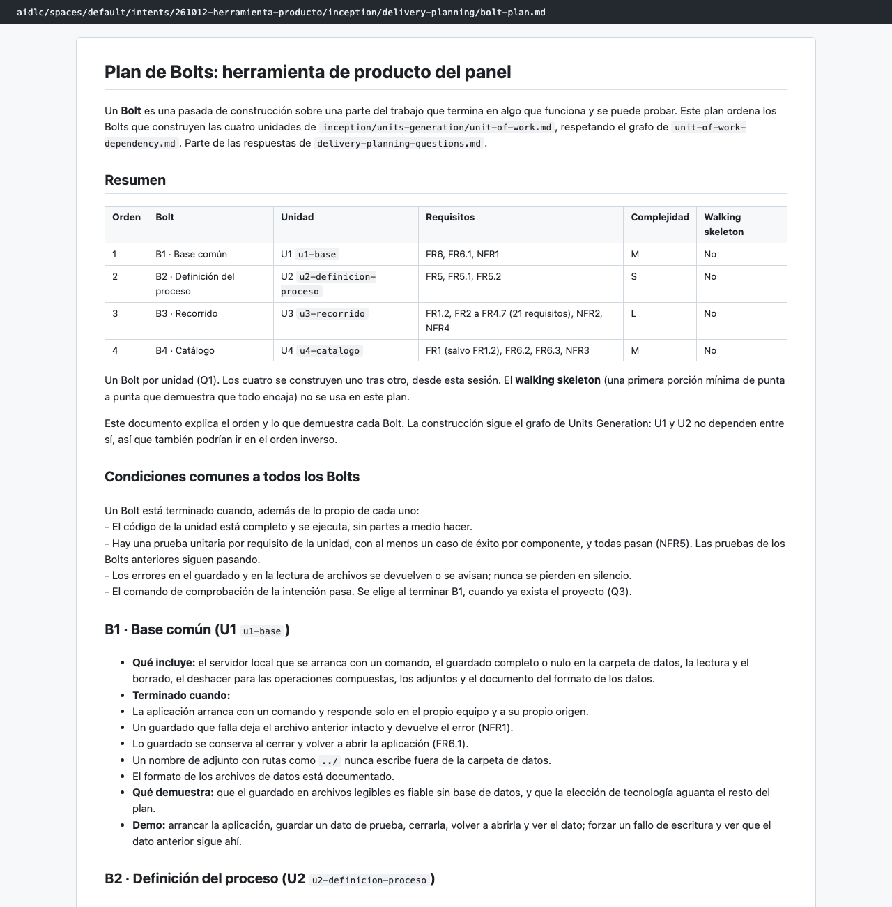
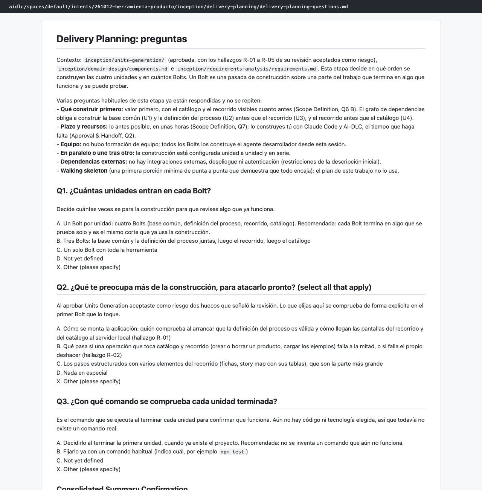

# Capítulo 08 · 2.9 Delivery Planning

> **En una frase:** el agente `delivery` ordenó la construcción en **4 bolts**, uno por unidad (base → definición → recorrido → catálogo), con su condición de terminado y sus riesgos. Cierra la fase de Concepción.

[← 2.7 Units Generation](10-2.7-units-generation.md) · [Resumen](00-resumen.md) · [Siguiente: 3.5 Code Generation →](12-3.5-code-generation/00-vision-general.md)

## 1 · Ubicación

Concepción · 2.9 Delivery Planning · ALWAYS. La condicional 2.8 Contract Design se saltó.

## 2 · Input

- Los documentos de 2.7: unidades, dependencias y mapa de requisitos.
- [components.md](../../aidlc/spaces/default/intents/261012-herramienta-producto/inception/domain-design/components.md) y [requirements.md](../../aidlc/spaces/default/intents/261012-herramienta-producto/inception/requirements-analysis/requirements.md).

## 3 · Proceso

1. Una tanda de 3 preguntas.
2. Resumen consolidado y confirmación.
3. Documentos: el plan de bolts, el reparto, los riesgos y el orden, y las dependencias externas.
4. Aprendizajes: 3 candidatas, no guardamos ninguna.
5. Gate: aprobamos.
6. Al aprobar, AI-DLC verificó la fase (Concepción → Construcción).

## 4 · Interacción

| Pregunta | Nuestra respuesta |
|---|---|
| Q1 · ¿Cuántas unidades entran en cada bolt? | Una por bolt |
| Q2 · ¿Qué te preocupa más de la construcción, para atacarlo pronto? | Nada en especial |
| Q3 · ¿Con qué comando se comprueba cada unidad terminada? | Decidirlo al terminar la primera unidad (recomendada) |

- **Resumen consolidado:** Looks correct.

De las 6 preguntas tipo solo se hicieron 3. Las demás (orden, plazo, recursos, equipo y dependencias externas) ya estaban respondidas en Ideación.

## 5 · Agentes

| Papel | Agente | Modelo |
|---|---|---|
| Lidera | `delivery` | Opus |
| Apoyo | `architect` (declarado) | No participó: agentes de apoyo apagados |
| Revisa | — | Esta etapa no tiene revisor |

## 6 · Controles

| Control | Qué pasó |
|---|---|
| Sensor `required-sections` | Pasó en los 5 archivos |
| Sensor `upstream-coverage` | **Falló en los 5 archivos**: ninguno cita `components`, que es uno de los documentos que la etapa consume. Es un aviso: no bloqueó la aprobación |
| Aprendizajes | 3 candidatas; "Keep none of these" |
| Gate | Approve |
| Verificación de fase | Los 35 requisitos funcionales, cubiertos en el diseño y en las unidades, con 2 avisos |

## 7 · Output

- [bolt-plan.md](../../aidlc/spaces/default/intents/261012-herramienta-producto/inception/delivery-planning/bolt-plan.md): los 4 bolts y las condiciones comunes de terminado.

  | Orden | Bolt | Unidad | Qué demuestra |
  |---|---|---|---|
  | 1 | B1 · Base común | U1 | Que el guardado en archivos es fiable sin base de datos |
  | 2 | B2 · Definición del proceso | U2 | Que la definición se lee y se valida al arrancar |
  | 3 | B3 · Recorrido | U3 | Los 10 pasos con sus reglas y pantallas (la unidad más grande, 21 requisitos) |
  | 4 | B4 · Catálogo | U4 | El catálogo, las operaciones con deshacer y los ejemplos |

- [team-allocation.md](../../aidlc/spaces/default/intents/261012-herramienta-producto/inception/delivery-planning/team-allocation.md): quién construye. Una persona con Claude Code y AI-DLC, en una sola sesión de trabajo.
- [risk-and-sequencing-rationale.md](../../aidlc/spaces/default/intents/261012-herramienta-producto/inception/delivery-planning/risk-and-sequencing-rationale.md): por qué ese orden y los 5 riesgos conocidos.
- [external-dependency-map.md](../../aidlc/spaces/default/intents/261012-herramienta-producto/inception/delivery-planning/external-dependency-map.md): no hay dependencias externas.
- [verification/phase-check-inception.md](../../aidlc/spaces/default/intents/261012-herramienta-producto/verification/phase-check-inception.md).

## 8 · Pruebas

Aquí se fijó la condición común de terminado de cada bolt:
- Una prueba por requisito, con al menos un caso de éxito por componente, y todas en verde.
- Las pruebas de los bolts anteriores siguen pasando.
- Pasa el comando de comprobación del trabajo, que se elegiría al terminar B1.

## 9 · Sorpresas y problemas

- **El sensor `upstream-coverage` falló en todos los documentos.** El plan de bolts no menciona `components` por su nombre, aunque se basa en las unidades que salen de él. El aviso no bloqueó nada.
- **El walking skeleton no se usó.** El plan lo dice explícitamente: el scope `express` lo trae apagado y no hay una primera porción mínima de punta a punta. El capítulo 06 no lo preveía ni para un lado ni para el otro.
- **Que no eligiéramos ningún riesgo (Q2) no los hizo desaparecer.** El agente los dejó todos en la tabla de riesgos, con su tratamiento.

## 10 · Tiempo y costo

- **11 minutos**, de 05:12 a 05:22.
- **24 llamadas al modelo**, del conductor con Opus.
- **4 mensajes nuestros.**

## 11 · Lo que aprendimos

- Con unidades pequeñas y una sola persona, el plan de entrega es corto. Su valor está en la **condición de terminado** y en el orden.
- Dejar el comando de comprobación para cuando exista el código es mejor que inventarlo antes.

## 12 · Capturas

*El plan de bolts.*

*Las 3 preguntas de la etapa.*

---

**Fuentes:** artefactos de `inception/delivery-planning/`; su `memory.md`; `verification/phase-check-inception.md`; auditoría (05:12–05:22 UTC).
