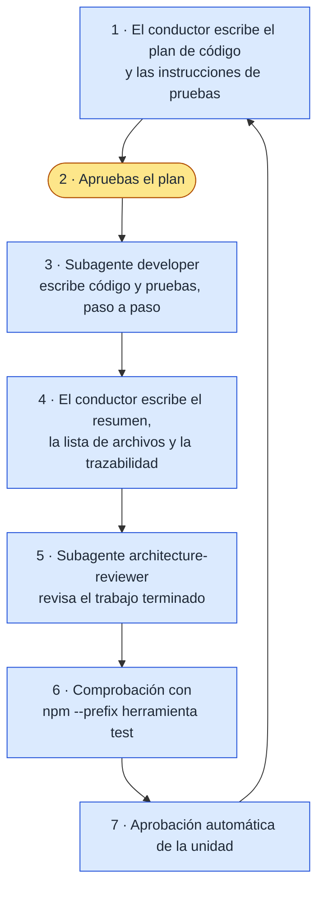
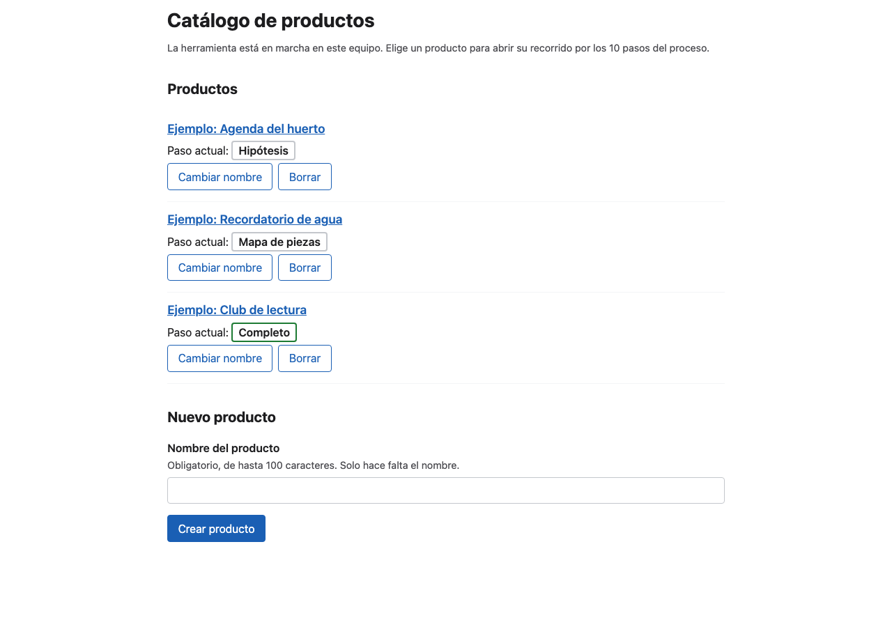
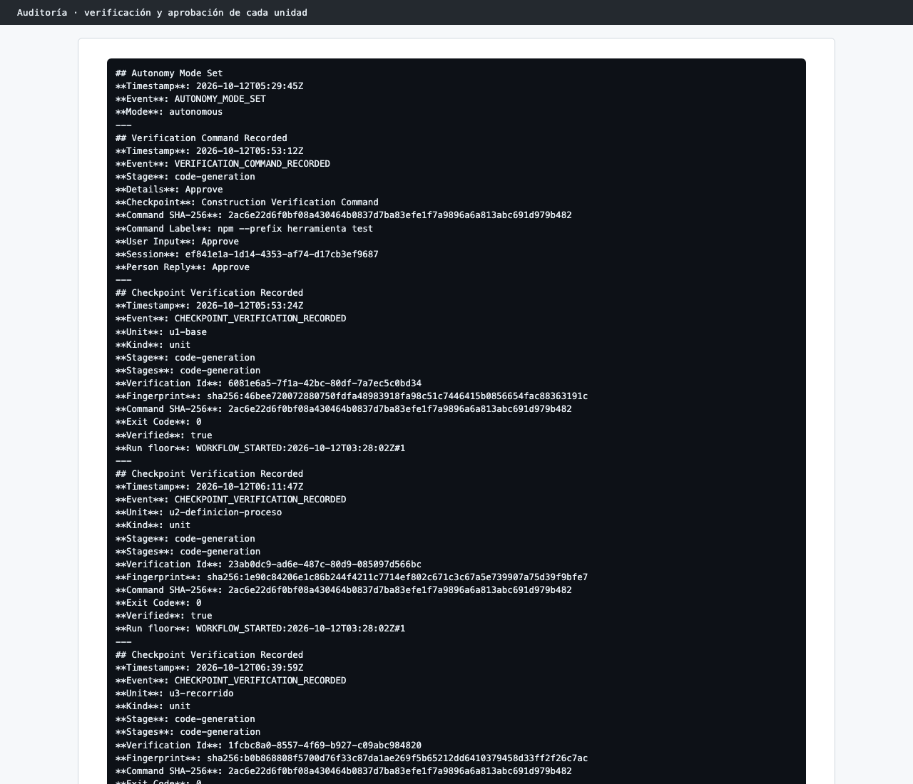

# Capítulo 08 · 3.5 Code Generation · Visión general

> **En una frase:** la etapa se repitió **una vez por unidad**. Para cada una, primero aprobamos su plan de código; después un subagente `developer` escribió el código y las pruebas, y un revisor y un comando de comprobación lo validaron antes de pasar a la siguiente. Salieron **110 pruebas en verde**, pero cerrar la etapa costó más que construirla.

[← 2.9 Delivery Planning](../11-2.9-delivery-planning.md) · [Resumen](../00-resumen.md) · [Siguiente: U1 · Base común →](01-u1-base.md)

Esta subcarpeta tiene una página por unidad y una para el cierre:

| Página | Qué cuenta |
|---|---|
| Esta | Lo común: el arranque, el modo automático, el ciclo de cada unidad y los números |
| [01 · U1 Base común](01-u1-base.md) | La primera unidad, donde se eligió la tecnología y el comando de comprobación |
| [02 · U2 Definición del proceso](02-u2-definicion-proceso.md) | La definición del proceso como archivo de datos |
| [03 · U3 Recorrido](03-u3-recorrido.md) | La unidad más grande |
| [04 · U4 Catálogo](04-u4-catalogo.md) | La última unidad, cortada por el límite de uso |
| [05 · Cierre de la etapa](05-cierre-de-la-etapa.md) | El bloqueo por un archivo de Obsidian y el paso a la Guard Policy `relaxed` |

## 1 · Ubicación

Construcción · 3.5 Code Generation · ALWAYS. Primera etapa de la fase. Las condicionales 3.1 a 3.4, de diseño por unidad, se saltaron.

## 2 · Input

- Para cada unidad: su definición en `unit-of-work.md` y su bolt en `bolt-plan.md`.
- `requirements.md`, `components.md` y `decisions.md`, como contexto.
- El código de las unidades anteriores, porque cada una se apoya en las previas.

## 3 · Proceso

### El arranque se bloqueó

Antes de la primera unidad, AI-DLC necesitaba registrar si el plan usa walking skeleton (una primera porción mínima de punta a punta). El conductor intentó registrarlo, y el control que impide escribir código sin un plan aprobado (`plan-approval-guard`) **rechazó ese comando tres veces**. El motivo: trataba el trabajo como si no tuviera unidades, aunque había cuatro. En esos 7 minutos bloqueó también otros tres intentos: dos notas personales de la IA y una consulta de versión (`aidlc update --check`).

El conductor dejó de insistir y nos pidió ejecutar el comando **en nuestra propia terminal**, porque el control solo vigila los comandos de la IA. Lo hicimos y la construcción arrancó. Fueron 7 minutos (05:22 → 05:29), con un reinicio de sesión por medio.

### Elegimos el modo automático

Antes de la primera unidad preguntó cómo seguir:

| Opción | Qué significa |
|---|---|
| **Continue automatically** ✅ | Aprueba solo las comprobaciones rutinarias al terminar cada unidad. Sigue preguntando los planes de código, los resúmenes, el comando de comprobación y cualquier fallo |
| Review each checkpoint | Espera nuestra aprobación al terminar cada unidad |

### El ciclo de cada unidad

Texto: plan → **apruebas el plan** → el developer construye → resumen, lista de archivos y trazabilidad → revisión → comprobación → aprobación automática → siguiente unidad.

El único paso nuestro en cada vuelta fue aprobar el plan, más elegir el comando de comprobación al terminar U1.

## 4 · Interacción

| Momento | Cuántas veces | Respuesta |
|---|---:|---|
| Modo de construcción | 1 | Continue automatically |
| Aprobar el plan de código | 5 (4 unidades, más U1 otra vez) | Approve Plan, todas |
| Comando de comprobación | 1 | Approve: `npm --prefix herramienta test` |
| Ejecutar un comando en nuestra terminal | 1 | El registro del walking skeleton |
| Decidir qué hacer con el bloqueo final | 4 preguntas | Ver [cierre](05-cierre-de-la-etapa.md) |

No hubo preguntas del tipo `[Answer]:` sobre el producto: los archivos `code-generation-questions.md` solo guardan la aprobación del plan.

## 5 · Agentes

| Papel | Agente | Modelo | Cómo |
|---|---|---|---|
| Conductor | — | Opus | Escribe los planes, coordina, resume y lleva la contabilidad |
| Lidera | `developer` | Opus | Como subagente, una vez por unidad (5 lanzamientos: U4 se repitió) |
| Revisa | `architecture-reviewer` | Sonnet | Como subagente, 5 revisiones (U4 dos veces), todas READY |

## 6 · Controles

| Control | Qué pasó |
|---|---|
| `plan-approval-guard` | Bloqueó 11 comandos o escrituras de la IA: 3 veces el registro del walking skeleton, 3 notas personales, 4 comandos de consulta (como leer un archivo con `sed`) y 1 commit. Ninguno era código de la herramienta: el control vigila cualquier comando mientras falta un plan aprobado o hay una pregunta abierta |
| Aprobación del plan bajo `strict` | Al cambiar el plan de U1 después de aprobarlo, volvió a pedir la aprobación |
| Sensor `required-sections` | Pasó en los 16 documentos |
| Sensor `traceability` | **Falló en las 4 unidades**: espera ver todos los requisitos en cada archivo de trazabilidad y cada unidad solo lista los suyos. Es un aviso |
| `reviewer-scope` | Bloqueó una vez al revisor de U2 cuando intentó leer fuera de su unidad |
| Comprobación de cada unidad | 4 verificaciones con `npm --prefix herramienta test`, todas con salida 0 |
| Guard Policy | La cambiamos de `strict` a `relaxed` para poder cerrar la etapa (ver [cierre](05-cierre-de-la-etapa.md)) |

## 7 · Output

- **El código**, en `herramienta/`: Node.js 20 o superior, módulos ES, **sin dependencias**, y pantallas en HTML, CSS y JavaScript sin framework.
- **Por unidad**, en `construction/<unidad>/code-generation/`:
  - el plan;
  - las instrucciones de pruebas;
  - el resumen del código;
  - `source-manifest.json`, la lista de archivos que tocó;
  - `traceability.json`;
  - la revisión.

| Unidad | Pasos del plan | Pruebas nuevas | Total en verde | Revisión |
|---|---:|---:|---:|---|
| U1 Base común | 49 | 24 | 24 | READY, 1 importante y 2 menores |
| U2 Definición del proceso | 36 | 20 | 44 | READY, 3 menores |
| U3 Recorrido | 60 | 35 | 79 | READY, 3 menores |
| U4 Catálogo | 51 | 31 | 110 | READY, 2 menores (3 en la segunda revisión) |

## 8 · Pruebas

- **Método:** primero el código y después sus pruebas, capa por capa. Es la postura por defecto de `org.md`, porque no se ejecutó Practices Discovery.
- **Volumen:** la estrategia estándar pide de 5 a 8 pruebas por componente, más pruebas de integración.
- **Ejecutor:** el integrado de Node (`node --test`). No hubo que instalar nada.
- Cada unidad terminó con **todas las pruebas anteriores en verde**.

## 9 · Sorpresas y problemas

1. **El control del plan bloqueó un paso que no era código.** Lo resolvimos ejecutando el comando a mano.
2. **El límite de uso cortó la construcción.** A las 06:46, a mitad de U4, se agotó el uso del plan Pro. La construcción se retomó casi 7 horas después y U4 empezó de cero (ver [U4](04-u4-catalogo.md)).
3. **El cierre de la etapa se bloqueó** por cambios en el playbook mientras se construía. Costó 35 minutos y obligó a cambiar la Guard Policy (ver [cierre](05-cierre-de-la-etapa.md)).
4. **Las pantallas no se abrieron en un navegador** durante la etapa: las pruebas solo comprobaban la lógica y el HTML. Se comprobaron después, al hacer las capturas de este capítulo.

## 10 · Tiempo y costo

| Tramo | Tiempo | Llamadas al modelo |
|---|---:|---:|
| Arranque bloqueado | 7 min | 23 |
| U1 | 24 min | 80 |
| U2 | 18 min | 63 |
| U3 | 28 min | 84 |
| U4, primer intento (cortado) | 6 min | 25 |
| Pausa por límite de uso | 6 h 53 min | — |
| U4, segundo intento | 25 min | 92 |
| Cierre bloqueado | 35 min | 49 |
| **Total de trabajo** | **2 h 23 min** | **416** |

Las llamadas incluyen al conductor y a los subagentes. Por agente: 178 del conductor, 200 del `developer` y 38 del `architecture-reviewer`.

## 11 · Lo que aprendimos

- **Aprobar el plan antes del código funciona.** Cada plan dice qué se construye, qué archivos toca y cuántas pruebas habrá, y se lee en un par de minutos.
- **El modo automático es cómodo y seguro.** Solo te pregunta lo que importa, y cada unidad pasa igualmente por revisión y comprobación.
- **Los controles vigilan a la IA, no a ti.** Cuando un control se equivoca, el camino es ejecutar el paso tú mismo, no desactivarlo.
- **Con el plan Pro, una construcción de 4 unidades puede no caber en un solo bloque de uso.** Conviene planificar pausas.

## 12 · Capturas

*La herramienta terminada: el catálogo con los tres productos de ejemplo.*

*La auditoría del modo automático, el comando de comprobación y la verificación de cada unidad.*

---

**Fuentes:** artefactos de `construction/*/code-generation/`; auditoría (05:22–14:39 UTC); conversaciones del 12/10/2026; `aidlc-state.md` (Runtime State).
