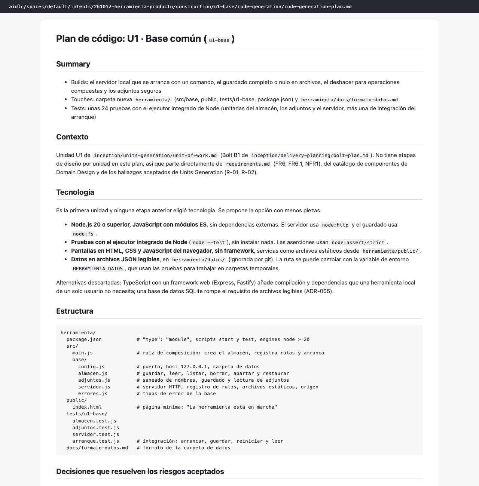
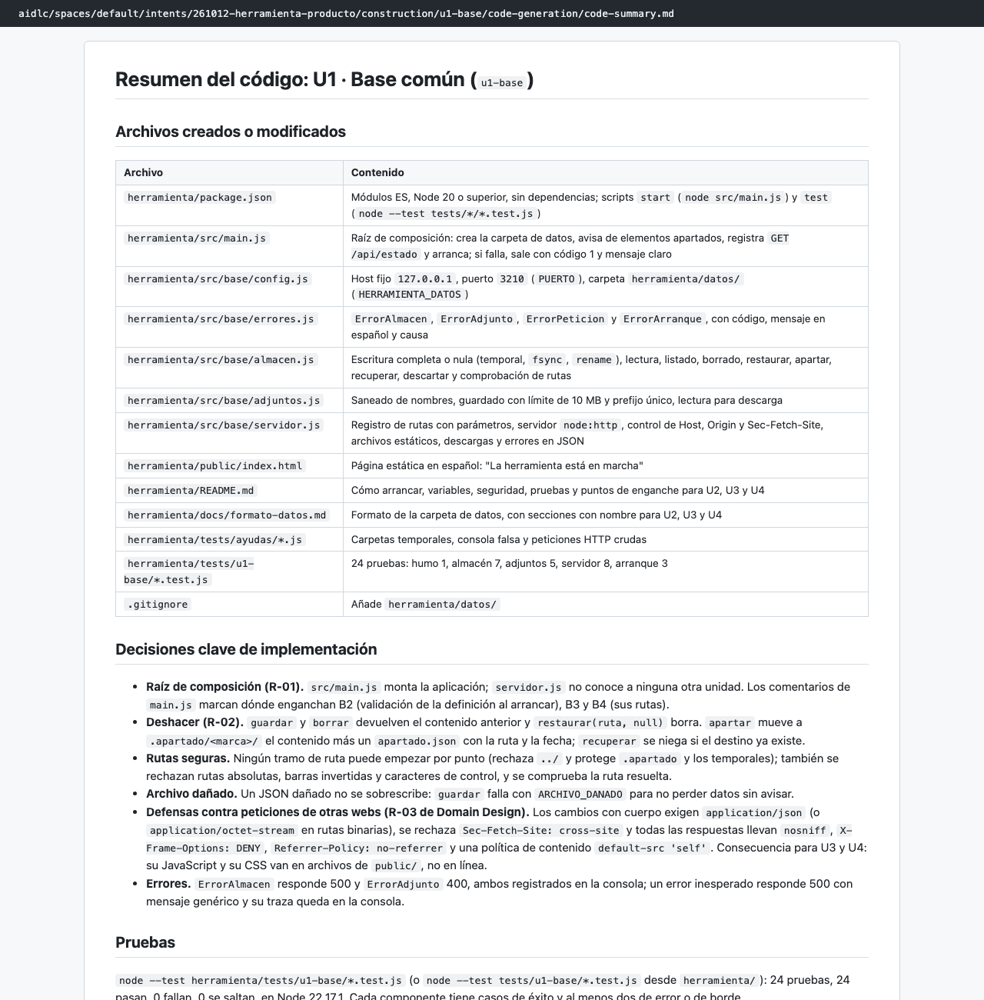
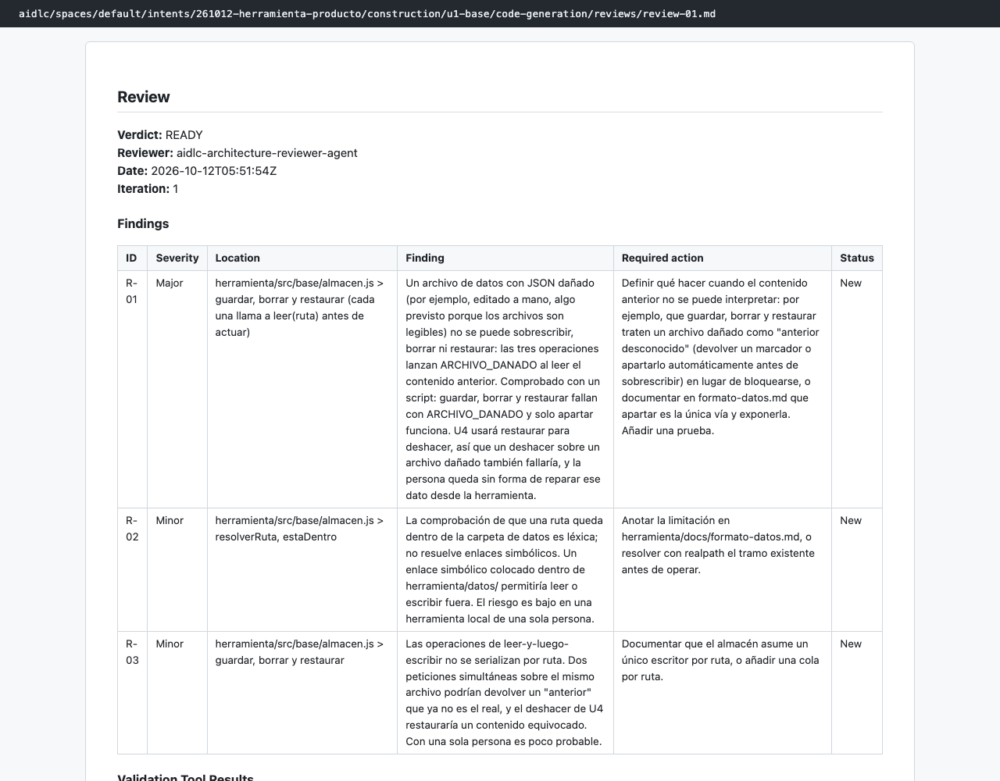

# Capítulo 08 · 3.5 Code Generation · U1 Base común

> **En una frase:** la primera unidad levantó el servidor local y el guardado en archivos. Aquí se eligió la tecnología (Node.js sin dependencias) y el comando que comprueba cada unidad. Fue también la única en la que el plan tuvo que aprobarse dos veces.

[← Visión general](00-vision-general.md) · [Resumen](../00-resumen.md) · [Siguiente: U2 →](02-u2-definicion-proceso.md)

## 1 · Ubicación

Construcción · 3.5 Code Generation · unidad U1 `u1-base` (bolt B1), tipo `service` y tamaño M.

## 2 · Input

- U1 en `unit-of-work.md`: dueña única de la escritura de archivos, servidor local, deshacer y adjuntos seguros.
- B1 en `bolt-plan.md`, con su condición de terminado.
- Requisitos: FR6, FR6.1 y NFR1.
- Las observaciones abiertas de 2.7: R-01 (quién monta la aplicación) y R-02 (cómo se deshace).

## 3 · Proceso

1. **05:30:** el conductor escribió el plan, de 12 pasos y 49 casillas, y las instrucciones de pruebas.
2. **05:32:** aprobamos el plan.
3. **05:32–05:48:** el subagente `developer` construyó la unidad (16 minutos).
4. **05:49:** al ejecutar las pruebas, el comando del plan no funcionaba: `node --test tests/u1-base/` no acepta carpetas desde Node 21. Se corrigió a `*.test.js` y, como el plan había cambiado después de aprobarlo, **AI-DLC pidió aprobarlo otra vez**. Lo aprobamos.
5. **05:50:** resumen, lista de archivos y trazabilidad.
6. **05:51–05:52:** revisión: READY.
7. **05:52:** el conductor propuso el comando de comprobación para todas las unidades y lo aprobamos.
8. **05:53:** comprobación superada y unidad aprobada automáticamente.

## 4 · Interacción

| Pregunta | Respuesta |
|---|---|
| ¿Apruebas el plan de código de u1-base? | Approve Plan |
| ¿Apruebas el plan corregido? | Approve Plan |
| ¿Uso `npm --prefix herramienta test` para comprobar cada unidad? | Approve |

## 5 · Agentes

| Papel | Agente | Modelo | Resultado |
|---|---|---|---|
| Construye | `developer` (subagente) | Opus | 24 pruebas en verde |
| Revisa | `architecture-reviewer` (subagente) | Sonnet | READY, con 1 observación importante y 2 menores |

- **R-01 (importante):** un archivo de datos con JSON dañado (por ejemplo, editado a mano) no se puede sobrescribir, borrar ni restaurar. Eso también debilita el deshacer que usará U4.
- **R-02 (menor):** la comprobación de que una ruta queda dentro de la carpeta de datos no resuelve enlaces simbólicos.
- **R-03 (menor):** dos peticiones simultáneas sobre el mismo archivo no se ordenan.

## 6 · Controles

| Control | Qué pasó |
|---|---|
| Aprobación del plan con `strict` | Volvió a pedir aprobación tras corregir el comando de pruebas |
| Sensor `traceability` | Aviso: el archivo solo lista los requisitos de U1 |
| Revisor | READY |
| Comprobación | `npm --prefix herramienta test`, salida 0 |

## 7 · Output

19 archivos: el servidor, el almacén, los adjuntos, la configuración, `package.json`, una página provisional, la documentación del formato de datos y 5 archivos de pruebas.

**Decisiones de implementación que conviene conocer:**
- **Raíz de composición:** `src/main.js` monta la aplicación y el servidor no conoce a las demás unidades. Resuelve R-01 de 2.7.
- **Deshacer:** `guardar` y `borrar` devuelven el contenido anterior. `apartar` mueve un archivo a `.apartado/` y `recuperar` lo devuelve. Resuelve R-02 de 2.7.
- **Defensas:** solo escucha en `127.0.0.1`, rechaza peticiones de otras webs y envía cabeceras de seguridad.
- **Tecnología:** Node.js 20 o superior, sin ninguna dependencia, con el ejecutor de pruebas integrado de Node.

Documentos: [plan](../../../aidlc/spaces/default/intents/261012-herramienta-producto/construction/u1-base/code-generation/code-generation-plan.md) · [resumen](../../../aidlc/spaces/default/intents/261012-herramienta-producto/construction/u1-base/code-generation/code-summary.md) · [revisión](../../../aidlc/spaces/default/intents/261012-herramienta-producto/construction/u1-base/code-generation/reviews/review-01.md).

## 8 · Pruebas

24 pruebas: almacén 7, adjuntos 5, servidor 8, arranque 3 y humo 1. Una de ellas simula un guardado fallido con una carpeta sin permiso de escritura.

## 9 · Sorpresas y problemas

- **El plan aprobado tenía un error real.** El comando de pruebas no funcionaba con nuestra versión de Node, y no se vio hasta ejecutarlo. Con `strict`, corregirlo obligó a aprobar el plan otra vez. Es justo lo que promete esa política.
- **Las casillas del plan de U1 quedaron sin marcar** (0 de 49), aunque el trabajo se hizo y se comprobó. En U2, U3 y U4 sí se marcaron todas.
- **La observación importante (R-01) no se arregló.** U3 y U4 copiaron la misma idea de no sobrescribir un archivo dañado. Queda como riesgo aceptado.
- **La trazabilidad de U1 no incluye NFR5**, aunque el mapa de requisitos le asigna esa responsabilidad. Es el origen del único hueco que encontró [Build and Test](../13-3.6-build-and-test.md).

## 10 · Tiempo y costo

**24 minutos** (05:29 → 05:53) y **80 llamadas al modelo**: 37 del conductor, 37 del `developer` y 6 del revisor.

## 11 · Lo que aprendimos

- La primera unidad decide la tecnología y la forma del proyecto. Su plan merece más atención que los siguientes.
- Elegir el comando de comprobación después de la primera unidad, como se decidió en 2.9, funcionó bien: ya existía un comando real.

## 12 · Capturas

*El plan de código de U1.*

*El resumen del código de U1.*

*La revisión: READY con una observación importante.*

---

**Fuentes:** `construction/u1-base/code-generation/`; auditoría (05:29–05:53 UTC); conversación de la sesión del 12/10/2026.
