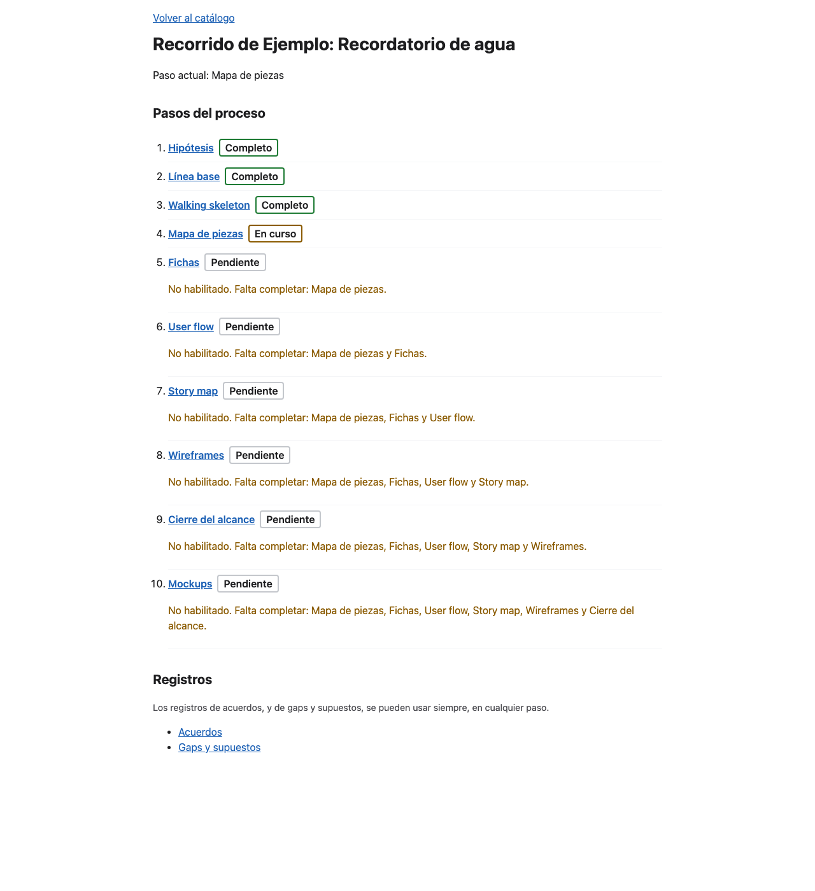
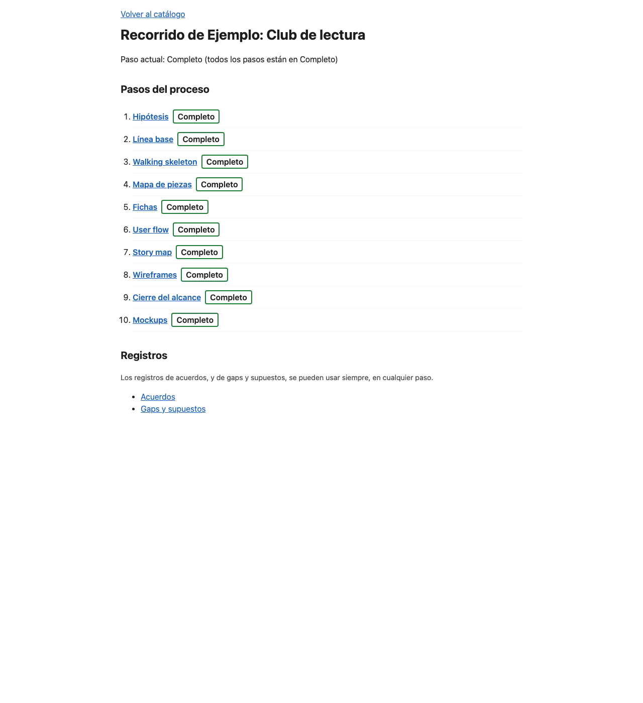
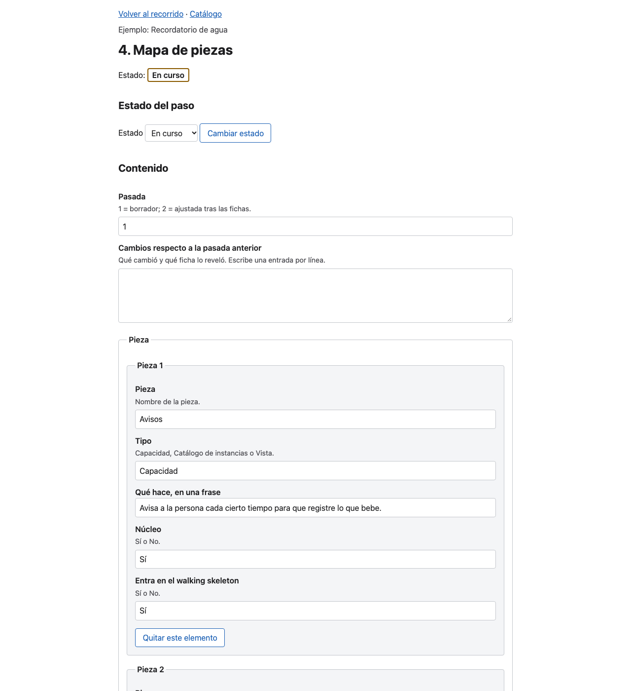
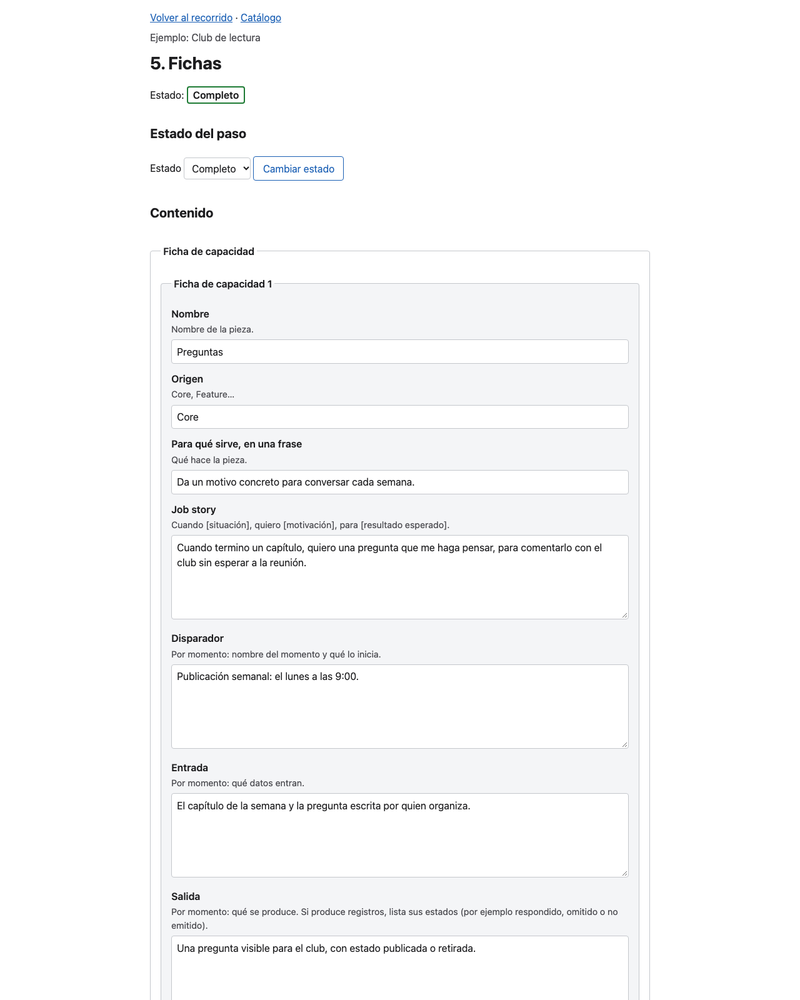
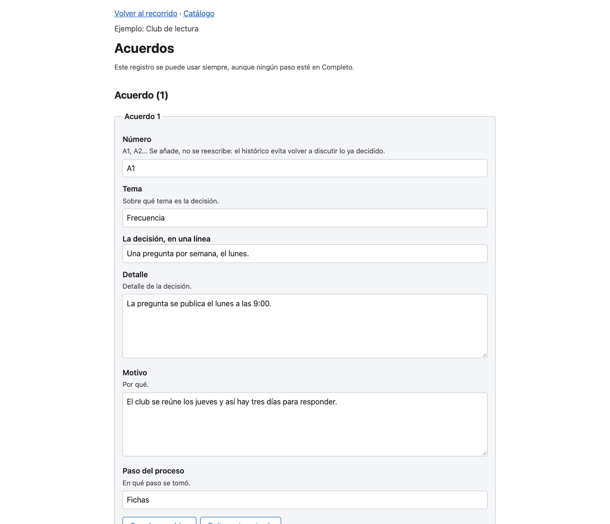
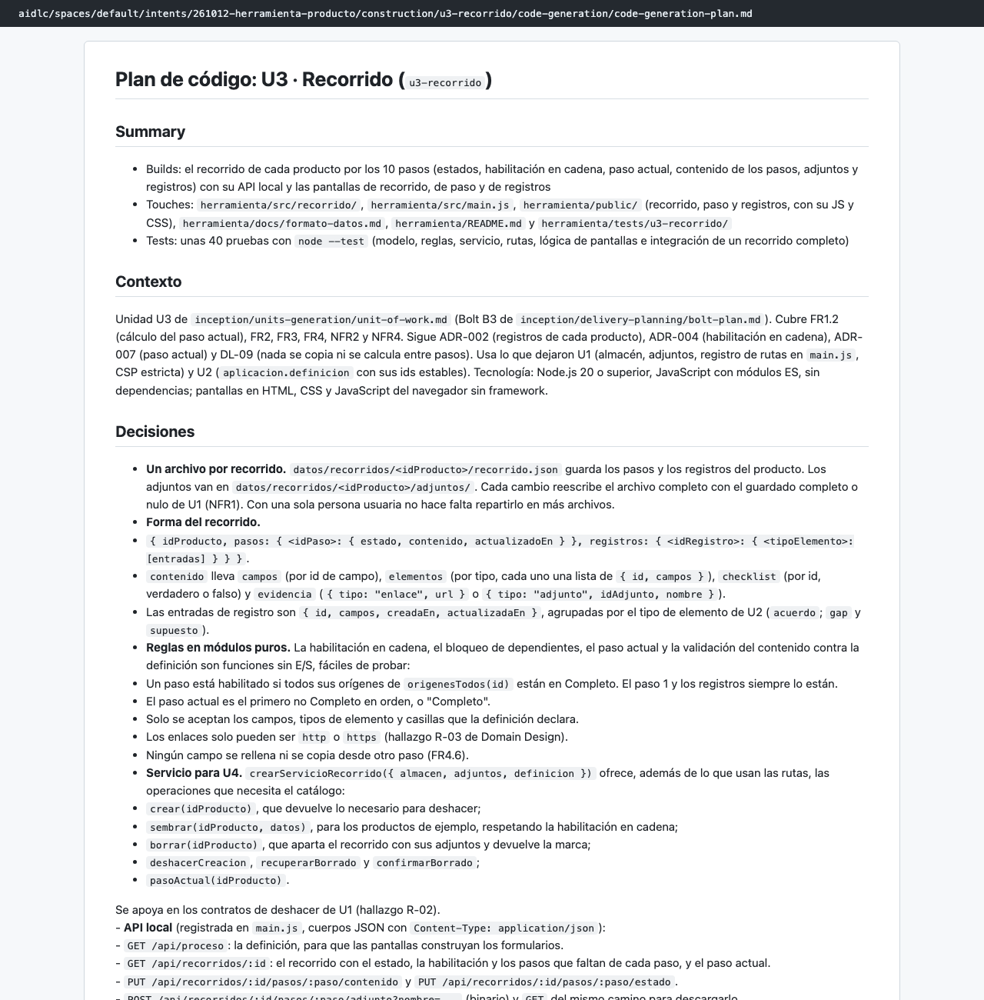
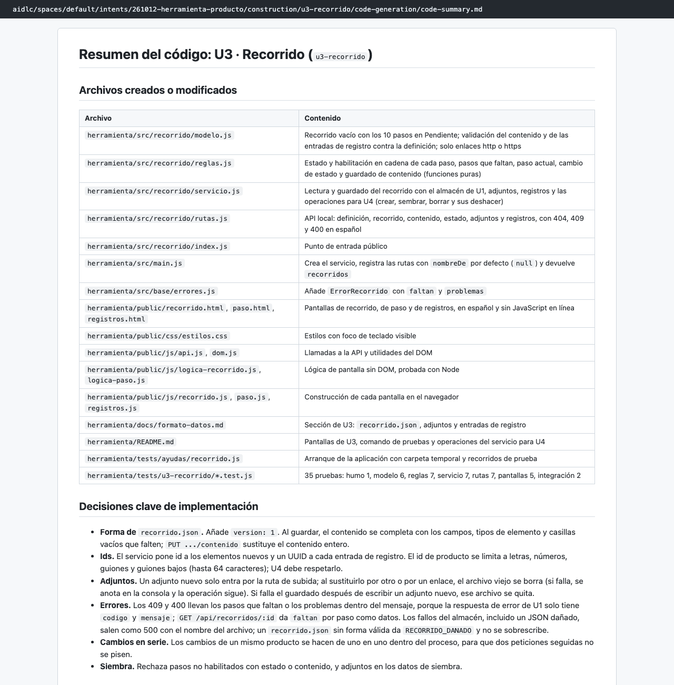
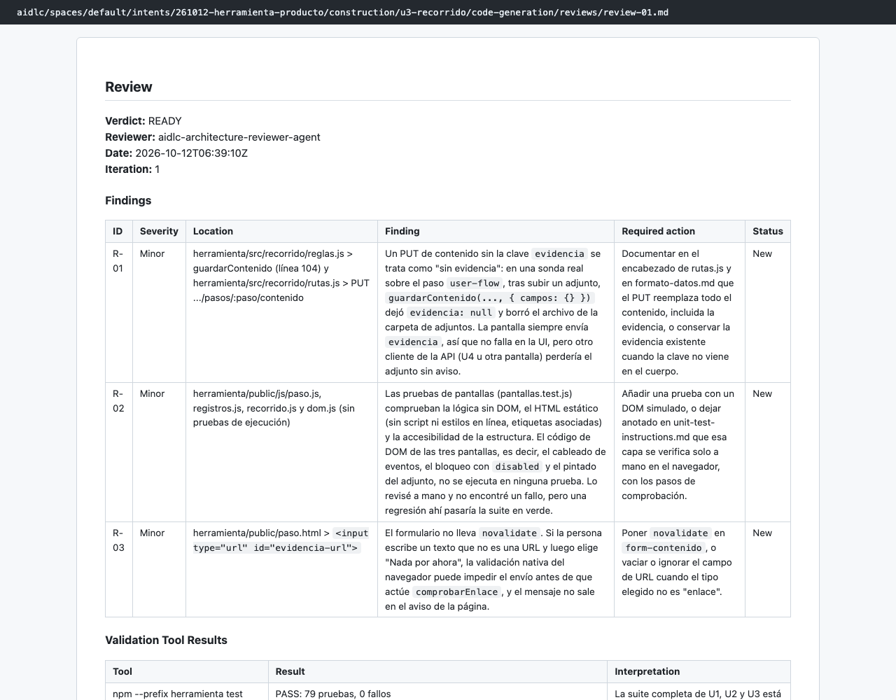

# Capítulo 08 · 3.5 Code Generation · U3 Recorrido

> **En una frase:** la unidad más grande construyó el corazón de la herramienta: los 10 pasos de cada producto con sus estados, la habilitación en cadena, el paso actual, el contenido, los adjuntos, los registros y tres pantallas. Cubre 23 de los 40 requisitos.

[← U2](02-u2-definicion-proceso.md) · [Visión general](00-vision-general.md) · [Siguiente: U4 →](04-u4-catalogo.md)

## 1 · Ubicación

Construcción · 3.5 Code Generation · unidad U3 `u3-recorrido` (bolt B3), tipo `ui` y tamaño L.

## 2 · Input

- U3 en `unit-of-work.md` y las decisiones ADR-002, ADR-004 y ADR-007.
- Requisitos: FR1.2, FR2 a FR4.7, NFR2 y NFR4.
- U1 (guardado y servidor) y U2 (definición del proceso), ya construidas.

## 3 · Proceso

1. **06:12–06:14:** plan de 14 pasos y 60 casillas. Aprobado.
2. **06:14–06:36:** el `developer` construyó la unidad (22 minutos).
3. **06:37–06:39:** resumen, revisión READY y comprobación con salida 0.
4. **06:40:** unidad aprobada automáticamente.

## 4 · Interacción

Una sola: aprobar el plan (Approve Plan).

## 5 · Agentes

| Papel | Agente | Modelo | Resultado |
|---|---|---|---|
| Construye | `developer` (subagente) | Opus | 35 pruebas nuevas, 79 en total |
| Revisa | `architecture-reviewer` (subagente) | Sonnet | READY, con 3 observaciones menores |

El revisor no se limitó a leer el código: arrancó la herramienta y la probó con **una sonda real**. Así encontró la observación R-01: guardar el contenido de un paso sin incluir su enlace o adjunto lo borra. Las otras dos:
- R-02: el código de las pantallas no se ejecuta en ninguna prueba.
- R-03: al formulario de evidencia le falta `novalidate`.

## 6 · Controles

| Control | Qué pasó |
|---|---|
| Sensor `traceability` | Aviso: solo lista los 23 requisitos de U3 |
| Revisor | READY |
| Comprobación | Salida 0 |

## 7 · Output

28 archivos:
- **El servicio y sus reglas:**
  - `src/recorrido/`: modelo, reglas (estados, habilitación en cadena y paso actual), servicio y rutas de la API.
  - Las operaciones que necesitaba U4: crear, sembrar, borrar y sus deshacer.
- **Las pantallas:**
  - `public/recorrido.html`, `paso.html` y `registros.html`, con su JavaScript y su CSS.
  - Todo en español, sin JavaScript en línea y con foco de teclado visible.

**Decisiones de implementación:**
- `recorrido.json` lleva un campo `version`.
- Los ids de producto solo admiten letras, números, guiones y guiones bajos, hasta 64 caracteres. Es una regla que U4 tuvo que copiar.
- Los cambios de un mismo producto se hacen de uno en uno.

Documentos: [plan](../../../aidlc/spaces/default/intents/261012-herramienta-producto/construction/u3-recorrido/code-generation/code-generation-plan.md) · [resumen](../../../aidlc/spaces/default/intents/261012-herramienta-producto/construction/u3-recorrido/code-generation/code-summary.md) · [revisión](../../../aidlc/spaces/default/intents/261012-herramienta-producto/construction/u3-recorrido/code-generation/reviews/review-01.md).

## 8 · Pruebas

35 pruebas: modelo 6, reglas 7, servicio 7, rutas 7, pantallas 5, integración 2 y humo 1. Una de integración lleva un recorrido completo por los 10 pasos.

## 9 · Sorpresas y problemas

- **Las pantallas no se abrieron en un navegador.** Las pruebas comprueban la lógica sin DOM y el HTML servido, pero no la interacción. Lo dejó escrito el resumen y lo repitió el revisor (R-02).
- **Desde U3 no se podía crear un producto en la interfaz**: esa parte llegaba con U4. Hasta terminar U4, la herramienta no se podía usar de punta a punta.
- **El plan tenía un error sobre las dependencias.** Decía que el paso 7 depende del 5 de forma indirecta, pero en la definición es directa. El `developer` lo detectó y ajustó la prueba.

## 10 · Tiempo y costo

**28 minutos** (06:12 → 06:40) y **84 llamadas al modelo**: 17 del conductor, 57 del `developer` y 10 del revisor.

## 11 · Lo que aprendimos

- La regla de habilitación en cadena se ve claramente en la pantalla de recorrido. Cada paso bloqueado dice qué falta: "No habilitado. Falta completar: Mapa de piezas".
- Una sonda real del revisor encuentra cosas que las pruebas unitarias no ven.

## 12 · Capturas

*El recorrido de un producto a medias: 3 pasos completos, 1 en curso y el resto bloqueados, con lo que falta.*

*El recorrido de un producto con los 10 pasos completos.*

*El paso 4 (Mapa de piezas) en curso, con su estado y su contenido.*

*El paso 5 (Fichas) de un producto completo, con sus campos.*

*El registro de acuerdos, disponible en cualquier paso.*

*El plan de código de U3.*

*El resumen del código de U3.*

*La revisión: READY con 3 observaciones menores.*

---

**Fuentes:** `construction/u3-recorrido/code-generation/`; auditoría (06:12–06:40 UTC); capturas tomadas el 12/10/2026 con la herramienta en marcha y los datos de ejemplo.
