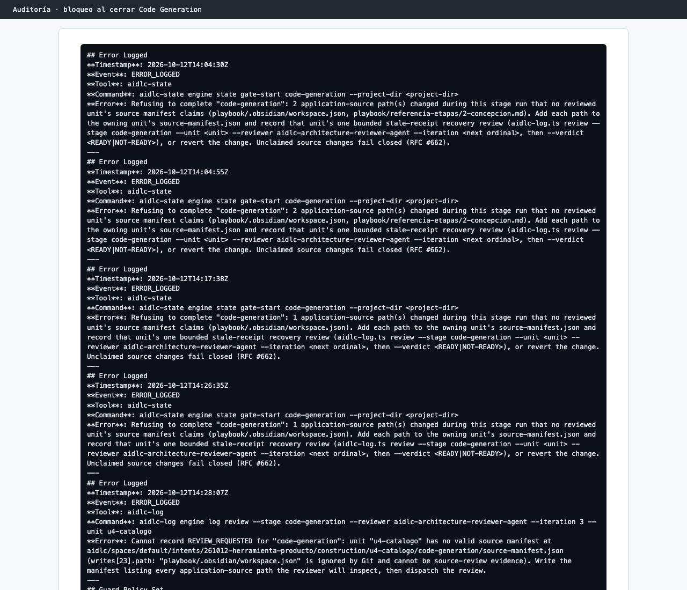

# Capítulo 08 · 3.5 Code Generation · Cierre de la etapa

> **En una frase:** con las cuatro unidades terminadas y aprobadas, AI-DLC **se negó a cerrar la etapa** porque dos archivos del playbook habían cambiado mientras se construía y no pertenecían a ninguna unidad. Tras 35 minutos de intentos, lo resolvimos cambiando la Guard Policy de `strict` a `relaxed`.

[← U4](04-u4-catalogo.md) · [Visión general](00-vision-general.md) · [Siguiente: 3.6 Build and Test →](../13-3.6-build-and-test.md)

Esta es la sorpresa más grande del recorrido y la que más enseña. Se cuenta entera.

## 1 · Qué pasó

Al cerrar Code Generation, AI-DLC comprueba que **cada archivo del proyecto que cambió durante la etapa** pertenece a alguna unidad. Es decir, que aparece en el `source-manifest.json` de alguna unidad, cuyo contenido revisó un revisor. Con Guard Policy `strict`, un archivo sin dueño **bloquea** el cierre. Así se evita que se cuele código sin revisar.

Habían cambiado dos archivos que no eran de la herramienta:

| Archivo | Por qué cambió |
|---|---|
| `playbook/referencia-etapas/2-concepcion.md` (hoy `playbook/02-etapas/2-concepcion.md`) | Una edición nuestra en el playbook, durante la etapa. Solo alineaba una tabla |
| `playbook/.obsidian/workspace.json` | Obsidian lo reescribe solo cada vez que abres o mueves una nota. Teníamos el playbook abierto |

El playbook vive en el mismo repositorio que el piloto, y AI-DLC no puede saber que esos archivos no son parte del producto.

## 2 · Los intentos, en orden

| Hora | Qué hicimos | Resultado |
|---|---|---|
| 14:04 | Cerrar la etapa | **Rechazado**: 2 archivos sin dueño |
| 14:05–14:16 | La IA preguntó qué hacer; pedimos que nos explicara qué tiene que ver el playbook con U4. Después elegimos **deshacer esos cambios** | Se restauró `2-concepcion.md` desde git, guardando antes una copia. `workspace.json` **no se pudo deshacer**: git lo ignora y nunca se había guardado |
| 14:16–14:17 | AI-DLC exigió una **revisión de recuperación** de U4, porque el código había "cambiado" desde la revisión | READY |
| 14:17 | Cerrar la etapa | **Rechazado**: queda 1 archivo sin dueño (`workspace.json`) |
| 14:25 | Elegimos **pausar** | Trabajo guardado |
| 14:26 | Retomar y cerrar | **Rechazado** otra vez |
| 14:28 | Elegimos **apuntar el archivo en U4** y pedir otra revisión | **Rechazado**: un archivo que git ignora no puede ser evidencia revisable |
| 14:30 | Elegimos **apartar `workspace.json`** (moverlo a una copia) | Contó como otro cambio y **agotó la única revisión de recuperación**. La única salida que quedaba era "Request Changes", que descartaba el trabajo de las 4 unidades |
| 14:35 | Pedimos hacer commit de todo | Bloqueado: hay una pregunta abierta |
| 14:39 | Pedimos **Guard Policy `relaxed`** para este trabajo | El cambio se aceptó con un aviso ("These files changed outside any unit's work… Kept them.") y la etapa se cerró |

Dijimos con claridad que no íbamos a repetir U1 a U4 de ninguna manera. La IA explicó entonces de dónde venía el bloqueo y que, en el modo relajado, ese caso se acepta con un aviso. La decisión de cambiarlo fue nuestra.

## 3 · Por qué cada salida fallaba

- **Deshacer** solo funciona con archivos que git conoce. `workspace.json` está en `.gitignore`.
- **Apuntarlo en una unidad** no sirve: AI-DLC no acepta como evidencia un archivo que git ignora.
- **Moverlo o borrarlo** es otro cambio, y la revisión de recuperación solo se permite una vez por unidad.
- **Request Changes** reabre Code Generation para todas las unidades: hay que repetir el trabajo, la revisión y la aprobación de cada una.

## 4 · Cómo quedó

- La Guard Policy del trabajo es `relaxed (set by you)` en `aidlc-state.md`. Solo afecta a este trabajo: el próximo empieza otra vez en `strict`, porque así lo dice el plan.
- La auditoría registra el cambio (`GUARD_POLICY_SET`, de `strict` a `relaxed`) y la aceptación del archivo (`CHANGE_ACCEPTED`).
- Los cambios de `2-concepcion.md` se recuperaron después desde la copia y se guardaron en la rama de este capítulo.

## 5 · Tiempo y costo

**35 minutos** (14:04 → 14:39), **49 llamadas al modelo** (44 del conductor y 5 de la revisión de recuperación), 4 preguntas a nosotros y una pausa. Es más tiempo que el que se tardó en construir U2 o U4.

## 6 · Lo que aprendimos

- **Con `strict`, el repositorio tiene que estar quieto mientras se construye.** Fuera del código de la herramienta, no se edita nada durante Code Generation, y menos con una herramienta como Obsidian, que escribe archivos por su cuenta.
- **Para el próximo recorrido**, una de dos: cerrar Obsidian durante Construcción, o tener el playbook en otro repositorio o fuera de la carpeta que vigila AI-DLC.
- **No hay que improvisar arreglos** cuando un control bloquea. Cada intento de quitar el archivo del medio era un cambio más, y el último gastó la única oportunidad de recuperación.
- **`relaxed` no apaga los controles.** Acepta el cambio, avisa una vez y lo deja registrado. Las revisiones y las comprobaciones de las unidades seguían hechas y válidas.
- **El control hizo su trabajo.** No podía saber que esos archivos eran inofensivos. El fallo fue de organización nuestra, no de AI-DLC.

## 7 · Capturas

*Los rechazos al cerrar la etapa, el cambio de Guard Policy y la aceptación del archivo, tal como quedaron en la auditoría.*

---

**Fuentes:** auditoría (14:04–14:39 UTC: `ERROR_LOGGED`, `REVIEW_REQUESTED`, `WORKFLOW_PARKED`, `GUARD_POLICY_SET` y `CHANGE_ACCEPTED`); conversación de la sesión del 12/10/2026; `aidlc-state.md`.
