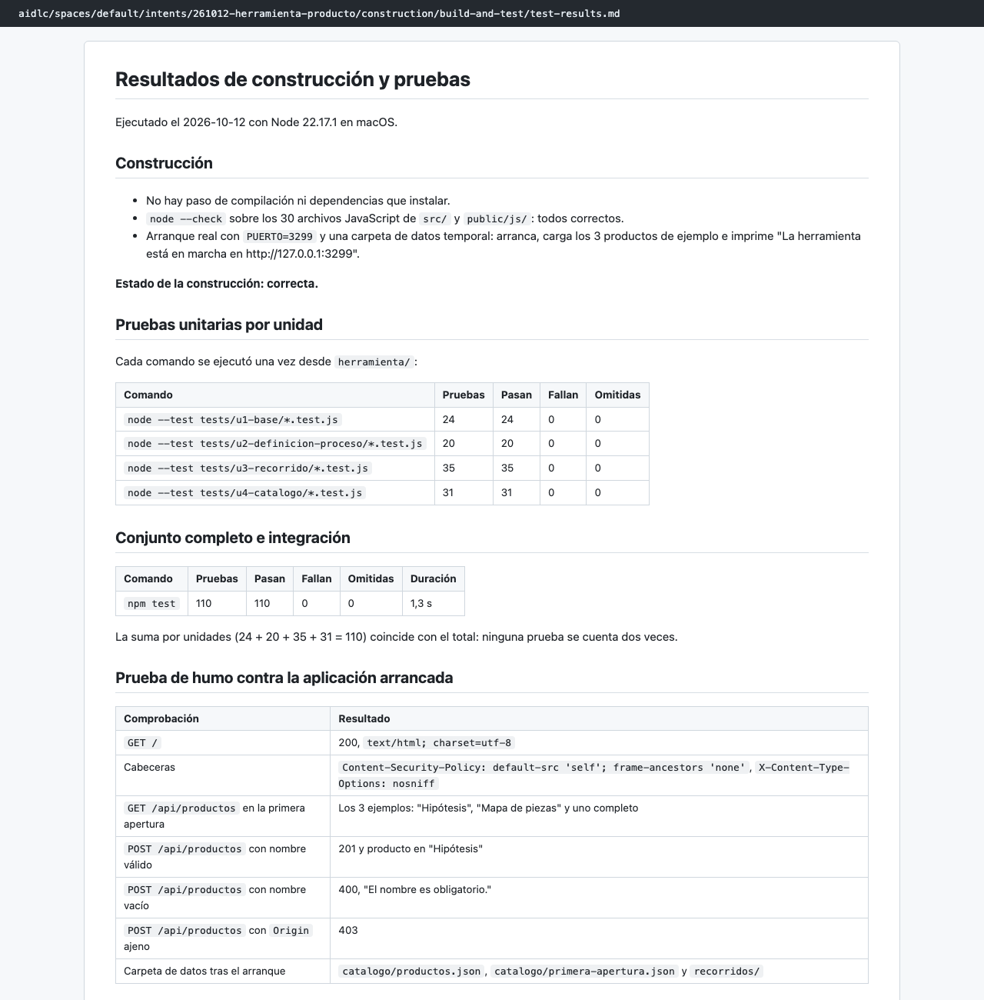
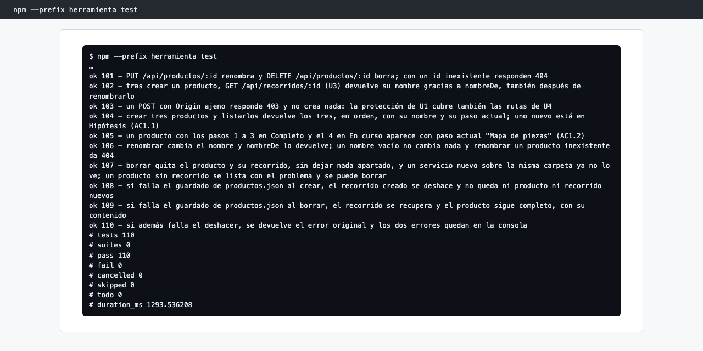
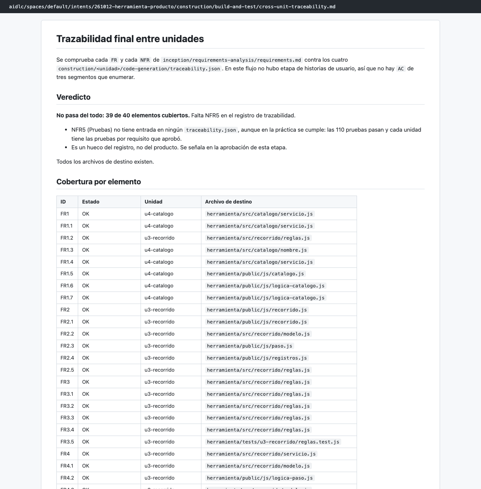

# Capítulo 08 · 3.6 Build and Test

> **En una frase:** el agente `quality` construyó y probó la herramienta completa: **110 de 110 pruebas en verde**, el 96,6 % de las líneas cubiertas y una prueba de humo con la herramienta arrancada. La trazabilidad final encontró **un solo hueco**: NFR5 no figuraba en ningún registro.

[← 3.5 Code Generation: cierre](12-3.5-code-generation/05-cierre-de-la-etapa.md) · [Resumen](00-resumen.md) · [Siguiente: esperado contra real →](14-esperado-vs-real.md)

## 1 · Ubicación

Construcción · 3.6 Build and Test · ALWAYS. Última etapa del recorrido. La condicional 3.7 CI Pipeline y toda la fase de Operación se saltaron.

## 2 · Input

- Para cada unidad: su plan, sus instrucciones de pruebas y su resumen de código.
- Los 4 archivos `traceability.json` y `requirements.md`, para la trazabilidad final.
- El código de `herramienta/`.

## 3 · Proceso

1. Inventario de los objetivos medibles. No había documentos de NFR (3.2 y 3.3 se saltaron), así que salieron de los contratos de pruebas de los cuatro planes.
2. Construcción: comprobación de sintaxis de los 30 archivos JavaScript (`node --check`). No hay compilación ni dependencias.
3. Pruebas: el comando de cada unidad, una vez cada uno, y después el conjunto completo con `npm test`.
4. Cobertura con el proveedor integrado de Node.
5. Prueba de humo: arrancar la herramienta con una carpeta de datos temporal y probar la API con `curl`.
6. Trazabilidad final: cada FR y NFR de los requisitos contra los cuatro `traceability.json`.
7. Documentos y cierre automático, por el modo automático elegido en 3.5.

## 4 · Interacción

Ninguna. Con el modo automático, el gate se aprobó solo y no hubo ritual de aprendizajes. Al terminar, AI-DLC dio el recorrido por completado.

## 5 · Agentes

| Papel | Agente | Modelo |
|---|---|---|
| Lidera | `quality` | Opus, en la conversación principal |
| Apoyo | `devsecops` (declarado) | No participó: agentes de apoyo apagados |
| Revisa | — | Esta etapa no tiene revisor |

## 6 · Controles

| Control | Qué pasó |
|---|---|
| Sensores `required-sections` y `upstream-coverage` | Pasaron en los 7 documentos |
| Sensor `type-check` | No se disparó: no hay TypeScript |
| Gate | Aprobado automáticamente (modo automático) |
| Verificación de fase | Construcción → fin, y `WORKFLOW_COMPLETED` con 12 etapas |

## 7 · Output

En `construction/build-and-test/`:
- [build-instructions.md](../../aidlc/spaces/default/intents/261012-herramienta-producto/construction/build-and-test/build-instructions.md): requisitos, variables (`PUERTO`, `HERRAMIENTA_DATOS`), cómo comprobar y arrancar, y problemas habituales.
- [integration-test-instructions.md](../../aidlc/spaces/default/intents/261012-herramienta-producto/construction/build-and-test/integration-test-instructions.md): las 6 fronteras entre unidades y la prueba que cubre cada una.
- [performance-test-instructions.md](../../aidlc/spaces/default/intents/261012-herramienta-producto/construction/build-and-test/performance-test-instructions.md): no aplica, porque no hay objetivos de rendimiento.
- [security-test-instructions.md](../../aidlc/spaces/default/intents/261012-herramienta-producto/construction/build-and-test/security-test-instructions.md): las protecciones locales y la prueba que cubre cada una.
- [test-results.md](../../aidlc/spaces/default/intents/261012-herramienta-producto/construction/build-and-test/test-results.md) y [build-and-test-summary.md](../../aidlc/spaces/default/intents/261012-herramienta-producto/construction/build-and-test/build-and-test-summary.md): resultados, matriz de objetivos y pendientes.
- [cross-unit-traceability.md](../../aidlc/spaces/default/intents/261012-herramienta-producto/construction/build-and-test/cross-unit-traceability.md): 39 de 40 requisitos cubiertos.

## 8 · Pruebas

| Comando | Pruebas | Pasan |
|---|---:|---:|
| `node --test tests/u1-base/*.test.js` | 24 | 24 |
| `node --test tests/u2-definicion-proceso/*.test.js` | 20 | 20 |
| `node --test tests/u3-recorrido/*.test.js` | 35 | 35 |
| `node --test tests/u4-catalogo/*.test.js` | 31 | 31 |
| `npm test` (todo) | **110** | **110** |

- **Cobertura:** 96,64 % de líneas, 89,51 % de ramas y 95,49 % de funciones. Es informativa: este tipo de trabajo no fija un mínimo.
- **Prueba de humo:**
  - `/` responde con cabeceras de seguridad.
  - La primera apertura carga los 3 ejemplos.
  - Crear responde 201; con el nombre vacío, 400; con un origen ajeno, 403.
- **Matriz de objetivos:** 6 objetivos, todos cumplidos:
  - el conjunto de pruebas existente sigue en verde;
  - el volumen de pruebas aprobado en cada una de las 4 unidades;
  - pruebas de integración en cada frontera entre unidades.

## 9 · Sorpresas y problemas

- **El hueco de NFR5 venía de lejos.** El revisor de 2.7 ya avisó (R-04) de que NFR5 es transversal y no solo de U1. La trazabilidad de U1 no lo incluyó, y aquí apareció como el único requisito sin entrada. En la práctica se cumple, porque cada unidad tiene sus pruebas y todas pasan. Es un hueco del registro, no del producto.
- **El sensor de trazabilidad de 3.5 avisó cuatro veces de algo distinto,** que cada archivo de unidad no tenía todos los requisitos, y no señaló este hueco concreto.
- **La etapa fue la más rápida del recorrido:** 3 minutos según la auditoría. Todo se podía comprobar en local.

## 10 · Tiempo y costo

**3 minutos** (14:39 → 14:42) y **13 llamadas al modelo** del conductor con Opus.

## 11 · Lo que aprendimos

- Con un proyecto sin dependencias, construir y probar es trivial. El valor de esta etapa está en la **trazabilidad final** y en dejar escrito qué queda pendiente.
- Un aviso de un revisor que se aprueba como "menor" puede reaparecer al final. Merece la pena anotar dónde se va a resolver.

## 12 · Capturas

*Los resultados de construcción y pruebas.*

*El final de la salida de `npm --prefix herramienta test`: 110 de 110.*

*La trazabilidad entre unidades, con NFR5 sin cubrir en el registro.*

---

**Fuentes:** artefactos de `construction/build-and-test/`; auditoría (14:39–14:42 UTC).
